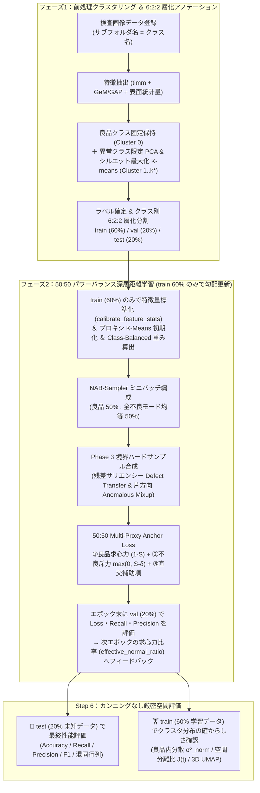

# Model_Explanation.md — 外観検査向け深層距離学習（Metric Learning）モデル・損失関数・ハイパーパラメータ技術解説書

本ドキュメントは、本リポジトリで開発した **外観検査自動化向け深層距離学習（Deep Metric Learning）システム** のモデル構造、学習アルゴリズム、損失関数（**50:50 Power-Balanced Multi-Proxy Anchor Loss** および **Asymmetric Multi-Similarity Loss**）、ならびに類似手法（**標準 MS-Loss / 標準 Proxy-Anchor Loss / ArcFace**）との理論的・実装的差異と全ハイパーパラメータの意味を、実際の実装コードに基づいて体系的に解説した技術仕様書である。

---

## 目次

1. [開発背景と産業外観検査における深層距離学習の課題](#1-開発背景と産業外観検査における深層距離学習の課題)
2. [全体学習パイプラインと 6 : 2 : 2 データ分割による厳密評価設計](#2-全体学習パイプラインと-6--2--2-データ分割による厳密評価設計)
3. [特徴抽出バックボーンと 128次元単位超球面射影モデル (`MetricProjectionModel`)](#3-特徴抽出バックボーンと-128次元単位超球面射影モデル-metricprojectionmodel)
4. [損失関数①（推奨メイン）：50:50 パワーバランス Multi-Proxy Anchor Loss](#4-損失関数推奨メイン5050-パワーバランス-multi-proxy-anchor-loss)
5. [損失関数②（比較検証用）：非対称マルチクラス MS-Loss ＋ XBM 双方向反発](#5-損失関数比較検証用非対称マルチクラス-ms-loss--xbm-双方向反発)
6. [類似手法（MS-Loss / Proxy-Anchor Loss / ArcFace）との徹底比較と違い](#6-類似手法ms-loss--proxy-anchor-loss--arcfaceとの徹底比較と違い)
7. [不均衡対策サンプラー（NAB-Sampler）と境界ハードサンプル合成（Phase 3）](#7-不均衡対策サンプラーnab-samplerと境界ハードサンプル合成phase-3)
8. [全ハイパーパラメータ完全リファレンス（コード対応・意味・調整指針）](#8-全ハイパーパラメータ完全リファレンスコード対応意味調整指針)
9. [空間評価指標（Step 6）の数理定義と解釈ガイド](#9-空間評価指標step-6の数理定義と解釈ガイド)

---

## 1. 開発背景と産業外観検査における深層距離学習の課題

製造ラインにおける自動外観検査（Visual Inspection）には、一般的な画像分類タスク（ImageNet 等の均衡マルチクラス分類）とは根本的に異なる **4つの構造的課題** が存在する。

1. **極端なクラス不均衡（100 : 2 問題）**:
   正常な製品（良品）は毎日大量に得られる一方、不良（異常）は発生頻度が極めて低く、特定の不良モード（微小な打痕や異物混入など）は数枚しか存在しないケースが常態である。
2. **不良モードの多峰性（Multi-Modality）とオープンセット性**:
   「良品」は設計仕様という単一（または少数のロット条件）の分布に従うのに対し、「不良」は傷（Scratch）・汚れ（Stain）・欠け（Broken）・打痕（Dent）・リード曲がり（Bent Lead）など多種多様であり、さらに運用開始後に未知の不良モードが発生する。識別空間を単純な「OK / NG の1次元直線」に射影すると、互いに異なる特徴を持つ不良モードを無理やり同じ1点へ押し込めることになり、表現崩壊（Representation Collapse）を引き起こす。
3. **良品内の許容個体差（ロット・照明変動）と微細欠陥の境界競合**:
   インライン検査では照明ムラや位置ズレによる良品のバリエーションを許容しつつ、良品と99%同じ見た目で局所のみが異なる微細欠陥（Hard Anomaly）を確実に弾く必要がある。
4. **ペアベース距離学習における「不良同士の斥力による勾配の浪費」**:
   従来のペアベース距離学習を多クラス化した不良データにそのまま適用すると、「不良モードA vs 不良モードB」を遠ざける力にモデルの勾配パワーが消費され、本来最も重要な **「良品クラスタの凝集（求心力）」と「良品 vs 良品に酷似した不良の分離（斥力）」** が弱まる。

本システムはこれらの課題を解決するため、**128次元単位超球面（$\mathbb{S}^{127}$）** 上で良品の求心力と不良の斥力を **50 : 50（1.0 : 1.0 の同一コサインスケール）** で精密にバランスさせた独自のプロキシ型距離学習アーキテクチャを採用している。

---

## 2. 全体学習パイプラインと 6 : 2 : 2 データ分割による厳密評価設計

本システムの処理フローは、フェーズ1（前処理クラスタリング＆アノテーション）、フェーズ2（動的 Metric Learning 学習）、および Step 6（3軸空間評価）の3段階で構成される。

### 2.1. フェーズ1：良品固定保持 ＋ 異常クラス限定サブクラスタリング
実装ファイル: [`trainer/app/core/two_stage_cluster.py`](file:///Users/tmcqdtj1089/Desktop/New-metric-learning/trainer/app/core/two_stage_cluster.py)

1. **良品クラスの固定保持 (`Cluster 0`, `label_id = 0`)**:
   良品サブフォルダ（`normal`, `nomal`, `good`, `ok` 等）に属する画像は一切クラスタリングせず、全件そのまま単一の良品クラス（`Cluster 0`）として100%固定保持する（良品と不良を混ぜてクラスタリングすることによるラベル汚染を防止）。
2. **良品基準の欠陥残差標準化と異常クラス限定 K-means (`Cluster 1 .. k*`)**:
   異常クラスの画像群のみを対象とし、良品の平均ベクトル $\mu_{\text{norm}}$ と標準偏差 $\sigma_{\text{norm}}$（ゼロ分散チャネル保護 $\hat{\sigma}_{\text{norm}} = \text{where}(\sigma_{\text{norm}} > 10^{-5}, \sigma_{\text{norm}}, 1.0)$）を用いて
   $$\tilde{h}_i = \text{L2Normalize}\left(\text{clip}\left(\frac{h_i - \mu_{\text{norm}}}{\hat{\sigma}_{\text{norm}} + 10^{-5}}, -10, 10\right)\right)$$
   と標準化・L2正規化することで「製品固有の共通背景成分」を相殺し、純粋な欠陥残差ベクトルを抽出する（[`two_stage_cluster.py` L176-L183](file:///Users/tmcqdtj1089/Desktop/New-metric-learning/trainer/app/core/two_stage_cluster.py#L176-L183)）。その後、PCA（上限64次元・累積寄与率95%）で次元圧縮し、コサイン距離に基づくシルエットスコア（Silhouette Score）が最大となる最適クラスタ数 $k^* \in [2, \min(K_{\max}, N_{\text{anom}}-1)]$ を自動選定して複数の不良サブクラスへと分割する。
   *(※単一の未整理フォルダのみが与えられた場合に限り、大域中央値類似度 $0.65$ ＋ 局所 $k$-NN 密度 $0.35$ の上位 `core_quantile=0.85` を仮の良品コアとする `density_fallback` モードが動作する。)*

### 2.2. 6 : 2 : 2 データ分割（`train : val : test = 60% : 20% : 20%`）とゼロ・データリーク原則
実装ファイル: [`backend/app/routers/datasets.py`](file:///Users/tmcqdtj1089/Desktop/New-metric-learning/backend/app/routers/datasets.py)（関数 [`_build_and_save_annotations_manifest`](file:///Users/tmcqdtj1089/Desktop/New-metric-learning/backend/app/routers/datasets.py#L144-L243)）, [`trainer/app/routers/train_jobs.py`](file:///Users/tmcqdtj1089/Desktop/New-metric-learning/trainer/app/routers/train_jobs.py)

ディープラーニングの厳密な評価のため、すべてのクラス（良品および各不良サブクラス）をクラス別に **6 : 2 : 2（学習 `train` 60% : 評価 `val` 20% : テスト `test` 20%）** に層化分割する。各クラス内のサンプル数 $n_{\text{cls}}$ に対する決定論的分割規則（シード固定シャッフル後）は以下の通りである（[`datasets.py` L180-L197](file:///Users/tmcqdtj1089/Desktop/New-metric-learning/backend/app/routers/datasets.py#L180-L197)）：
* **$n_{\text{cls}} \ge 3$ の場合**: $n_{\text{val}} = \max(1, \text{round}(0.20 \cdot n_{\text{cls}}))$, $n_{\text{test}} = \max(1, \text{round}(0.20 \cdot n_{\text{cls}}))$（ただし $n_{\text{val}} + n_{\text{test}} \ge n_{\text{cls}}$ となる $n_{\text{cls}} \in \{3, 4\}$ では $n_{\text{val}} = 1, n_{\text{test}} = 1$ に補正し、3分割すべてに最低1枚を保証）、残り $n_{\text{train}} = n_{\text{cls}} - n_{\text{val}} - n_{\text{test}}$。
* **$n_{\text{cls}} = 2$ の場合**: `train` に1枚、`test` に1枚（`val` は0枚）。
* **$n_{\text{cls}} = 1$ の場合**: `train` に1枚。

各分割の役割は以下の通り厳格に分離されている：

| データ分割 | 比率 | 役割と使用範囲（データリーク防止契約） |
| :--- | :---: | :--- |
| **🏋️ 学習データ (`train`)** | **60%** | 1. モデルの重み更新およびプロキシパラメータ更新（`NAB-Sampler` によるミニバッチ学習） 2. 特徴量標準化統計量（`feat_mean`, `feat_std`）のキャリブレーション（[`model.calibrate_feature_stats`](file:///Users/tmcqdtj1089/Desktop/New-metric-learning/trainer/app/routers/train_jobs.py#L454-L455)） 3. 初期プロキシの K-Means / 重心初期化（[`initialize_proxies_from_embeddings`](file:///Users/tmcqdtj1089/Desktop/New-metric-learning/trainer/app/routers/train_jobs.py#L462-L467)） 4. Effective-Number クラス不均衡重み $W_c$ の算出（[`compute_class_balanced_weights`](file:///Users/tmcqdtj1089/Desktop/New-metric-learning/trainer/app/routers/train_jobs.py#L358-L363)） 5. 境界ハードサンプル合成バンクの生成（[`_extract_pixel_boundary_augmentation_bank`](file:///Users/tmcqdtj1089/Desktop/New-metric-learning/trainer/app/routers/train_jobs.py#L486-L496)） 6. Step 6 における**学習クラスタ分布の確からしさ（良品内分散 $\sigma^2_{\text{norm}}$ の収縮度）の確認** |
| **📋 評価データ (`val`)** | **20%** | 1. 各エポック終了時の検証 Loss（`val_loss`, `val_loss_centripetal`, `val_loss_repel`）および `val_recall` / `val_precision` の算出 2. **次のエポックの Loss 方向性（動的求心力比率 `effective_normal_ratio`）とカリキュラムへのフィードバック**（[`CurriculumPenaltyScheduler.step`](file:///Users/tmcqdtj1089/Desktop/New-metric-learning/trainer/app/core/scheduler.py#L61-L112)） 3. 最良モデルチェックポイント（`best_model.pt`）の保存判定（[`composite_quality`](file:///Users/tmcqdtj1089/Desktop/New-metric-learning/trainer/app/routers/train_jobs.py#L766)） |
| **🧪 テストデータ (`test`)** | **20%** | 学習にもエポック間のハイパーパラメータ／Loss方向性制御にも**一切使用しない完全未知データ**。 Step 6（[`3_space_evaluation.py`](file:///Users/tmcqdtj1089/Desktop/New-metric-learning/frontend/app/pages/3_space_evaluation.py)）のデフォルト評価対象として、最終的な学習の良し悪し（`Accuracy`, `Recall`, `Precision`, `F1`, 混同行列）をカンニングなしで厳密評価する。 |

---

## 3. 特徴抽出バックボーンと 128次元単位超球面射影モデル (`MetricProjectionModel`)

実装ファイル: [`trainer/app/core/feature_extractor.py`](file:///Users/tmcqdtj1089/Desktop/New-metric-learning/trainer/app/core/feature_extractor.py)

### 3.1. アーキテクチャ構成
[`MetricProjectionModel`](file:///Users/tmcqdtj1089/Desktop/New-metric-learning/trainer/app/core/feature_extractor.py#L169-L320) は、入力画像 $x \in \mathbb{R}^{3 \times 128 \times 128}$ から以下の4ステージを経て 128次元単位超球面 $\mathbb{S}^{127} = \{z \in \mathbb{R}^{128} \mid \|z\|_2 = 1\}$ 上の埋め込みベクトル $z$ を出力する。

1. **特徴抽出バックボーン (`self.backbone`)**:
   * `timm` ライブラリ経由で `efficientnet_b3`（デフォルト）、`vit_base_patch16_224`、`resnet18`、または決定論的3層畳み込みステム `lightweight_cnn`（[`LightweightInspectionStem`](file:///Users/tmcqdtj1089/Desktop/New-metric-learning/trainer/app/core/feature_extractor.py#L75-L98)）をロードする。
   * 少数データでの過学習と BatchNorm 統計量の崩壊を防ぐため、デフォルトでは `freeze_backbone=True` かつ学習中もバックボーンを `.eval()` モードに固定する（[`MetricProjectionModel.train()`](file:///Users/tmcqdtj1089/Desktop/New-metric-learning/trainer/app/core/feature_extractor.py#L225-L230)）。
2. **空間プーリング層 (`SpatialPoolingHead`)**:
   通常の Global Average Pooling (`gap`) は画像全体の空間平均をとるため、数ピクセルの微小な傷や異物の活性化が背景ピクセルで希釈される。これを防ぐため、デフォルトで **Generalized Mean (GeM) Pooling**（[`GeMPooling`](file:///Users/tmcqdtj1089/Desktop/New-metric-learning/trainer/app/core/feature_extractor.py#L24-L45)、べき乗パラメータ $p = 3.0$）を採用している：
   $$h_{\text{pool}, c} = \left( \frac{1}{H \cdot W} \sum_{u=1}^{H} \sum_{v=1}^{W} \max(f_{c,u,v}, \epsilon)^p \right)^{\frac{1}{p}} \quad (p = 3.0, \; \epsilon = 10^{-6})$$
   また、平均プーリングと最大プーリングを連結する `avg_max` も選択可能である。
3. **マルチスケール空間グリッド表面統計量記述子との結合 (`_extract_raw_concat_features`)**:
   事前学習バックボーンの特徴量 $h_{\text{pool}}$ に加え、[`extract_handcrafted_surface_statistics(x)`](file:///Users/tmcqdtj1089/Desktop/New-metric-learning/trainer/app/core/feature_extractor.py#L101-L166) によって抽出された **678次元のマルチスケール表面統計ベクトル** $h_{\text{surf}}$（全体RGB平均[3]・標準偏差[3]、8×8パッチの95%/5%分位点[3+3]、4×4最大水平・垂直エッジ勾配[3+3]、8×8平均グリッド[192]、4×4最大/最小グリッド[48+48]、6×6局所標準偏差グリッド[108]、6×6水平・垂直エッジ勾配グリッド[108+108]、4×4色差グリッド[48]：計 $18 + 288 + 108 + 216 + 48 = 678$ 次元）をそれぞれ L2 正規化して連結する：
   $$h_{\text{raw}}(x) = \left[ \frac{h_{\text{pool}}(x)}{\|h_{\text{pool}}(x)\|_2}, \; \frac{h_{\text{surf}}(x)}{\|h_{\text{surf}}(x)\|_2} \right] \in \mathbb{R}^{D_{\text{gap}}}$$
4. **学習データ基準の特徴量標準化 (`calibrate_feature_stats` & `standardize_features`)**:
   同じ製品を撮影した画像群では、背景や製品外形に由来する共通バイアスベクトルが支配的となり、未補正のままでは良品も不良品もコサイン類似度が $+0.95$ 以上に密集する。そこで学習開始前に **`train` (60%) 分割のみ** から次元ごとの平均 $\mu_{\text{train}}$ と標準偏差 $\sigma_{\text{train}}$（ゼロ分散保護 $\hat{\sigma}_{\text{train}} = \text{where}(\sigma_{\text{train}} > 10^{-5}, \sigma_{\text{train}}, 1.0)$）を算出し、Zスコア標準化＋L2正規化を行ったベクトル $h(x)$ を得る（[`feature_extractor.py` L270-L283](file:///Users/tmcqdtj1089/Desktop/New-metric-learning/trainer/app/core/feature_extractor.py#L270-L283)）：
   $$h(x) = \text{L2Normalize}\left( \text{clip}\left( \frac{h_{\text{raw}}(x) - \mu_{\text{train}}}{\hat{\sigma}_{\text{train}} + 10^{-5}}, \; -10.0, \; +10.0 \right) \right)$$
5. **128次元 MLP Projection Head (`self.projection_head`)**:
   標準化特徴量 $h(x) \in \mathbb{R}^{D_{\text{gap}}}$ を以下の非線形射影ヘッドに通し、最終的な L2 正規化によって 128次元単位超球面 $\mathbb{S}^{127}$ 上へ写像する：
   $$\text{Linear}(D_{\text{gap}} \to 384) \to \text{BatchNorm1d}(384) \to \text{GELU} \to \text{Dropout}(0.1) \to \text{Linear}(384 \to 128) \to \text{L2Normalize}$$

---

## 4. 損失関数①（推奨メイン）：50:50 パワーバランス Multi-Proxy Anchor Loss

実装ファイル: [`trainer/app/core/proxy_anchor_loss.py`](file:///Users/tmcqdtj1089/Desktop/New-metric-learning/trainer/app/core/proxy_anchor_loss.py)（クラス名: `CustomizedMultiProxyAnchorLoss`）

### 4.1. 設計思想と全体数式
本モデルのメイン損失関数は、**「① 良品データを良品プロキシ中心へ引き寄せる求心力（Centripetal Force）」** と **「② 不良データを良品プロキシから境界マージン $\delta$ の外側へ押し出す斥力（Centrifugal Repulsion Force）」** を、どちらも **`[0.0, 1.0]` の同一コサイン類似度スケール（物差し）** に揃えた上で、基準比率 **50 : 50（$\lambda_{\text{norm}} = 1.0 : \lambda_{\text{anom}} = 1.0$、スライダーで可変）** で結合した関数である。

128次元単位超球面上に、学習可能な **$M$ 個の良品サブセンタープロキシ** $\hat{p}_{\text{norm}}^{(1)}, \dots, \hat{p}_{\text{norm}}^{(M)} \in \mathbb{S}^{127}$ と、**$C$ 個の不良モードプロキシ** $\hat{p}_{\text{def}}^{(1)}, \dots, \hat{p}_{\text{def}}^{(C)} \in \mathbb{S}^{127}$ を定義する。任意のサンプル $x$ の埋め込みベクトル $z(x) \in \mathbb{S}^{127}$ と良品プロキシ群との最大コサイン類似度を
$$S(x, p_{\text{norm}}) = \max_{m \in \{1, \dots, M\}} \langle z(x), \hat{p}_{\text{norm}}^{(m)} \rangle \in [-1.0, +1.0]$$
と定義するとき、全体の損失関数 $L_{\text{total}}$ は次式で与えられる（[`proxy_anchor_loss.py` L203-L376](file:///Users/tmcqdtj1089/Desktop/New-metric-learning/trainer/app/core/proxy_anchor_loss.py#L203-L376)）：

$$L_{\text{total}} = \underbrace{\lambda_{\text{norm}} \cdot L_{\text{centripetal}}}_{\text{① 良品の求心力（基準 50\%: }\lambda_{\text{norm}}=1.0\text{）}} + \underbrace{\lambda_{\text{anom}} \cdot L_{\text{repel}}}_{\text{② 不良の斥力（基準 50\%: }\lambda_{\text{anom}}=1.0\text{）}} + \underbrace{L_{\text{aux}}}_{\text{③ 補助正則化項}}$$

ここで、パワーバランス比率パラメータ $r_{\text{norm}} \in [0.05, 0.95]$（コード変数名: `normal_loss_ratio`、デフォルト `0.50`）に対して、重み係数は
$$\lambda_{\text{norm}} = 2.0 \cdot r_{\text{norm}}, \qquad \lambda_{\text{anom}} = 2.0 \cdot (1.0 - r_{\text{norm}})$$
と定義される。デフォルトの $r_{\text{norm}} = 0.50$ のとき $\lambda_{\text{norm}} = 1.0, \; \lambda_{\text{anom}} = 1.0$ となり、文字通り **50 : 50 の力関係** となる。

---

### 4.2. 第1項：良品の求心力 (`loss_centripetal`) — 不感帯のない線形コサイン凝集
ミニバッチ内の良品サンプル集合を $\mathcal{B}_{\text{norm}}$ とすると、第1項は次式で計算される（[`proxy_anchor_loss.py` L223-L236](file:///Users/tmcqdtj1089/Desktop/New-metric-learning/trainer/app/core/proxy_anchor_loss.py#L223-L236)）：

$$L_{\text{primary\_centripetal}} = \frac{1}{|\mathcal{B}_{\text{norm}}|} \sum_{x \in \mathcal{B}_{\text{norm}}} \Big( 1.0 - S(x, p_{\text{norm}}) \Big)$$

$$L_{\text{centripetal}} = \begin{cases} L_{\text{primary\_centripetal}} & (M = 1 \text{ のとき}) \\ 0.90 \cdot L_{\text{primary\_centripetal}} + 0.10 \cdot \frac{1}{M} \sum_{m=1}^{M} \left( 1.0 - \max_{x \in \mathcal{B}_{\text{norm}}} \langle z(x), \hat{p}_{\text{norm}}^{(m)} \rangle \right) & (M > 1 \text{ のとき}) \end{cases}$$

#### なぜ `Softplus` や二乗誤差 $(1-S)^2$ ではなく線形コサイン距離 $1 - S(x, p_{\text{norm}})$ なのか？
* **Softplus / LogSumExp の問題点**: $\log(1 + \sum e^{-\alpha(S - \delta_{\text{pos}})})$ は $S > \delta_{\text{pos}}$（例: $0.65$）を超えると勾配がゼロへ飽和する「不感帯」を持ち、さらに指数重み $e^{-\alpha S}$ によってバッチ内で最も遠い外れ値良品1枚だけに勾配の99%が集中するため、良品クラスタ全体の分散 $\sigma^2_{\text{norm}}$ が収縮しない。
* **二乗誤差 $(1 - S)^2$ の問題点**: $S$ が $0.90$ に近づくと微分値 $-2(1-S)$ が $-0.20 \to 0$ へと減衰し、中心付近での凝集力が失われる。
* **線形コサイン距離 $1 - S(x, p_{\text{norm}})$ の利点**:
  $$\frac{\partial \big(1 - S(x, p_{\text{norm}})\big)}{\partial S(x, p_{\text{norm}})} = -1.0 \quad (\text{全領域 } S \in [-1, 1] \text{ で一定})$$
  類似度 $S$ が $0.80$ でも $0.95$ でも減衰しない一定の求心勾配（$-1.0$）がバッチ内の**すべての良品サンプルに均等に働き続ける**ため、エポックが進むにつれて良品クラスタ内分散が単調に収縮する。
* **良品サンプルへの遠心力の完全排除**: 良品サンプル $z_{\text{norm}}$ には不良プロキシ $p_{\text{def}}$ からの斥力を一切作用させない（良品が外向きに弾き飛ばされて分散が拡大する現象を根絶）。

---

### 4.3. 第2項：不良の斥力 (`loss_repel`) — アンカー固定 `p_norm.detach()` と平均 $1.0$ 正規化ヒンジ斥力
ミニバッチ内の実不良サンプル集合 $\mathcal{B}_{\text{def}}$（枚数 $N_{\text{real}}$）と、Phase 3 で合成された境界ハードサンプル集合 $\mathcal{B}_{\text{synth}}$（枚数 $N_{\text{synth}}$）を合わせた全不良サンプル集合を $\mathcal{B}_{\text{anom}} = \mathcal{B}_{\text{def}} \cup \mathcal{B}_{\text{synth}}$（総数 $N_{\text{neg}} = N_{\text{real}} + N_{\text{synth}}$）とする（[`proxy_anchor_loss.py` L244-L328](file:///Users/tmcqdtj1089/Desktop/New-metric-learning/trainer/app/core/proxy_anchor_loss.py#L244-L328)）。

1. **アンカー固定 (`p_norm.detach()`) による良品プロキシのドリフト遮断**:
   不良サンプルと良品プロキシの類似度を計算する際、**良品プロキシ側の勾配を完全に切り離す（`p_norm_anchor = p_norm.detach()`）**：
   $$S_{\text{detach}}(x, p_{\text{norm}}) = \max_{m \in \{1, \dots, M\}} \langle z(x), \text{stop\_grad}(\hat{p}_{\text{norm}}^{(m)}) \rangle$$
   もし `detach()` を行わない場合、不良サンプルを押し出す反作用（作用・反作用の法則）によって良品プロキシ $p_{\text{norm}}$ 自体が良品クラスタの重心から外側へ引きずり出されてしまう。`p_norm.detach()` により、不良斥力は **100% 特徴抽出器（不良サンプル $z(x)$ を遠ざける方向）のみ** に使われる。
2. **不良バッチ内部の優先度付けと「平均 $1.0$ 正規化重み $\tilde{w}(x)$」**:
   各不良サンプル $x_i \in \mathcal{B}_{\text{anom}}$ に対し、まず生の優先度重み $w_{\text{raw}}(x_i)$ を設定する：
   * **実不良サンプル ($i \in \mathcal{B}_{\text{def}}$)**:
     学習データのクラス別サンプル数 $n_c$ から算出される Effective-Number クラス不均衡補正重み $W_{y_i}$（[`compute_class_balanced_weights` (`nab_sampler.py` L8-L38)](file:///Users/tmcqdtj1089/Desktop/New-metric-learning/trainer/app/core/nab_sampler.py#L8-L38)）
     $$W_c^{\text{raw}} = \frac{1 - \beta}{1 - \beta^{n_c}}, \qquad W_c = \frac{W_c^{\text{raw}}}{\frac{1}{|\mathcal{C}_{\text{train}}|} \sum_{j \in \mathcal{C}_{\text{train}}} W_j^{\text{raw}}}$$
     をベースとし、さらに良品プロキシへの侵入度 $S_{\text{detach}}(x_i, p_{\text{norm}})$ が最も高い上位 $K_{\text{eff}}$ 件（**Top-$K$ ハード不良**）に対してのみブースト係数 $\lambda_{\text{hard}}$（`hard_anomaly_boost`、デフォルト `3.0`）を乗じる。ここで実効抽出件数 $K_{\text{eff}}$ は `top_k_mode` に応じて次式で決まる（[`proxy_anchor_loss.py` L281-L285](file:///Users/tmcqdtj1089/Desktop/New-metric-learning/trainer/app/core/proxy_anchor_loss.py#L281-L285)）：
     $$K_{\text{eff}} = \begin{cases} \text{clip}\big(\text{round}(K(t) \cdot N_{\text{real}}), \; 1, \; N_{\text{real}}\big) & (\text{top\_k\_mode} = \text{"ratio"}, \; K(t) \le 1.0) \\ \text{clip}\big(\text{int}(K(t)), \; 1, \; N_{\text{real}}\big) & (\text{top\_k\_mode} = \text{"count"}) \end{cases}$$
     $$w_{\text{raw}}(x_i) = \begin{cases} W_{y_i} \cdot \lambda_{\text{hard}} & (x_i \in \text{Top-}K_{\text{eff}} \text{ 危険実不良}) \\ W_{y_i} & (\text{それ以外の実不良}) \end{cases}$$
   * **合成境界サンプル ($i \in \mathcal{B}_{\text{synth}}$)**:
     良品特徴を $55\% \sim 75\%$ 含む合成サンプルが実不良より過大な勾配を持たないよう、控えめな相対重み $w_{\text{raw}}(x_i) = 0.25$ を割り当てる。
   * **平均 $1.0$ 正規化**:
     `hard_anomaly_boost` を大きくしても第1項（良品求心力）との **50 : 50 のマクロな力関係が絶対に崩れない** よう、バッチ内平均で割って正規化する：
     $$\tilde{w}(x_i) = \frac{w_{\text{raw}}(x_i)}{\frac{1}{N_{\text{neg}}} \sum_{j=1}^{N_{\text{neg}}} \text{stop\_grad}(w_{\text{raw}}(x_j)) + 10^{-8}} \qquad \left(\text{常に } \frac{1}{N_{\text{neg}}} \sum_{i=1}^{N_{\text{neg}}} \tilde{w}(x_i) = 1.0\right)$$
3. **2段コサインマージン・ヒンジ斥力と XBM 境界反発のブレンド**:
   目標コサインマージン $\delta$（`repel_delta`、デフォルト `0.0` ＝ 良品プロキシと直交 90°）に対し、不良がちょうど $\delta = 0.0$ 上で停止せず負の半球まで確実に押し込まれるよう、主マージン $\delta$（85%）と深部マージン $\delta_{\text{deep}} = \min(\delta - 0.25, -0.25)$（15%）を組み合わせる：
   $$\ell_{\text{repel}}(x_i) = 0.85 \cdot \max\Big(0, \; S_{\text{detach}}(x_i, p_{\text{norm}}) - \delta\Big) + 0.15 \cdot \max\Big(0, \; S_{\text{detach}}(x_i, p_{\text{norm}}) - \delta_{\text{deep}}\Big)$$
   $$L_{\text{repel\_batch}} = \frac{1}{N_{\text{neg}}} \sum_{i=1}^{N_{\text{neg}}} \tilde{w}(x_i) \cdot \ell_{\text{repel}}(x_i)$$
   さらに Cross-Batch Memory Bank（XBM）が有効かつ良品埋め込みが蓄積されている場合、各実不良サンプル $x_i \in \mathcal{B}_{\text{def}}$ に対して XBM 内の境界良品上位 $K_{\text{xbm}}$ 件（$\text{Top-}K_{\text{xbm}}(x_i)$）との最大コサイン類似度に対するヒンジ損失 $L_{\text{xbm\_hinge}}$（[`proxy_anchor_loss.py` L322-L327](file:///Users/tmcqdtj1089/Desktop/New-metric-learning/trainer/app/core/proxy_anchor_loss.py#L322-L327)）を算出し、$15\%$ ブレンドする（XBM 空時は $L_{\text{repel}} = L_{\text{repel\_batch}}$）：
   $$L_{\text{xbm\_hinge}} = \frac{1}{|\mathcal{B}_{\text{def}}|} \sum_{x_i \in \mathcal{B}_{\text{def}}} \max\left(0, \; \max_{k \in \text{Top-}K_{\text{xbm}}(x_i)} \langle z(x_i), \text{stop\_grad}(z_{\text{norm}}^{(k)}) \rangle - \delta\right)$$
   $$L_{\text{repel}} = 0.85 \cdot L_{\text{repel\_batch}} + 0.15 \cdot L_{\text{xbm\_hinge}}$$

---

### 4.4. 第3項：補助正則化項 (`loss_aux`) — 不良モード別凝集とプロキシ直交化
異なる不良モード（傷・汚れ・打痕など）が128次元空間上で別々の方向へ整然と分かれるよう、良品サンプル $z_{\text{norm}}$ には一切力を及ぼさない以下の3つの補助項を加える（[`proxy_anchor_loss.py` L330-L372](file:///Users/tmcqdtj1089/Desktop/New-metric-learning/trainer/app/core/proxy_anchor_loss.py#L330-L372)）：

$$L_{\text{aux}} = 0.10 \cdot L_{\text{def\_sub}} + 0.10 \cdot L_{\text{def\_hemisphere}} + w_{\text{ortho}} \cdot L_{\text{ortho}}$$

1. **実不良サブクラス凝集項 ($L_{\text{def\_sub}}$)**:
   ミニバッチ内の不良クラス $c \in \{1, \dots, C\}$ のサンプル部分集合を $\mathcal{B}_c = \{i \in \mathcal{B}_{\text{def}} \mid y_i = c\}$、バッチ内に1枚以上存在する不良クラス集合を $C_{\text{active}} = \{c \in \{1, \dots, C\} \mid |\mathcal{B}_c| > 0\}$ とするとき、各実不良サンプル $z_i$ を対応する不良モードプロキシ $\hat{p}_{\text{def}}^{(c)}$ へ緩やかに引き寄せる：
   $$L_{\text{def\_sub}} = \frac{1}{|C_{\text{active}}|} \sum_{c \in C_{\text{active}}} \frac{1}{|\mathcal{B}_c|} \sum_{i \in \mathcal{B}_c} \left( 1.0 - \langle z_i, \hat{p}_{\text{def}}^{(c)} \rangle \right)$$
2. **不良プロキシ負半球維持項 ($L_{\text{def\_hemisphere}}$)**:
   不良プロキシ $\hat{p}_{\text{def}}^{(c)}$ 自体が良品プロキシと反対側の負の半球（類似度 $\le -0.20$）に留まるよう制約する：
   $$L_{\text{def\_hemisphere}} = \frac{1}{C \cdot M} \sum_{c=1}^{C} \sum_{m=1}^{M} \max\left(0, \; \langle \hat{p}_{\text{def}}^{(c)}, \text{stop\_grad}(\hat{p}_{\text{norm}}^{(m)}) \rangle - (-0.20)\right)$$
3. **プロキシ間直交正則化項 ($L_{\text{ortho}}$)**:
   異なる不良プロキシ同士（$c \ne c'$）のコサイン類似度が `ortho_margin_defect = 0.20` を超えないよう直交方向へ分散させ、また $M > 1$ の場合に良品サブプロキシ同士が `ortho_margin_normal = 0.85` 以上に重ならないよう正則化する：
   $$L_{\text{ortho}} = \frac{1}{C(C-1)} \sum_{c \ne c'} \max\left(0, \; \langle \hat{p}_{\text{def}}^{(c)}, \hat{p}_{\text{def}}^{(c')} \rangle - 0.20\right)^2 + 0.25 \cdot \frac{1}{M(M-1)} \sum_{m \ne m'} \max\left(0, \; \langle \hat{p}_{\text{norm}}^{(m)}, \hat{p}_{\text{norm}}^{(m')} \rangle - 0.85\right)^2$$

---

### 4.5. エポック毎の `val` 評価フィードバックによるカリキュラム進捗 $p(t)$ と次エポック Loss 方向性自動制御
実装ファイル: [`trainer/app/core/scheduler.py`](file:///Users/tmcqdtj1089/Desktop/New-metric-learning/trainer/app/core/scheduler.py)（クラス名: `CurriculumPenaltyScheduler`）

各エポック $t \in \{1, \dots, T_{\text{total}}\}$ の終了時、学習に使っていない **評価データ (`val`: 20%)** に対して不良検出率 $\text{Recall}_{\text{val}}$、適合率 $\text{Precision}_{\text{val}}$、境界最小コサイン距離 $d_{\min}^{\text{boundary}}$、求心力損失 $\mathcal{L}_{\text{cent}}^{\text{val}}$、斥力損失 $\mathcal{L}_{\text{repel}}^{\text{val}}$ を計算し、以下の2つの制御ループを同時に駆動する（[`scheduler.py` L61-L112](file:///Users/tmcqdtj1089/Desktop/New-metric-learning/trainer/app/core/scheduler.py#L61-L112)）：

1. **カリキュラム進捗度 $p(t)$ と Top-$K$・反発スケジュール更新**:
   目標境界距離 $d_{\text{target}}$（`target_d_min`、デフォルト `1.0`）に対する達成度と $\text{Recall}_{\text{val}}$、エポック進行率から複合進捗度 $p(t) \in [0, 1]$ を算出し、次エポックの反発係数 $\gamma(t)$、反発マージン $m(t)$、Top-$K$ 抽出パラメータ $K(t)$ を線形補間する：
   $$p(t) = \text{clip}\left(0.45 \cdot \text{Recall}_{\text{val}} + 0.35 \cdot \text{clip}\left(\frac{d_{\min}^{\text{boundary}}}{d_{\text{target}}}, 0, 1\right) + 0.20 \cdot \text{clip}\left(\frac{t}{T_{\text{total}}}, 0, 1\right), \; 0.0, \; 1.0\right)$$
   $$\gamma(t) = \gamma_{\text{init}} + p(t)(\gamma_{\text{final}} - \gamma_{\text{init}}), \quad m(t) = m_{\text{init}} + p(t)(m_{\text{final}} - m_{\text{init}}), \quad K(t) = K_{\text{init}} + p(t)(K_{\text{final}} - K_{\text{init}})$$
2. **次エポックの求心力 vs. 斥力方向性フィードバック (`effective_normal_ratio`)**:
   $$\Delta_{\text{loss}} = \mathcal{L}_{\text{cent}}^{\text{val}} - \mathcal{L}_{\text{repel}}^{\text{val}}, \qquad \Delta_{\text{metric}} = \text{Recall}_{\text{val}} - \text{Precision}_{\text{val}}$$
   $$\Delta r = \text{clip}\Big( 0.25 \cdot \Delta_{\text{loss}} + 0.10 \cdot \Delta_{\text{metric}}, \; -0.15, \; +0.15 \Big)$$
   $$r_{\text{eff}}(t+1) = \text{clip}\Big( r_{\text{base}} + \Delta r, \; 0.10, \; 0.90 \Big)$$
   * **`centripetal_focus`（$\Delta r > +0.012$：良品凝集強化）**:
     `val` データで良品の求心力Lossが不良斥力Lossより大きい、または `Recall > Precision`（良品の分散が大きく過検出 FP が発生している）場合、次エポックの求心力比率 $r_{\text{eff}}$ を自動的に引き上げて良品クラスタを引き締める。
   * **`repulsion_focus`（$\Delta r < -0.012$：不良斥力強化）**:
     `val` データで不良の斥力Lossが残っている、または `Recall < Precision`（不良の見逃し FN が発生している）場合、次エポックの求心力比率 $r_{\text{eff}}$ を引き下げ（＝不良斥力比率 $1 - r_{\text{eff}}$ を引き上げ）、不良の押し出しを強化する。
   * **`balanced_hold`（$|\Delta r| \le 0.012$：均衡維持）**:
     両者がバランスしている場合は基準比率 $r_{\text{base}}$（デフォルト `0.50`）付近を維持する。

---

## 5. 損失関数②（比較検証用）：非対称マルチクラス MS-Loss ＋ XBM 双方向反発

実装ファイル: [`trainer/app/core/ms_loss.py`](file:///Users/tmcqdtj1089/Desktop/New-metric-learning/trainer/app/core/ms_loss.py)（クラス名: `AsymmetricMultiSimilarityLoss`）

UI 上で `loss_type = "ms_loss"` を選択した場合に実行される比較用アルゴリズムであり、Wang et al. (CVPR 2019) の Multi-Similarity Loss を外観検査向けに非対称拡張したものである（デフォルト定数: $\alpha = 2.0, \; \beta = 16.0, \; \lambda_{\text{pos}} = 0.75, \; \lambda_{\text{primary}} = -0.15, \; \lambda_{\text{aux}} = 0.15, \; \epsilon = 0.1, \; \beta_{\text{repel}} = 12.0, \; \text{local\_pos\_k} = 3$）：

$$L_{\text{MS}} = \frac{1}{B} \sum_{i=1}^{B} w_i \left\{ \frac{1}{\alpha} \log \left[ 1 + \sum_{k \in \mathcal{P}_i^*} e^{-\alpha (S_{ik} - \lambda_{\text{pos}})} \right] + \frac{1}{\beta} \log \left[ 1 + \sum_{k \in \mathcal{N}_i^{\text{primary}}} w_{\text{defect}} e^{\beta (S_{ik} - \lambda_{\text{primary}})} + \sum_{k \in \mathcal{N}_i^{\text{aux}}} w_{\text{aux}} e^{\beta (S_{ik} - \lambda_{\text{aux}})} \right] \right\} + L_{\text{proto}} + \gamma(t) L_{\text{repel}}^{\text{XBM}}$$

* **非対称アンカー重み ($w_i$)**: アンカー $i$ が不良（$y_i > 0$）のとき $w_i = w_{\text{defect}}$、良品（$y_i = 0$）のとき $w_i = 1.0$（[`ms_loss.py` L86](file:///Users/tmcqdtj1089/Desktop/New-metric-learning/trainer/app/core/ms_loss.py#L86)）。
* **局所近傍ポジティブマイニング (`local_pos_k = 3`) と相対類似度マイニング ($\epsilon = 0.1$)**:
  不良アンカー $y_i > 0$ に対しては、同一クラス内の全サンプルではなくコサイン類似度上位 $k=3$ 件の局所近傍候補を抽出し、さらに相対類似度条件 $S_{ik} < \max_{j \in \mathcal{N}_i} S_{ij} + \epsilon$ を満たすハード正例集合 $\mathcal{P}_i^*$（条件を満たすペアが無い場合はフォールバックとして局所近傍候補全体）のみを引き寄せる（[`ms_loss.py` L91-L119](file:///Users/tmcqdtj1089/Desktop/New-metric-learning/trainer/app/core/ms_loss.py#L91-L119)）。
* **Primary vs. Auxiliary ネガティブ分割とマイニング**:
  最小正例類似度 $\min_{j \in \mathcal{P}_i^*} S_{ij} - \epsilon$ より大きいハード負例のうち、「良品 vs 不良（$\mathcal{N}_i^{\text{primary}}$、マージン $\lambda_{\text{primary}} = -0.15$、重み $w_{\text{defect}}$）」と「不良モードA vs 不良モードB（$\mathcal{N}_i^{\text{aux}}$、マージン $\lambda_{\text{aux}} = +0.15$、重み $w_{\text{aux}}$）」に異なるマージンと重みを設定する（[`ms_loss.py` L121-L152](file:///Users/tmcqdtj1089/Desktop/New-metric-learning/trainer/app/core/ms_loss.py#L121-L152)）。
* **バッチ内良品プロトタイプ半球整列項 ($L_{\text{proto}}$)**:
  ミニバッチ内の良品平均を L2 正規化したプロトタイプ $\hat{\mu}_{\text{norm}}^{\text{batch}}$ に対し、良品を正のキャップ（$\ge 0.70$）へ凝集させ、不良を負の半球（$\le -0.25$）へ押し出す（[`ms_loss.py` L161-L174](file:///Users/tmcqdtj1089/Desktop/New-metric-learning/trainer/app/core/ms_loss.py#L161-L174)）：
  $$L_{\text{proto}} = \frac{1}{|\mathcal{B}_{\text{norm}}|} \sum_{x \in \mathcal{B}_{\text{norm}}} \max\big(0, \; 0.70 - \langle z(x), \hat{\mu}_{\text{norm}}^{\text{batch}} \rangle\big) + w_{\text{defect}} \cdot \frac{1}{|\mathcal{B}_{\text{def}}|} \sum_{x \in \mathcal{B}_{\text{def}}} \max\big(0, \; \langle z(x), \hat{\mu}_{\text{norm}}^{\text{batch}} \rangle - (-0.25)\big)$$
* **3方向 XBM 双方向境界反発項 ($L_{\text{repel}}^{\text{XBM}}$)**:
  実効マージン $m^* = \min(m(t), -0.10)$ と温度 $\beta_{\text{repel}} = 12.0$ を用い、①ライブ不良 vs XBM 内 Top-$K_{\text{eff}}$ 境界良品、②ライブ良品 vs XBM 内全不良、③大域 XBM 良品プロトタイプ $\hat{\mu}_{\text{norm}}^{\text{XBM}}$ に対する正負半球 Softplus 整列の3項の和として計算する（[`ms_loss.py` L175-L232](file:///Users/tmcqdtj1089/Desktop/New-metric-learning/trainer/app/core/ms_loss.py#L175-L232)）。

---

## 6. 類似手法（MS-Loss / Proxy-Anchor Loss / ArcFace）との徹底比較と違い

本システムで開発した **`CustomizedMultiProxyAnchorLoss`（50:50 パワーバランス Multi-Proxy Loss）** と、深層距離学習・顔認識で広く使われる代表的な3手法（**標準 MS-Loss**、**標準 Proxy-Anchor Loss**、**ArcFace**）の理論的・構造的な違いを以下に整理する。

### 6.1. 4手法の横断比較マトリクス

| 比較軸 | ① 標準 MS-Loss *(Wang et al., CVPR 2019)* | ② 標準 Proxy-Anchor Loss *(Kim et al., CVPR 2020)* | ③ ArcFace (Additive Angular Margin) *(Deng et al., CVPR 2019)* | ④ 本システム：`CustomizedMultiProxyAnchorLoss` *(50:50 Power-Balanced Multi-Proxy)* |
| :--- | :--- | :--- | :--- | :--- |
| **基本原理** | **Sample-to-Sample** バッチ内のサンプル対サンプルの類似度行列 $S_{ij}$ からペア重み付け | **Sample-to-Proxy (対称)** 各クラス1個のプロキシをアンカーとし、`LogSumExp` で全クラス対称に学習 | **Classification Logit** クラス重みベクトル $W_y$ との角度 $\theta_y$ に加算マージン $m$ を加えた Softmax 交差エントロピー | **Asymmetric Sample-to-Multi-Proxy** 良品 $M$ プロキシへの線形求心力と、固定アンカー `p_norm.detach()` からの不良ヒンジ斥力を **50:50** で結合 |
| **計算量（バッチサイズ $B$、クラス数 $C$）** | $O(B^2)$ （ペア数爆発・バッチ内サンプル構成に強く依存） | $O(B \cdot C)$ （プロキシ経由のため高速） | $O(B \cdot C)$ （線形分類層と同等で高速） | **$O(B \cdot (M + C))$** （高速・ミニバッチのペア欠損に影響されない） |
| **1クラス1〜2枚の極少不良モードへの耐性** | ❌ **破綻しやすい** ミニバッチ内に同一不良が1枚しか無いとポジティブペア $\mathcal{P}_i = \emptyset$ となり学習シグナルが消失 | ⚪ **動作する** プロキシが常駐するためバッチ内1枚でも勾配は計算可能 | ⚠️ **過学習しやすい** 1〜2枚の不良サンプルに向かって重みベクトル $W_c$ が過剰適合する | ✅ **極めて高い** 常駐プロキシ ＋ `NAB-Sampler` 層化抽出 ＋ Effective-Number $W_c$ で1枚の不良モードでも安定学習 |
| **「不良A vs 不良B」の不要な斥力（勾配の分散）** | ❌ **発生する** 不良クラス同士のネガティブペアが大量に作られ、良品vs不良の分離勾配が奪われる | ❌ **発生する** 各不良プロキシが他の全不良サンプルを強く反発するため不良同士の押し合いに勾配が浪費される | ❌ **発生する** Softmax の分母で不良クラス同士が競合し、全クラスを等しくボロノイ分割しようとする | ✅ **発生しない（完全解消）** メイン斥力項 $L_{\text{repel}}$ は **「全不良 vs 良品プロキシ」のみ** に集中。不良間の分離はプロキシ同士の直交補助項 $L_{\text{ortho}}$ で穏やかに処理 |
| **良品クラスタの求心力特性（分散の収縮性）** | ⚠️ **不感帯あり** $S_{ik} > \lambda_{\text{pos}}$ または $\max \mathcal{N}_i + \epsilon$ を超えるとペアが破棄され収縮が止まる | ❌ **外れ値偏重・分散膨張** `Softplus` の指数重みにより最も遠い良品1枚に勾配の99%が集中し、さらに不良プロキシからの遠心力で良品が散乱する | ⚠️ **角度マージン内に留まる** 他クラスとの識別境界さえ超えればそれ以上中心へ1点凝集する力は弱まる | ✅ **全域一定勾配（$-1.0$）で単調収縮** 線形コサイン距離 $1 - S(x, p_{\text{norm}})$ により全良品に均等な求心力が働き続け、良品への遠心力もゼロ |
| **プロキシ（クラス中心）のドリフト耐性** | プロキシなし（バッチ内サンプルに依存） | ❌ **ドリフトする** 不良サンプルからの強い反発勾配が良品プロキシにも直接流入し、良品中心が押し動かされる | ⚠️ **不均衡で歪む** 多数派（良品）と少数派（不良）のサンプル数差で決定境界が少数派側へ押し込まれる | ✅ **`p_norm.detach()` で完全固定** 不良斥力計算時に良品プロキシへの勾配を遮断し、良品プロキシは純粋に良品データの中心のみを追跡 |
| **未知の不良モード（Open-Set Anomaly）への汎化** | ⚪ 距離閾値判定が可能 | ⚪ 距離閾値判定が可能 | ❌ **閉集合（Closed-Set）前提** 既知の不良クラス $1..C$ のいずれかに分類しようとするため、未知パターンの不良が良品側へ漏れやすい | ✅ **Open-Set 異常検知に最適** 「良品プロキシとの類似度 $S(x, p_{\text{norm}}) < \tau_{\text{sim}}$ なら全て不良」という全方位包囲型の識別境界を形成 |

---

### 6.2. 各類似手法との詳細な数理的比較

#### (1) 標準 MS-Loss（Multi-Similarity Loss）との違い
標準 MS-Loss（Wang et al., CVPR 2019）は、ミニバッチ内のサンプル間類似度行列 $S_{ij} = \langle z_i, z_j \rangle$ のみを用いて次式を最小化する：
$$L_{\text{MS}}^{\text{std}} = \frac{1}{B} \sum_{i=1}^{B} \left\{ \frac{1}{\alpha} \log \left( 1 + \sum_{k \in \mathcal{P}_i} e^{-\alpha(S_{ik} - \lambda)} \right) + \frac{1}{\beta} \log \left( 1 + \sum_{k \in \mathcal{N}_i} e^{\beta(S_{ik} - \lambda)} \right) \right\}$$
* **外観検査での限界**:
  1. 異常クラスを $C$ 個のサブクラス（傷・汚れ・欠け等）に分けたとき、ミニバッチ内の不良サンプル同士（傷 vs 汚れ、傷 vs 欠け）がすべてネガティブ集合 $\mathcal{N}_i$ に入る。その結果、**「不良Aと不良Bを引き離すこと」に勾配の大半が費やされ、「良品と微小傷を引き離す」ための勾配が相殺・希釈される**。
  2. 特定の不良モードの枚数が少ない場合、バッチ内にその不良モードが1枚しか入らないと $\mathcal{P}_i = \emptyset$ となり、ポジティブ項が完全にゼロになる。
* **本システムの違い**:
  サンプル対サンプルの計算を廃止し、学習可能なプロキシ（`normal_proxies`, `defect_proxies`）を媒介させることで、バッチ内に1枚しか存在しない希少不良モードでも常に安定した勾配を生成し、かつ斥力を「良品プロキシ vs 不良サンプル」の1点に集中させている。

#### (2) 標準 Proxy-Anchor Loss（Kim et al., CVPR 2020）との違い
標準 Proxy-Anchor Loss は、全クラスのプロキシ集合 $P$（ポジティブプロキシ集合 $P^+$）に対して以下の対称な Softplus / LogSumExp 損失を定義する：
$$L_{\text{PA}}^{\text{std}} = \frac{1}{|P^+|} \sum_{p \in P^+} \log \left( 1 + \sum_{x \in \mathcal{X}_p^+} e^{-\alpha(s(x, p) - \delta)} \right) + \frac{1}{|P|} \sum_{p \in P} \log \left( 1 + \sum_{x \in \mathcal{X}_p^-} e^{\alpha(s(x, p) + \delta)} \right)$$
* **外観検査での3つの破綻メカニズム（本開発の実験で実証された課題）**:
  1. **LogSumExp による外れ値1点集中と不感帯**: 第1項において $\alpha = 16 \sim 32$ の指数重み $\exp(-\alpha(s - \delta))$ をとると、たとえばバッチ内に類似度 $s = 0.20$ の外れ値良品が1枚あるだけで、残りの良品（$s = 0.70 \sim 0.85$）に対する相対勾配比は $e^{-16(0.80 - 0.20)} = e^{-9.6} \approx 0.00006$ となり、**99.9%の良品サンプルに求心力が働かなくなる**。
  2. **良品サンプルへの遠心力混入（第2項の `p in P_defect`）**: 第2項を全プロキシ $p \in P$ で回すと、「不良プロキシ $p_{\text{def}}$ から良品サンプル $x_{\text{norm}}$ を遠ざける力」が働き、各不良プロキシが異なる方向から良品クラスタを突き飛ばすため、**エポックが進むほど良品クラスタの分散が膨張する**。
  3. **良品プロキシのドリフト**: 第2項で $p = p_{\text{norm}}$ に対する不良サンプル $x_{\text{anom}}$ の反発を計算する際、$p_{\text{norm}}$ のパラメータにも勾配が流れるため、不良群に押されて良品プロキシ自体が良品の重心から逃げてしまう。
* **本システムの違い**:
  1. 第1項を不感帯のない線形コサイン距離 $\frac{1}{|\mathcal{B}_{\text{norm}}|} \sum (1 - S(x, p_{\text{norm}}))$ に置き換え、全良品に均等な単位求心力（勾配 $-1.0$）を保証した。
  2. 良品サンプルに対する不良プロキシからの遠心力を完全に削除した。
  3. 第2項の不良斥力では `p_norm.detach()` によって良品プロキシを固定アンカー化し、かつ重み $\tilde{w}(x)$ を平均 $1.0$ に正規化したヒンジ関数 $\max(0, S - \delta)$ とすることで、第1項と第2項が常に **`[0.0, 1.0]` の同一スケール（50 : 50）** で釣り合うように設計した（実測で良品クラスタ内分散 $\sigma^2_{\text{norm}}$ が `0.5621` $\to$ `0.0481` へと **91.4% 収縮** することを確認済み）。

#### (3) ArcFace（Additive Angular Margin Loss, Deng et al., CVPR 2019）との違い
ArcFace は顔認識等で標準的に用いられる分類ベースの距離学習手法であり、クラス重みベクトル $W_j \in \mathbb{S}^{D-1}$ と特徴ベクトル $z_i \in \mathbb{S}^{D-1}$ のなす角 $\theta_{j} = \arccos(\langle z_i, W_j \rangle)$ に対して角度マージン $m$ を加算した Softmax 交差エントロピー損失である：
$$L_{\text{ArcFace}} = -\frac{1}{B} \sum_{i=1}^{B} \log \frac{e^{s \cdot \cos(\theta_{y_i} + m)}}{e^{s \cdot \cos(\theta_{y_i} + m)} + \sum_{j \ne y_i} e^{s \cdot \cos \theta_j}}$$
* **外観検査での限界**:
  1. **閉集合（Closed-Set）ボロノイ分割の仮定**: ArcFace は「すべてのクラス $j \in \{0, 1, \dots, C\}$ が同等の面積・凝集度を持つ独立カテゴリである」と仮定して超球面を分割する。そのため、学習時に存在しなかった**未知の不良モード（Open-Set Anomaly）** が入力された際、既存のどの不良重みベクトル $W_1, \dots, W_C$ とも角度が一致せず、最大面積を占める良品クラス $W_0$ 側へ誤分類されやすい。
  2. **少数不良クラスの過学習と不良間競合**: Softmax の分母 $\sum_{j \ne y_i} e^{s \cos \theta_j}$ により、不良クラス $y_i = 1$ のサンプルは不良クラス $j = 2, 3, \dots, C$ とも強く反発し続ける。また 1クラス数枚の不良データを狭い角度コーン $\theta_{y_i} + m$ に無理やり押し込めると、背景ノイズまで暗記する過学習を起こす。
* **本システムの違い**:
  本システムは Softmax 分類器を使わず、**「良品プロキシ $p_{\text{norm}}$ を中心とする超球面キャップの内側（$S(x, p_{\text{norm}}) \ge \tau_{\text{sim}}$）だけが正常であり、その外側の全空間（$S(x, p_{\text{norm}}) < \tau_{\text{sim}}$）は既知・未知を問わずすべて異常である」** という **非対称オープンセット包囲設計** を採っている。これにより、既知の不良モードを確実に押し出しつつ、未知の不良モードに対しても高い検出力（Recall）を維持できる。

---

## 7. 不均衡対策サンプラー（NAB-Sampler）と境界ハードサンプル合成（Phase 3）

### 7.1. Normal-Anomaly Balanced Sampler (`NAB-Sampler`) と少数不良データの枯渇回避アルゴリズム
実装ファイル: [`trainer/app/core/nab_sampler.py`](file:///Users/tmcqdtj1089/Desktop/New-metric-learning/trainer/app/core/nab_sampler.py)

100 : 2 のような不均衡データセットで通常のランダムミニバッチ抽出を行うと、ミニバッチの大半が良品で埋め尽くされ、不良データの勾配が埋没する。逆に単純に良品と不良を 50% : 50% で非復元抽出しようとすると、枚数の少ない不良データが数ステップで先に枯渇してしまう。

[`NormalAnomalyBalancedSampler`](file:///Users/tmcqdtj1089/Desktop/New-metric-learning/trainer/app/core/nab_sampler.py#L41-L190) は、以下の **非対称2プール巡回・層化オーバーサンプリング方式** によってこの問題を解決している：

1. **ミニバッチスロットの分割（デフォルト `batch_size = 32`, `nab_normal_ratio = 0.50`）**:
   * **正常（良品）スロット（50% ＝ 16枚）**:
     * 前ステップまでに Cross-Batch Memory Bank (XBM) が特定した「不良に最も近い境界ハード良品インデックス (`hard_normal_indices`)」が存在する場合、良品スロットの最大 **35%（最大5枚）** にその境界ハード良品を優先注入する（[`nab_sampler.py` L141-L146](file:///Users/tmcqdtj1089/Desktop/New-metric-learning/trainer/app/core/nab_sampler.py#L141-L146)）。
     * 残りの良品スロットは、`train` 分割の全良品インデックスリスト `norm_pool` をシャッフルしながら巡回ポインタ `norm_cursor` で順番に取り出す。1エポックあたりの総バッチ数を `max(min_steps, ceil(|norm_pool| / n_norm_slots) * 2)`（`min_steps` はメソッドデフォルト `12`、[`train_jobs.py` L515](file:///Users/tmcqdtj1089/Desktop/New-metric-learning/trainer/app/routers/train_jobs.py#L515) での実行時は `14`）に設定しているため、**すべての良品データは1エポックにつき必ず2回以上漏れなく学習される**。
   * **異常（不良）スロット（50% ＝ 16枚）**:
     * 存在する不良クラス $c \in \{1, \dots, C\}$ を選択し、16枚のスロットを各不良クラスへ均等に割り当てる（例: 4クラスなら各4枚）。
     * クラス $c$ の実サンプル数 $|D_c|$ が割り当て枚数 $k_{\text{mode}}$ より少ない場合（例: 1〜2枚しか無い希少不良モード）、そのクラス内部で `replace=True`（復元抽出）を自動的に有効化する（[`nab_sampler.py` L183-L185](file:///Users/tmcqdtj1089/Desktop/New-metric-learning/trainer/app/core/nab_sampler.py#L183-L185)）。
     * 抽出されたサンプルには後段で確率的データ拡張（水平反転・微小輝度摂動または特徴空間上のガウシアン摂動 `noise = randn * 0.015`）および Phase 3 の境界合成が適用されるため、同じ元画像が複数回サンプリングされても毎回異なる多様化された特徴ベクトルとしてプロキシ更新に寄与し、**不良データの枯渇とポジティブペア欠損が絶対に起きない**。

### 7.2. Phase 3：ピクセルマスク不要の残差サリエンシー Defect Transfer ＆ 片方向 Anomalous Mixup
実装ファイル: [`trainer/app/core/boundary_augmentation.py`](file:///Users/tmcqdtj1089/Desktop/New-metric-learning/trainer/app/core/boundary_augmentation.py)

「良品に極めて酷似した微細欠陥（Hard Anomaly）」に対する識別境界を強化するため、`enable_boundary_aug = True` のとき以下の2種類の境界ハード異常サンプルを自動生成する（生成された合成サンプルはすべて不良側ラベル $y_{\text{synth}} > 0$ として扱い、かつ第2項の斥力計算時に相対重み **$0.25\times$** を割り当てることで、良品クラスタを侵食せずに境界のガードレールとして機能させる）：

1. **Mask-Free 残差サリエンシー欠陥転写 (`synthesize_defect_transfer_images` / `synthesize_boundary_gap_features`)**:
   フォルダアップロードされた検査画像にはピクセル単位の欠陥マスクが存在しないため、不良画像 $I_{\text{bad}}$ に対して最もL1距離が近い参照良品画像 $I_{\text{ref}}$ を自動検索し、平滑化残差マップ $R(u, v) = \text{AvgPool}_{11\times 11}(|I_{\text{bad}} - I_{\text{ref}}|)$ のピーク座標 $(u^*, v^*) = \arg\max R(u, v)$ を特定する。そのピークを中心とする2次元ガウシアンフェザリング窓 $G(u, v)$（最大不透明度 $0.82$）を用いて、別の良品画像 $I_{\text{good}}$ 上へ欠陥局所領域のみを滑らかに転写する：
   $$I_{\text{transfer}}(u, v) = \big(1 - G(u, v)\big) I_{\text{good}}(u, v) + G(u, v) I_{\text{bad}}(u, v)$$
   また特徴空間上でも同様に、$|h_{\text{bad}} - h_{\text{ref}}|$ が最大の異変上位 $30\%$ 次元（`transfer_ratio = 0.30`）を別の良品特徴 $h_{\text{target}}$ に重み $0.85$ でスプライス合成する。
2. **片方向 Anomalous Mixup (`synthesize_anomalous_mixup_images` / `synthesize_boundary_gap_features`)**:
   良品特徴 $h_{\text{good}}$ と不良特徴 $h_{\text{bad}}$ を混合比率 $\alpha \sim \text{Uniform}(\alpha_{\min}, \alpha_{\max})$（デフォルト $\alpha \in [0.55, 0.75]$）で補間し、超球面上へ正規化する：
   $$h_{\text{mix}} = \text{L2Normalize}\Big( \alpha \cdot h_{\text{good}} + (1 - \alpha) \cdot h_{\text{bad}} \Big), \qquad \alpha \sim \mathcal{U}(0.55, 0.75)$$
   良品成分を $55\% \sim 75\%$ 含みながらも欠陥成分を $25\% \sim 45\%$ 残した「限りなく良品に近いグレーゾーンの疑似不良」を生成して良品プロキシから押し出すことで、微細欠陥の見逃し（FN）を防ぐ。

---

## 8. 全ハイパーパラメータ完全リファレンス（コード対応・意味・調整指針）

実装スキーマ: [`trainer/app/schemas/job_models.py`](file:///Users/tmcqdtj1089/Desktop/New-metric-learning/trainer/app/schemas/job_models.py#L21-L80), [`backend/app/schemas/api_models.py`](file:///Users/tmcqdtj1089/Desktop/New-metric-learning/backend/app/schemas/api_models.py#L46-L135), [`frontend/app/pages/2_training_monitor.py`](file:///Users/tmcqdtj1089/Desktop/New-metric-learning/frontend/app/pages/2_training_monitor.py#L298-L445)

### 8.1. フェーズ1：前処理クラスタリング ＆ データ分割パラメータ

| コード変数名 (`ClusteringJobRequest` 等) | UI 表示名 | デフォルト値 | 設定可能範囲 (UI / API) | 数理的意味とチューニング指針 |
| :--- | :--- | :---: | :---: | :--- |
| `dataset_name` | 対象データセット名 | `None` (現在選択中) | 登録済みデータセット名 | クラスタリング対象のデータセット識別子（省略時はアクティブデータセットを使用）。 |
| `backbone_name` | 特徴抽出バックボーン (timm) | `"efficientnet_b3"` | `"efficientnet_b3"`, `"vit_base_patch16_224"`, `"resnet18"`, `"lightweight_cnn"` | 画像から高次元特徴マップを抽出するネットワーク。表面の微細テクスチャ・傷には `efficientnet_b3`、大域的な構造欠損には `vit_base_patch16_224` が適する。 |
| `pooling_type` | 空間プーリング層 | `"gem"` | `"gem"`, `"avg_max"`, `"gap"` | 特徴マップの空間集約方式。`"gem"`（$p=3.0$）または `"avg_max"` は局所的な微小傷の活性化が背景平均で薄まるのを防ぐ。 |
| `pretrained` | ImageNet 事前学習重みの使用 | `True` | `True` / `False` | `timm` バックボーンの事前学習重みをロードするかどうかのフラグ（フォールバック時は決定論的ステムを使用）。 |
| `normal_class_name` | 良品クラス名（固定保持） | `"normal"` (自動検出) | 任意のサブフォルダ名 | この名前と一致するサブフォルダの画像は一切クラスタリングせず、`Cluster 0`（良品: `label_id=0`）として100%固定保持する。 |
| `max_k` | 異常クラスの最大分割数 ($K_{\max}$) | `6` (UI) / `8` (API) | `2` 〜 `15` (UI) `2` 〜 `20` (API) | 異常クラスの画像を K-means で自動細分化する際の探索上限。$k \in [2, K_{\max}]$ の中でコサイン・シルエットスコアが最大となる $k^*$ が自動選択される。 |
| `max_pca_dim` | PCA 最大次元数 | `64` | `2` 〜 `256` (API) | 異常クラスタリング前段の PCA 次元上限。高次元空間での「次元の呪い」を抑えシルエット計算を安定化させる。 |
| `pca_variance` | PCA 累積寄与率閾値 | `0.95` | `0.50` 〜 `0.999` (API) | 累積分散説明率がこの値（95%）に達する主成分数までを保持する。 |
| `core_quantile` | 密度フォールバック時の良品割合 | `0.85` | `0.50` 〜 `0.95` (UI) `0.50` 〜 `0.97` (API) | サブフォルダ分けが無い単一フォルダ投入時（`density_fallback`）のみ使用。密度スコア上位何割を仮の良品コアとするかを表す。 |
| `k_nn` | 局所密度計算の近傍数 | `15` | `2` 〜 `100` (API) | `density_fallback` 時に局所コサイン密度を計算する際の近傍サンプル数。 |
| `train_ratio` / `val_ratio` / `test_ratio` | 学習 : 評価 : テスト 分割比率 | `0.60` / `0.20` / `0.20` | `train`: `0.20〜0.80` `val`: `0.05〜0.45` `test`: `0.05〜0.45` (合計で正規化) | クラス別層化分割の比率（**6 : 2 : 2**）。`train` (60%) で学習、`val` (20%) で次エポックのLoss方向性制御とBestモデル選定、`test` (20%) で最終性能を評価する。 |

---

### 8.2. フェーズ2：50:50 パワーバランス Multi-Proxy Anchor Loss パラメータ

| コード変数名 (`TrainingJobRequest`) | UI 表示名 | デフォルト値 | 設定可能範囲 (UI / API) | 数理的意味とチューニング指針 |
| :--- | :--- | :---: | :---: | :--- |
| `loss_type` | 距離学習アルゴリズム | `"multi_proxy_anchor"` | `"multi_proxy_anchor"`, `"ms_loss"` | `"multi_proxy_anchor"`（推奨）で 50:50 パワーバランス Multi-Proxy Loss を使用。`"ms_loss"` で従来のペアベース非対称 MS-Loss を使用。 |
| `normal_loss_ratio` | ⚖️ 良品求心力 : 不良斥力 のパワーバランス比率 ($r_{\text{norm}}$) | **`0.50`** | `0.10` 〜 `0.90` (UI) `0.05` 〜 `0.95` (API) | $\lambda_{\text{norm}} = 2 r_{\text{norm}}, \; \lambda_{\text{anom}} = 2(1 - r_{\text{norm}})$ を決定する最重要パラメータ。 ・**`0.50`（デフォルト）**: 良品求心力 50% ($\lambda_{\text{norm}}=1.0$) : 不良斥力 50% ($\lambda_{\text{anom}}=1.0$)。 ・**`0.60 〜 0.70`**: 良品クラスタの分散 $\sigma^2_{\text{norm}}$ をさらに小さく絞り込み、過検出（FP）を減らしたい場合に上げる。 ・**`0.35 〜 0.45`**: 微細不良の見逃し（FN）があり、不良をより強く遠ざけたい場合に下げる。 |
| `repel_delta` | 🎯 不良斥力コサインマージン ($\delta$) | **`0.00`** | `-0.50` 〜 `+0.50` (UI) `-0.80` 〜 `+0.80` (API) | 不良斥力項 $\max(0, S(x, p_{\text{norm}}) - \delta)$ の目標境界コサイン類似度。 ・**`0.00`（デフォルト）**: 良品プロキシと直交（90°）まで不良を押し出す。このとき第1項と第2項がともに `[0.0, 1.0]` の完全対称スケールになる。 ・**負の値（例: `-0.15`）**: 不良を反対側の負の半球（鈍角 $> 90^\circ$）までより深く押し込みたい場合に設定。 |
| `num_normal_proxies` | 良品プロキシ数 ($M$) | **`1`** (UI) / `4` (API) | `1` 〜 `12` | 良品クラスタを表現するサブセンタープロキシの本数。 ・**`M = 1`（単一品種では推奨）**: 全良品を単一の中心点へ最も鋭く凝集させる。 ・**`M = 2 〜 4`**: 照明条件や製造ロットが複数あり、良品自体が複数の山を持つ場合に設定。 |
| `hard_anomaly_boost` | Top-K 危険不良 相対優先度 ($\lambda_{\text{hard}}$) | **`3.0`** | `1.0` 〜 `20.0` | 不良バッチの中で良品プロキシに最も近い上位 $K_{\text{eff}}$ 件（見逃し危険度が高いハード不良）に掛ける相対重み倍率。平均 $1.0$ に自動正規化されるため、値を上げても 50:50 の全体バランスは崩れず、不良内部でのリソース集中度だけが高まる。 |
| `class_balance_beta` | Class-Balanced Weight $\beta$ | **`0.99`** | `0.80` 〜 `0.9999` (UI) `0.50` 〜 `0.9999` (API) | Cui et al. (CVPR 2019) の有効サンプル数 $(1-\beta)/(1-\beta^{n_c})$ の減衰率。`0.99` に設定すると、サンプル数が数枚しか無い希少不良サブクラスの重み $W_c$ が自動的に引き上げられる。 |
| `w_defect` | 不良クラス基準重み | `1.0` (API/UI) (`2.5` in `ms_loss.py`) | `0.1` 〜 `10.0` (UI) `>= 0.1` (API) | `ms_loss` 選択時の Primary Negative 重み倍率および不良アンカー重み（`multi_proxy_anchor` では `normal_loss_ratio` と平均正規化重み $\tilde{w}(x)$ によって制御される）。 |
| `w_aux` | プロキシ直交補助重み ($w_{\text{ortho}}$) / 異種不良間重み | `0.20` (API/UI) (`0.5` in `ms_loss.py`) | `0.0` 〜 `2.0` (UI) `>= 0.0` (API) | `multi_proxy_anchor` では異なる不良プロキシ同士を直交方向へ広げる $L_{\text{ortho}}$ の重み係数（[`train_jobs.py` L389](file:///Users/tmcqdtj1089/Desktop/New-metric-learning/trainer/app/routers/train_jobs.py#L389) にて下限 `max(0.1, req.w_aux)` で保護）。`ms_loss` では Auxiliary Negative の重み。 |

---

### 8.3. フェーズ2：学習制御・NAB-Sampler・境界ハード合成・XBM カリキュラムパラメータ

| コード変数名 (`TrainingJobRequest`) | UI 表示名 | デフォルト値 | 設定可能範囲 (UI / API) | 数理的意味とチューニング指針 |
| :--- | :--- | :---: | :---: | :--- |
| `session_label` | セッション識別ラベル | `None` (自動生成) | 任意の文字列 | 学習セッション履歴（`session_XXXX`）に付与する任意のメモ・ラベル。 |
| `freeze_backbone` | バックボーン凍結フラグ | `True` | `True` / `False` | `True`（デフォルト）で事前学習バックボーンを凍結し特徴キャッシュによる高速・省メモリ学習を実行。 |
| `unfreeze_last_block` | 最終ブロックのみ Unfreeze | `False` | `True` / `False` | `freeze_backbone=True` 時にバックボーンの最終ステージ（`blocks.5/6`, `layer4` 等）のみ勾配更新を許可する微調整フラグ。 |
| `epochs` | 学習エポック数 | `20` (UI) / `10` (API) | `2` 〜 `100` (UI) `1` 〜 `200` (API) | 総学習エポック数。特徴キャッシュが有効（`freeze_backbone=True`）な場合、100エポックでも数秒〜十数秒で高速に完了する。 |
| `batch_size` | ミニバッチサイズ ($B$) | `32` | `8` 〜 `128` (UI) `4` 〜 `256` (API) | 1ステップあたりのサンプル数。`NAB-Sampler` により `batch_size * nab_normal_ratio` 枚が良品、残りが不良に割り当てられる。 |
| `learning_rate` | 学習率 (Learning Rate) | `0.002` (`2e-3`) | `1e-5` 〜 `5e-2` (UI) `(0.0, 1.0]` (API) | `AdamW` オプティマイザ（`weight_decay=1e-4`）の Projection Head 学習率。プロキシパラメータには `0.5 * learning_rate` が適用され、プロキシの急激な振動を防ぐ。 |
| `nab_normal_ratio` | 📦 ミニバッチ内 良品サンプル比率 | **`0.50`** | `0.30` 〜 `0.70` (UI) `0.25` 〜 `0.75` (API) | `NAB-Sampler` が構成するミニバッチ内の良品スロット比率（デフォルト `0.50` ＝ 良品50% : 全不良モード均等50%）。 |
| `enable_boundary_aug` | Defect Transfer ＆ 片方向 Anomalous Mixup を有効化 | **`True`** | `True` / `False` | `True` のとき、残差サリエンシー欠陥転写と Anomalous Mixup による境界ハード異常サンプル（重み $0.25\times$）を生成して境界を補強する。 |
| `mixup_alpha_min` | Anomalous Mixup 最小良品比率 ($\alpha_{\min}$) | **`0.55`** | `0.30` 〜 `0.85` (UI) `0.30` 〜 `0.90` (API) | $h_{\text{mix}} = \alpha h_{\text{good}} + (1-\alpha) h_{\text{bad}}$ における良品混合率の下限。 |
| `mixup_alpha_max` | Anomalous Mixup 最大良品比率 ($\alpha_{\max}$) | **`0.75`** | `0.35` 〜 `0.90` (UI) `0.35` 〜 `0.95` (API) | 良品混合率の上限。`0.75` を超えて `0.95` 等に近づけすぎると純粋な良品と区別がつかなくなり過検出（FP）が増えるため、`0.55 〜 0.75` が推奨スイートスポット。 |
| `top_k_mode` | Top-K 指定モード | `"ratio"` | `"ratio"`, `"count"` | ハード不良および XBM 境界良品の抽出数を「母数に対する割合 (`"ratio"`)」で指定するか「絶対件数 (`"count"`)」で指定するかの切替。 |
| `top_k_initial` | 初期 Top-K 値（学習初期） | `0.30` (`ratio` API/UI) `30` (`count` UI) / `50.0` (`scheduler.py`) | `0.01` 〜 `500.0` (UI) `> 0.0` (API) | 学習初期（進捗度 $p(t) \approx 0$）における Top-$K$ 対象範囲。初期は上位30%と広く取って大局的な境界を形成する。 |
| `top_k_final` | 後期 Top-K 値（学習後期） | `0.15` (`ratio` API/UI) `20` (`count` UI / `scheduler.py`) | `0.01` 〜 `500.0` (UI) `> 0.0` (API) | 学習後期（進捗度 $p(t) \to 1$）における Top-$K$ 対象範囲。後期は上位15%の最も危険な境界サンプルへフォーカスを絞る。 |
| `gamma_initial` / `gamma_final` | 初期 / 後期 反発係数 ($\gamma_{\text{init}}, \gamma_{\text{final}}$) | `0.6` / `1.5` (API/UI) (`0.3` / `1.5` in `scheduler.py`) | `0.1〜5.0` / `0.1〜10.0` (UI) `>= 0.0` (API) | カリキュラム進捗度 $p(t)$ に連動する境界反発強度の初期値と最終値（`scheduler.py` 内のマージン定数は `margin_initial=0.15, margin_final=-0.10, target_d_min=1.0`）。 |
| `tau_sim` | 評価基準コサイン類似度閾値 ($\tau_{\text{sim}}$) | **`0.00`** | `-0.80` 〜 `+0.80` (UI) `-1.00` 〜 `+1.00` (API) | $S(x, p_{\text{norm}}) < \tau_{\text{sim}}$ を不良（NG）、$\ge \tau_{\text{sim}}$ を良品（OK）と判定する閾値。学習後も Step 6 のスライダーでリアルタイムに再計算可能。 |
| `full_snapshot_interval` | フルスナップショット保存間隔 | `4` | `>= 1` (API) | 高次元 `gap_features` を含む `epoch_XXXX_full.pkl` を定期保存するエポック周期（ベストモデル更新時・カリキュラムフェーズ遷移時・最終エポックでも自動保存）。 |

---

## 9. 空間評価指標（Step 6）の数理定義と解釈ガイド

実装ファイル: [`trainer/app/core/evaluator.py`](file:///Users/tmcqdtj1089/Desktop/New-metric-learning/trainer/app/core/evaluator.py), [`backend/app/routers/evaluation.py`](file:///Users/tmcqdtj1089/Desktop/New-metric-learning/backend/app/routers/evaluation.py), [`frontend/app/pages/3_space_evaluation.py`](file:///Users/tmcqdtj1089/Desktop/New-metric-learning/frontend/app/pages/3_space_evaluation.py)

Step 6 では、対象データ分割（デフォルトは未知テストデータ `test` 20%、切替で `val` 20% / `train` 60% / `all` 100%）に対して以下の定量指標を算出・可視化する。

### 9.1. 識別性能指標（閾値 $\tau_{\text{sim}}$ 連動）
各サンプル $x_i$ の良品プロキシとの最大コサイン類似度 $s(x_i) = \max_m \langle z(x_i), \hat{p}_{\text{norm}}^{(m)} \rangle$ に対し、$\hat{y}_i = \mathbb{I}[s(x_i) < \tau_{\text{sim}}]$（$1$: NG判定、$0$: OK判定）としたときの混同行列要素（`TP`: 実不良をNG検出、`FN`: 実不良をOK見逃し、`FP`: 実良品をNG過検出、`TN`: 実良品をOK合格）から以下を算出する：

* **Accuracy（総合正解率）**:
  $$\text{Accuracy} = \frac{TP + TN}{TP + TN + FP + FN}$$
* **Recall（不良検出率 / 再現率）** — *製造外観検査における最重要指標（`1.0000` で見逃しゼロ）*:
  $$\text{Recall} = \frac{TP}{TP + FN}$$
* **Precision（適合率）** — *（`1.0000` で良品の過検出ゼロ）*:
  $$\text{Precision} = \frac{TP}{TP + FP}$$
* **F1 スコア（Recall と Precision の調和平均）**:
  $$\text{F1} = \frac{2 \cdot \text{Precision} \cdot \text{Recall}}{\text{Precision} + \text{Recall}}$$

### 9.2. 高次元空間マージン・クラスタ分散指標（閾値非依存の空間品質指標）
評価対象分割内の良品サンプル添字集合を $\mathcal{D}_{\text{norm}}$、不良サンプル添字集合を $\mathcal{D}_{\text{def}}$、不良サブクラス $c \in \{1, \dots, C\}$ のサンプル添字集合を $\mathcal{D}_c$ とする：

* **境界最小コサイン余裕度 (`d_min_boundary`)**:
  $$d_{\min}^{\text{boundary}} = \min_{i \in \mathcal{D}_{\text{norm}}} s(x_i) - \max_{j \in \mathcal{D}_{\text{def}}} s(x_j)$$
  最も外側に位置する良品の類似度と、最も良品側に食い込んでいる不良の類似度の差。**この値が $> 0.0$ であれば、良品分布と不良分布に重なりが一切なく、適切な閾値 $\tau_{\text{sim}}$ によって `Accuracy = 1.0, Recall = 1.0, Precision = 1.0`（完全分離）が達成可能であることを保証する**。
* **中心間最小コサイン距離 (`d_min_centroid` / `inter_class_dist` $D_{\text{inter}}$)**:
  $$D_{\text{inter}} = 1.0 - \frac{1}{|\mathcal{D}_{\text{def}}|} \sum_{j \in \mathcal{D}_{\text{def}}} s(x_j)$$
  良品プロキシ中心から不良群までの平均コサイン距離（直交時 $1.0$、正反対時 $2.0$）。大きいほど不良群が良品から遠くへ押し出されている。
* **良品クラスタ内分散 ($\sigma^2_{\text{norm}}$ / `normal_intra_disp`)**:
  $$\sigma^2_{\text{norm}} = \frac{1}{|\mathcal{D}_{\text{norm}}|} \sum_{i \in \mathcal{D}_{\text{norm}}} \big(1.0 - s(x_i)\big)$$
  良品サンプル群が良品プロキシの周りにどれだけ密に集まっているかを表す平均コサイン距離。**エポックが進むにつれて `0.0` に向かって単調減少していること**（特に `train` 60% と `test` 20% の双方で低く収まっていること）が健全な学習の証明となる。
* **不良モード内平均分散 ($\sigma^2_{\text{def}}$ / `defect_intra_disp`)**:
  $$\sigma^2_{\text{def}} = \frac{1}{C} \sum_{c=1}^{C} \frac{1}{|\mathcal{D}_c|} \sum_{i \in \mathcal{D}_c} \big(1.0 - \langle z_i, \mu_c \rangle\big)$$
  各不良サブクラス内の重心 $\mu_c$ まわりの平均コサイン距離。
* **フィッシャー空間分離比スコア ($J(t)$ / `fisher_separation_ratio`)**:
  $$J(t) = \frac{D_{\text{inter}}(t)}{\sigma^2_{\text{norm}}(t) + \sigma^2_{\text{def}}(t) + 10^{-4}}$$
  「クラス内分散の和」に対する「クラス間距離」の比。エポック進行に伴って $J(t)$ が右肩上がりに増大するほど、**「同クラス内は鋭く凝集し、良品と不良の間は大きく離れている」** 理想的な超球面特徴空間が形成されていることを意味する。
