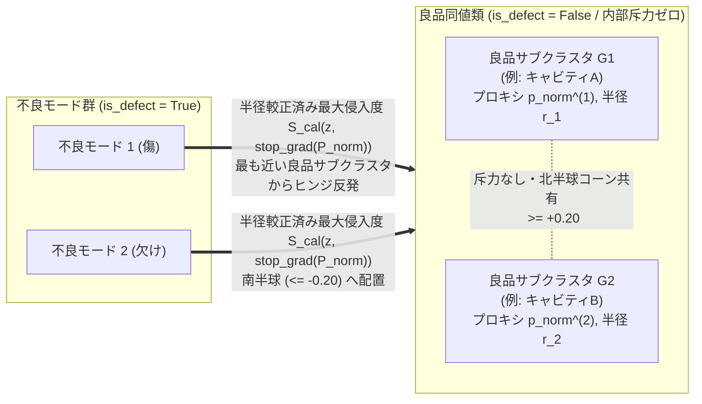

# 良品クラス多峰性（複数クラスタ混在）に対する「多クラス対多クラス学習」案のEGM技術検証・根本原因分析・先行研究調査レポート

> [!IMPORTANT]
> 本書は、EGM（Elephant & Goldfish Model）プロトコルに基づき、独立コンテキストの3つの専門レビュアー（`egm-zoom-out`：高高度アーキテクチャ・YAGNI監査、`egm-design`：数理・実装ストレステスト、`egm-inventive-catalyst`：TRIZ技術矛盾解消）による並列検証と、実機セッションデータ（`bottle` / `bottle2`、`session_0004`〜`session_0009`）の定量・画像解析を統合した設計検証レポートである。
> 参照仕様書：[README.md](file:///Users/tmcqdtj1089/Desktop/New-metric-learning/README.md)、[Model_Explanation.md](file:///Users/tmcqdtj1089/Desktop/New-metric-learning/Model_Explanation.md)

---

## 1. 結論と提案への直接回答（Critique First）

### 1.1. 結論要約：「対称な多クラス対多クラス化」は棄却、「同陣営・無斥力のマルチサブセンター包囲＋前処理・境界合成の局所化」へ転換すべき

「良品クラスも複数クラスタに分割し、多クラス対多クラスのグループ学習にする」という提案は、**クラス間の力の掛け方（良品クラスタ同士に斥力を働かせるか否か）** によって成否が正反対に分かれる。

1. **【棄却（NG）】対称な「多クラス対多クラス分類」（良品クラスタ $N_1, \dots, N_M$ 同士にも斥力・Softmax競合を入れる設計）**:
   * **理由①（正常多様体の引き裂きと過検出 FP の誘発）**: 良品内の複数グループが照明変動・回転位相・ロット差などの連続的または緩やかな変動に由来する場合、K-Means の分割境界を挟んで良品 $N_1$ と良品 $N_2$ が互いに反発し、両者の間に低類似度の「死角の谷（Dead Zone）」が形成される。未知テストデータで中間的な照明・位相の良品が入るとその谷に落ち、過検出（FP）が増加する。
   * **理由②（勾配資源の浪費と微細欠陥の見逃し FN 増加）**: [README.md 3.4節](file:///Users/tmcqdtj1089/Desktop/New-metric-learning/README.md#L130-L138) および [Model_Explanation.md 1節](file:///Users/tmcqdtj1089/Desktop/New-metric-learning/Model_Explanation.md#L32-L33) で排除したはずの「同陣営内の不要な押し合い」を、データ枚数の8割を占める良品側で再発させることになる。射影ヘッド（[`MetricProjectionModel.projection_head`](file:///Users/tmcqdtj1089/Desktop/New-metric-learning/trainer/app/core/feature_extractor.py#L217-L223)）の主特異値方向が「良品 $N_1$ と良品 $N_2$ の違い（ロット・位相などの正常変動 $\nu$）」の拡大に奪われ、L2正規化によって局所的な微細欠陥成分 $\delta_{\text{def}}$ の角度変位が圧縮されて見逃し（FN）が増える。
   * **理由③（Open-Set 異常検知性能の喪失）**: 閉集合の多クラスボロノイ分割（ArcFace / Softmax CE 等）へ寄せると、既知不良 $D_1 \dots D_C$ のいずれとも似ていない未知不良が、空間の大部分を占める $M$ 個の良品ボロノイ領域のいずれかに吸収される。

2. **【条件付き採用（要パイプライン改修）】非対称な「同陣営マルチサブセンター包囲学習」（良品群 $\{N_1 \dots N_M\}$ 内部の斥力は完全ゼロ、不良群 $\{D_1 \dots D_C\}$ を全良品サブセンターの和集合から押し出す設計）**:
   * 良品サブクラスタ間は「同じ合格判定に属する同値類（Equivalence Classes）」として**サンプル間斥力を一切掛けず**、各良品サンプルは最も近い良品サブセンター $\hat{p}_{\text{norm}}^{(m^*)}$ へのみ凝集させ、各不良サンプルは $\max_{m} \langle z(x), \text{stop\_grad}(\hat{p}_{\text{norm}}^{(m)}) \rangle$ を通じて「最も侵入している良品サブセンター」から押し出す形であれば、Open-Set 異常検知の性質を壊さずに多峰性を吸収できる。
   * **ただし重大な盲点がある**：実は [`CustomizedMultiProxyAnchorLoss`](file:///Users/tmcqdtj1089/Desktop/New-metric-learning/trainer/app/core/proxy_anchor_loss.py#L47) には既に `num_normal_proxies`（$M$ 個の良品プロキシ）の枠組みが存在しているにもかかわらず、**現行コードの周辺7箇所に「良品＝単一平均の単峰分布である」という暗黙の前提（バグ・構造矛盾）が埋め込まれているため、単に $M > 1$ に変更したりフォルダを分けたりするだけでは正しく機能しない。**

---

## 2. 実機データ（`http://localhost:18501/space_evaluation`）の定量・画像フォレンジック分析

現在の評価画面（アクティブデータセット：`bottle2` および `bottle`、`session_0004`〜`session_0009`）で実際に何が起きているかを、保存済みスナップショット（`.pkl` / `.json`）と実画像から検証した結果を示す。

### 2.1. セッション横断の実測挙動（`M=1` 強制凝集による精度低下）

| Session (Dataset) | 設定 (`M`, `r_norm`, `pool`) | Ep 1 `val` F1 / FP / FN | Best Ep (`val` F1) | Ep 100 `all` Acc / FP / FN | 良品内分散 `normal_intra_disp` (Ep1 → Ep100) | 観測された現象 |
| :--- | :--- | :---: | :---: | :---: | :---: | :--- |
| **`session_0004`** (`bottle`) | `M=1`, `r=0.5`, `gap` | 0.9375 / 1 / 1 | Ep 27 (0.9412) | **0.8733** / **37枚** / 0枚 | `0.0233` → **`0.3209`** (13.8倍膨張) | 良品229枚中37枚が負半球（`-0.98`付近）へ弾き出され Accuracy 87.3% へ低下 |
| **`session_0005`** (`bottle`) | **`M=2`**, `r=0.5`, `gap` | 0.9091 / 2 / 1 | Ep 58 (**0.9697**) | 0.9623 / 11枚 / 0枚 | `0.0499` → `0.0482` (膨張抑制) | `M=2` にするだけで Ep 100 分散が `0.3209` → `0.0482` へ改善したが、後述の周辺バグにより後期に FP 11枚が発生 |
| **`session_0008`** (`bottle2`) | `M=1`, `r=0.5`, `gap` | 0.9677 / 0 / 1 | Ep 2 (0.9697) | 0.9863 / 4枚 / 0枚 | `0.0222` → `0.0518` (2.3倍拡大) | Ep 2 がピークで、学習を進めるほど良品分散が悪化し `d_min_boundary` が `0.043` → `0.00025` へ縮小 |
| **`session_0009`** (`bottle2`) | `M=1`, **`r=0.9`**, `gap` | 0.9677 / 0 / 1 | Ep 64 (0.9697) | 0.9829 / 4枚 / **1枚** | `0.0052` → `0.0415` (7.9倍拡大) | 求心力比率を `0.90`（90:10）まで強めて無理やり1点に絞ろうとした結果、後半で `val` Accuracy が `0.986` → **`0.9315`**（F1 `0.8571`）へ下落し、不良の見逃し（FN: `sim=+0.7085`）まで残存 |

### 2.2. なぜ `bottle` / `bottle2` の良品クラス内に複数クラスタが生じ、無理な1点凝集で誤判定が起きたのか

[`bottle2/manifests/clustering_result.json`](file:///Users/tmcqdtj1089/Desktop/New-metric-learning/data/datasets/bottle2/manifests/clustering_result.json) の良品229枚（`nomal/`）を解析すると、良品全体の平均ベクトルに対するコサイン類似度（`density_score`）が **`-0.2846`（反対半球）から `+0.5796`** まで大きく2極以上に分かれている。実画像を照合すると、物理的・数理的な原因は以下の通りである。

1. **固定直交グリッド表面統計量（678次元）による回転位相・金型個体差のクラスタ分裂**:
   * [`extract_handcrafted_surface_statistics`](file:///Users/tmcqdtj1089/Desktop/New-metric-learning/trainer/app/core/feature_extractor.py#L101-L166) は、画像を `8×8` 平均・`6×6` 局所標準偏差・`6×6` エッジ勾配・`4×4` 色差の**回転非不変な固定 `(x, y)` グリッド（678次元）** に分割し、`timm` 特徴量と 1:1 のノルム比率で結合している（[`feature_extractor.py` L254-L257](file:///Users/tmcqdtj1089/Desktop/New-metric-learning/trainer/app/core/feature_extractor.py#L254-L257)）。
   * `bottle` の良品画像には、①瓶底中央に同心円状の成形マークが写る個体（例：`train_good_073_103-13.png`、`pca_x = +0.65`, `density = -0.28`）と中央が完全に黒い個体（例：`train_good_012_149-13.png`、`pca_x = -0.84`, `density = +0.58`）の2系統があり、さらに②口部ネジ山の終端段差（ハイライト）が12時方向・4時方向・6時方向・7時方向のどこに位置するかによって固定グリッド上の異なるセルが強く発火する。
2. **多対一折り畳み（Many-to-One Folding）による「特徴の重ね合わせ誤認（FN / FP 同時発生）」**:
   * `M = 1` で全良品を単一プロキシ $\hat{p}_{\text{norm}}$ へ線形求心力 `1 - S` で引き寄せると、凍結バックボーン上の2層MLPは「グループAの特徴（中央の成形リング）」も「グループBの特徴（7時方向の口部ネジ山ハイライト）」も両方同じ $\hat{p}_{\text{norm}}$（類似度 `+1.0`）へ写像するよう重みを折り畳む。
   * ところが、`session_0009` で最後まで見逃された不良画像 `test_broken_small_010_005-93.png`（Ep 100 でも `sim = +0.7085` で良品誤判定 FN）は、**「グループAの中央成形リング」を持ちつつ「7時方向の口部に微小欠け」がある個体**である。MLPがグループBの7時方向ハイライトを良品中心へ引き込む写像を学習させられた結果、7時方向の欠け特徴が相殺されて良品クラスタ内部に取り込まれた。
   * 逆に、6〜7時方向の異常を無理に押し出そうとした反動で、6時方向に正常なネジ山終端を持つ良品 `test_good_006_000-95.png` が全セッション共通で `sim = -0.72 〜 -0.81` の不良領域へ弾き飛ばされ、固定的な過検出（FP）となっている。

---

## 3. 現行コードベースに潜む「単峰性（1クラスタ）前提」の7つの構造欠陥

単に UI で `num_normal_proxies` ($M$) を `2〜4` に増やす、あるいは前処理で良品フォルダを分割するだけでは解決しない理由は以下の7箇所にある。

### 欠陥①：【Blocker】ラベルスキーマが「良品以外の全クラス名＝不良（`is_defect = True`）」とハードコードされている
* **該当箇所**: [`backend/app/routers/datasets.py` L160-L164, L204-L205](file:///Users/tmcqdtj1089/Desktop/New-metric-learning/backend/app/routers/datasets.py#L160-L205)、[`trainer/app/routers/train_jobs.py` L528](file:///Users/tmcqdtj1089/Desktop/New-metric-learning/trainer/app/routers/train_jobs.py#L528)、[`proxy_anchor_loss.py` L213](file:///Users/tmcqdtj1089/Desktop/New-metric-learning/trainer/app/core/proxy_anchor_loss.py#L213)
* **メカニズム**: `_build_and_save_annotations_manifest` は単一の `normal_class_name` だけを `label_id = 0` に割り当て、`lbl != norm_cls` のすべてのラベル名を `1..C`（`is_defect = lbl_id > 0`）に変換する。したがって現状のUIやフォルダ構成で良品を `normal_group_1`, `normal_group_2` の2クラスに分けると、**片方の良品グループが自動的に「不良クラス」として学習・反発される**。また、単一 `"nomal"` のままでは 6:2:2 分割（[`datasets.py` L175-L198](file:///Users/tmcqdtj1089/Desktop/New-metric-learning/backend/app/routers/datasets.py#L175-L198)）が良品内サブクラスタに対して層化されない。

### 欠陥②：【Blocker】大域1平均 Z-Score 標準化が2つの良品クラスタを正反対の極（$\cos \approx -1$）へ引き裂き、Farkas 半球矛盾を起こす
* **該当箇所**: [`trainer/app/core/feature_extractor.py` L261-L290](file:///Users/tmcqdtj1089/Desktop/New-metric-learning/trainer/app/core/feature_extractor.py#L261-L290)、[`proxy_anchor_loss.py` L140-L152, L301, L345-L346](file:///Users/tmcqdtj1089/Desktop/New-metric-learning/trainer/app/core/proxy_anchor_loss.py#L140-L152)
* **メカニズム**:
  1. 良品が2つのモード $\mu_A, \mu_B$ を持つとき、[`calibrate_feature_stats`](file:///Users/tmcqdtj1089/Desktop/New-metric-learning/trainer/app/core/feature_extractor.py#L275-L276) の全体平均 `feat_mean` は中間の空白地帯 $\frac{1}{2}(\mu_A + \mu_B)$ に置かれ、全体標準偏差 `feat_std` はモード間距離 $\frac{1}{2}|\mu_A - \mu_B|$ で肥大化して微細欠陥のSN比を潰す。
  2. さらに平均を引いて L2 正規化（[`feature_extractor.py` L290](file:///Users/tmcqdtj1089/Desktop/New-metric-learning/trainer/app/core/feature_extractor.py#L290)）すると、良品クラスタ $A$ は $+\vec{u}$、良品クラスタ $B$ は **$-\vec{u}$（180°正反対の対蹠点）** に配置される。
  3. その状態で $M=2$ プロキシを初期化すると $\hat{p}_1 \approx -\hat{p}_2$ となり、`p_norm_mean`（[`proxy_anchor_loss.py` L140](file:///Users/tmcqdtj1089/Desktop/New-metric-learning/trainer/app/core/proxy_anchor_loss.py#L140)）がゼロ付近で相殺されるだけでなく、球面幾何学（Farkas の補題）によりすべての点 $z \in \mathbb{S}^{127}$ で $\max(\langle z, \hat{p}_1 \rangle, \langle z, -\hat{p}_1 \rangle) \ge 0$ となるため、**深部ヒンジ `deep_margin = -0.25`（[`L301`](file:///Users/tmcqdtj1089/Desktop/New-metric-learning/trainer/app/core/proxy_anchor_loss.py#L301)）および不良プロキシ負半球制約 `p_def @ p_norm.T <= -0.20`（[`L346`](file:///Users/tmcqdtj1089/Desktop/New-metric-learning/trainer/app/core/proxy_anchor_loss.py#L346)）を同時に満たす解が数学的に存在しなくなる**。

### 欠陥③：【Blocker】Phase 3 境界合成（Defect Transfer & Anomalous Mixup）が「異種良品クラスタ間のブリッジ」に偽の不良ラベルを撒いている
* **該当箇所**: [`trainer/app/core/boundary_augmentation.py` L96-L99, L138-L143, L181-L204](file:///Users/tmcqdtj1089/Desktop/New-metric-learning/trainer/app/core/boundary_augmentation.py#L181-L204)、[`train_jobs.py` L214-L216](file:///Users/tmcqdtj1089/Desktop/New-metric-learning/trainer/app/routers/train_jobs.py#L214-L216)
* **メカニズム**:
  * `synthesize_boundary_gap_features`（および画像空間の `synthesize_defect_transfer_images`）は、不良サンプルに最も近い参照良品 `ref_idx`（例：良品クラスタ $A$）を見つけた後、貼り付け先・Mixup先の良品を **`target_idx = (ref_idx + 1 + arange) % b_norm`（モジュロ巡回）** で無作為に選んでいる。
  * バッチ内に複数の良品クラスタが混在していると、**「クラスタ $B$ の正常特徴 70% ＋ クラスタ $A$ 由来の不良特徴 30%」** という合成ベクトルが生成される。このベクトルは超球面上で**良品クラスタ $A$ と良品クラスタ $B$ を結ぶ測地線（正常多様体の内部・中間領域）** に位置するにもかかわらず、`y_synth > 0`（不良）として反発損失が掛けられる。これが長エポック学習（Ep 50〜100）で正常サンプルが次々と負半球へ弾き出される直接の汚染源となっている。

### 欠陥④：【Blocker】`M > 1` 時の孤児プロキシ引きずり（`subcenter_anchor`）と逆向きのプロキシ間斥力（`ortho_margin_normal`）
* **該当箇所**: [`trainer/app/core/proxy_anchor_loss.py` L58, L231-L233, L357-L366](file:///Users/tmcqdtj1089/Desktop/New-metric-learning/trainer/app/core/proxy_anchor_loss.py#L231-L233)、[`2_training_monitor.py` L318-L325](file:///Users/tmcqdtj1089/Desktop/New-metric-learning/frontend/app/pages/2_training_monitor.py#L318-L325)
* **メカニズム**:
  * UI側のデフォルト値が `num_normal_proxies = 1`（[`2_training_monitor.py` L322](file:///Users/tmcqdtj1089/Desktop/New-metric-learning/frontend/app/pages/2_training_monitor.py#L322)）に固定されており、APIスキーマのデフォルト `4`（[`job_models.py` L65](file:///Users/tmcqdtj1089/Desktop/New-metric-learning/trainer/app/schemas/job_models.py#L65)）と食い違っている。
  * さらに $M > 1$ を指定しても、`subcenter_anchor = (1.0 - sim_jn.max(dim=0).values).mean()`（[`L232`](file:///Users/tmcqdtj1089/Desktop/New-metric-learning/trainer/app/core/proxy_anchor_loss.py#L232)）が各プロキシに最も近いバッチ内1枚の良品へ外向き勾配 $\frac{0.10}{M}$ を与える。真のクラスタ数より $M$ が大きい場合や、少数派の良品クラスタがミニバッチ（良品16枚）から欠落したステップでは、別クラスタの外縁にある正常サンプル1枚に $\frac{0.90}{16} = 0.056$ に匹敵する逆向き引力（$M=2$ で $0.050$）が掛かり、良品クラスタの裾野を外側へ引き剥がす。
  * 同時に `loss_ortho`（[`L365`](file:///Users/tmcqdtj1089/Desktop/New-metric-learning/trainer/app/core/proxy_anchor_loss.py#L365)）が $\langle \hat{p}_m, \hat{p}_{m'} \rangle > 0.85$ にペナルティを課すため、単峰データに対して誤って $M=4$ を設定するとプロキシ同士が強制的に $31.8^\circ$ 以上押し広げられ、単一クラスタを人工的に引き裂く。

### 欠陥⑤：【Blocker】クラスタ間で分散（半径）が異なる場合の単一閾値 `tau_sim` 破綻と評価指標の歪み
* **該当箇所**: [`trainer/app/core/evaluator.py` L87-L93, L120-L144, L223-L228, L298-L303](file:///Users/tmcqdtj1089/Desktop/New-metric-learning/trainer/app/core/evaluator.py#L298-L303)
* **メカニズム**:
  * 良品クラスタ $G_1$ が高凝集（半径 $r_1 = 0.04$、正常類似度 $\ge 0.96$）で、良品クラスタ $G_2$ が照明変動等で広分散（半径 $r_2 = 0.20$、正常類似度 $\ge 0.80$）である場合、生の最大類似度 $\max_m \langle z, \hat{p}_m \rangle$ に対して共通のスカラ閾値 $\tau_{\text{sim}}$ を適用すると、$G_2$ の過検出（FP）を防ぐために閾値を $\le 0.80$ まで緩めざるを得ず、その結果 **$G_1$ 上で類似度 $0.88$（半径の3倍外側）に出現した微細欠陥が見逃される（FN）**。
  * また [`evaluator.py` L127-L129](file:///Users/tmcqdtj1089/Desktop/New-metric-learning/trainer/app/core/evaluator.py#L127-L129) のクラス別分散と [`L227`](file:///Users/tmcqdtj1089/Desktop/New-metric-learning/trainer/app/core/evaluator.py#L227) の大域 `d_min_boundary` は、良品全体が1箇所に集まっている前提で計算されているため、$M \ge 2$ で綺麗に分離できていても分散悪化・マージン負値と誤判定される。

### 欠陥⑥：【Major】`NAB-Sampler` の良品非層化抽出と `CurriculumPenaltyScheduler` の正帰還暴走
* **該当箇所**: [`trainer/app/core/nab_sampler.py` L123-L161](file:///Users/tmcqdtj1089/Desktop/New-metric-learning/trainer/app/core/nab_sampler.py#L123-L161)、[`trainer/app/core/scheduler.py` L92-L97](file:///Users/tmcqdtj1089/Desktop/New-metric-learning/trainer/app/core/scheduler.py#L92-L97)
* **メカニズム**:
  * `NAB-Sampler` は不良スロットをクラス均等抽出する一方、良品16スロットは単一プールからの非層化巡回＋XBM境界良品35%優先注入で埋めるため、少数派の良品サブクラスタがバッチから頻繁に欠落する。
  * 同時に、多峰性良品を $M=1$ で学習すると `val_loss_centripetal` が高止まりし `Precision` が下がるため、[`scheduler.py` L92-L97](file:///Users/tmcqdtj1089/Desktop/New-metric-learning/trainer/app/core/scheduler.py#L92-L97) が `centripetal_focus` と判定して次エポックの求心力比率 `effective_normal_ratio` を自動的に引き上げ、**無理な1点折り畳みをさらに加速させる悪循環（正帰還ループ）** に入る。

### 欠陥⑦：【Major】フェーズ1残差クラスタリングの背景混入と単一画像推論のプロキシ不整合
* **該当箇所**: [`trainer/app/core/two_stage_cluster.py` L176-L183](file:///Users/tmcqdtj1089/Desktop/New-metric-learning/trainer/app/core/two_stage_cluster.py#L176-L183)、[`trainer/app/routers/train_jobs.py` L1066-L1078](file:///Users/tmcqdtj1089/Desktop/New-metric-learning/trainer/app/routers/train_jobs.py#L1066-L1078)
* **メカニズム**:
  * フェーズ1の異常サブクラスタリングが単一の良品平均 `ref_mean` を引くため、不良クラスタが「傷・汚れの種類」ではなく「どの良品サブグループから発生したか」という背景差で分割される。
  * また単一画像推論（`run_single_image_inference`）が `best_model.pt`（例：Ep 64）のモデル重みをロードしながら、`normal_proxies` だけは最終エポック（Ep 100）の `.pkl` から読み込んでおり、座標系の不一致を起こしている。

---

## 4. 反証・代替アプローチとの比較（損失関数を改修する前に検討すべき YAGNI 選択肢）

損失関数やクラスタ学習を複雑化する前に、以下の3つのより単純な解決策で問題の過半が解消しないかを先に検証する必要がある。

| 優先順 | アプローチ | 有効なケース（根本原因） | 限界・損失関数改修が必要になる境界線 |
| :---: | :--- | :--- | :--- |
| **選択肢1** *(運用分離・コード改修ゼロ)* | **既知メタデータ（品種・カメラ・表裏・照明条件）ごとのデータセット分離** | 良品内の2クラスタが「別品種」「カメラ1とカメラ2」「表と裏」など撮影時点で既知の条件差である場合。既存のマルチデータセット機能（`data/datasets/<name>/`）で個別モデルに分けるだけで単峰性が回復し、精度低下は消滅する。 | 同一品種・同一カメラ内で、金型キャビティ差・納入ロット差・円周方向の回転位相など**撮影時に事前分離できない潜在グループ**が混在する場合は分離不能。 |
| **選択肢2** *(記述子見直し・最小変更)* | **回転・位置に過敏な 678次元固定直交グリッド統計量の縮小または極座標・回転不変化** | `bottle` のように製品が円筒対称で回転位相によって良品が複数クラスタに割れている場合。固定 `(x, y)` グリッド統計量が回転差を増幅しているため、半径方向（同心円リング）統計量へ変更するか表面統計量の結合比率を下げるだけで良品クラスタが自然に1つへまとまる。 | 成形マークの有無（キャビティA/B）や複数照明・非対称部品の許容個体差など、回転不変化だけでは消えない本質的な多峰性には対処できない。 |
| **選択肢3** *(非パラメトリックベースライン)* | **凍結特徴または学習済み空間上の Coreset Memory Bank $k$-NN 判定（PatchCore 型）** | デフォルトが `freeze_backbone=True` であるため、単一プロキシへ無理に凝集させずとも、学習データの良品特徴バンクに対する最近傍距離 $\min_{m \in \mathcal{M}} (1 - \langle z(x), m \rangle)$ をとれば、1個でも10個でも任意の形状の正常多様体を崩壊ゼロで表現できる。 | 背景変動に比べて欠陥が極微小（数ピクセル）であり、事前学習バックボーンのままでは正常個体差に埋もれる場合、教師あり不良データを使って欠陥チャネルを増幅する**距離学習（射影ヘッド＋Multi-Proxy Loss）** が優位となる。 |

---

## 5. 推奨アーキテクチャ設計（Asymmetric Multi-Subcenter Union ＋ 4つの最小数理変換）

上記の選択肢1・2で解消しない「同一検査工程内の本質的な多峰性良品 ＋ 微細欠陥の教師あり分離」を解く場合、**対称な多クラス対多クラス化は行わず、現行の `CustomizedMultiProxyAnchorLoss` の 50:50 スケールと `tau_sim` UI を維持したまま、以下の4つの変換を適用する設計**が最も合理的である。

### 変換1：シルエットゲート付き良品サブクラスタ自動推定（$M^*$）と「北半球共有コーン制約」への反転
* **対象**: [`two_stage_cluster.py`](file:///Users/tmcqdtj1089/Desktop/New-metric-learning/trainer/app/core/two_stage_cluster.py)、[`proxy_anchor_loss.py` L102-L153, L223-L236, L357-L366](file:///Users/tmcqdtj1089/Desktop/New-metric-learning/trainer/app/core/proxy_anchor_loss.py#L102-L153)
* **設計**:
  1. **単峰時は $M^*=1$、多峰時のみ $M^* = k^*$ を自動選択**: `train` 分割の良品特徴（射影前の `gap_features`）に対して $k \in \{2 \dots M_{\max}\}$ のコサイン・シルエットスコアを計算し、$\max_k \text{Sil}_{\cos}(k) < 0.22$ なら $M^* = 1$（無理な分割を防止）、$\ge 0.22$ なら最適クラスタ数 $M^* = k^*$ を有効化する（最小クラスタ枚数ガード $n_{\min} \ge 4$）。
  2. **`subcenter_anchor` の廃止とモード均等求心力**: 孤児プロキシが他クラスタの良品を引き剥がす `0.10 * subcenter_anchor`（[`L232`](file:///Users/tmcqdtj1089/Desktop/New-metric-learning/trainer/app/core/proxy_anchor_loss.py#L232)）を削除し、`NAB-Sampler` の良品スロットをサブクラスタ層化抽出した上で、バッチ内に存在する各良品サブクラスタ $m \in \mathcal{A}_{\text{batch}}$ ごとに求心力を平均する：
     $$L_{\text{centripetal}} = \frac{1}{|\mathcal{A}_{\text{batch}}|} \sum_{m \in \mathcal{A}_{\text{batch}}} \frac{1}{|\mathcal{B}_{\text{norm}}^{(m)}|} \sum_{i \in \mathcal{B}_{\text{norm}}^{(m)}} \big(1.0 - \langle z_i, \hat{p}_{\text{norm}}^{(m)} \rangle\big)$$
  3. **プロキシ直交項の不等号反転（北半球コーン制約）**: 従来の「良品プロキシ同士が `0.85` 以上近づいたら押し離す」項（[`L365`](file:///Users/tmcqdtj1089/Desktop/New-metric-learning/trainer/app/core/proxy_anchor_loss.py#L365)）を廃止し、逆に**良品プロキシ群が互いに反対半球へ散らばって南半球を塞ぐのを防ぐ下限コーン制約** $\langle \hat{p}_{\text{norm}}^{(m)}, \hat{p}_{\text{norm}}^{(m')} \rangle \ge +0.20$（最大角度 $78.5^\circ$ 以内）へ反転する：
     $$L_{\text{cone\_norm}} = 0.25 \cdot \frac{1}{M^*(M^*-1)} \sum_{m \ne m'} \max\big(0, \; 0.20 - \langle \hat{p}_{\text{norm}}^{(m)}, \hat{p}_{\text{norm}}^{(m')} \rangle\big)^2$$
     これにより、良品サブクラスタ同士は無理に1点（$0^\circ$）へ潰されることなく最大 $78.5^\circ$ 離れて共存でき、かつ反対側の南半球全体（$\le -0.20$）をすべての不良モードプロキシに対して矛盾なく開放できる。

### 変換2：サブクラスタ別の半径差を吸収する Möbius 局所分散キャリブレーション
* **対象**: [`proxy_anchor_loss.py` L267-L306](file:///Users/tmcqdtj1089/Desktop/New-metric-learning/trainer/app/core/proxy_anchor_loss.py#L267-L306)、[`evaluator.py` L279-L303](file:///Users/tmcqdtj1089/Desktop/New-metric-learning/trainer/app/core/evaluator.py#L279-L303)
* **設計**:
  * `train` 分割の良品サンプルのみから、各良品プロキシ $m$ に属する良品の90%分位コサイン距離 $r_m \in [0.015, 0.60]$ とその平均 $\bar{r} = \frac{1}{M^*}\sum_m r_m$ を算出し、距離 $d_m(z) = 1 - \langle z, \hat{p}_m \rangle \in [0, 2]$ を以下の滑らかな単調全単射（Möbius 変換）で正規化する：
    $$\alpha_m = \text{clip}\!\left(\frac{\bar{r}(2 - r_m)}{r_m(2 - \bar{r})}, \; 0.40, \; 4.00\right), \qquad \tilde{d}_m(z) = \frac{2 \alpha_m d_m(z)}{(\alpha_m - 1) d_m(z) + 2}, \qquad S_{\text{cal}}(z) = 1.0 - \min_{m} \tilde{d}_m(z) \in [-1, +1]$$
  * $M^*=1$ のときは従来のコサイン類似度と厳密に一致し、$M^* \ge 2$ で狭い良品クラスタと広い良品クラスタが混在しても、全クラスタの外縁（$d_m = r_m$）が同一の類似度等高線 $1 - \bar{r}$ に揃うため、単一の閾値 $\tau_{\text{sim}}$ と単一のマージン $\delta$ で微細欠陥を漏れなく弾ける。

### 変換3：同一良品サブクラスタ内に限定した Phase 3 境界合成と残差標準化
* **対象**: [`boundary_augmentation.py` L96-L99, L138-L143, L180-L204](file:///Users/tmcqdtj1089/Desktop/New-metric-learning/trainer/app/core/boundary_augmentation.py#L180-L204)、[`feature_extractor.py` L261-L290](file:///Users/tmcqdtj1089/Desktop/New-metric-learning/trainer/app/core/feature_extractor.py#L261-L290)
* **設計**:
  * **同モード限定ペアリング**: Defect Transfer および Anomalous Mixup における貼り付け先・補間先の良品を、モジュロ巡回 `(ref_idx + 1) % b_norm` ではなく、不良サンプルの最近傍良品 `h_ref` と同じ良品サブクラスタに属する上位近傍良品（$\langle h_{\text{cand}}, h_{\text{ref}} \rangle \ge 0.50$）のみに制限する。これにより良品クラスタ間の測地線上に偽の不良が生成されるのを防ぐ。
  * **プールされたクラスタ内標準偏差によるスケーリング**: 大域標準偏差 $\sigma_{\text{global}}$ ではなく、各良品サブクラスタ内の分散をプールした $\hat{\sigma}_{\text{within}} = \sqrt{\frac{1}{N_{\text{norm}}}\sum_m \sum_{x \in G_m} (h(x) - \mu_m)^2}$ で特徴量をスケーリングし、フェーズ1の異常残差も最近傍良品サブクラスタ重心 $\mu_{m^*(x)}$ との差分で計算する。

---

## 6. 参考になる主要論文・先行研究ガイド

本課題（「クラス内部に複数のサブクラスタ／多峰性がある場合の距離学習・異常検知における表現崩壊の回避」）に直接対応する代表的な査読付き論文7編を、本システムとの対応関係とともに整理する。

### 6.1. 論文比較一覧テーブル

| 領域・アプローチ | 論文タイトル・著者・会議 | 解いている核心問題 | 本システムへの示唆と注意点 |
| :--- | :--- | :--- | :--- |
| **① 多球面 1クラス異常検知** *(本課題に最も直結)* | **Deep Multi-sphere Support Vector Data Description (DMSVDD)** Z. Ghafoori & C. Leckie, *SIAM SDM 2020* | 単一超球面への凝集（Deep SVDD）が多峰性の正常データで無理な写像と精度低下を起こす問題を定式化し、**複数の正常超球面（中心と個別半径）を反発なしで同時最適化**する。 | 「良品クラスタ同士は反発させず、複数の超球の和集合として正常領域を定義し、球ごとに半径を持つべき」という設計の直接の理論根拠となる。教師あり不良斥力項は持たないため、本システムの第2項（ヒンジ斥力）と組み合わせる。 |
| **② マージン距離学習におけるクラス崩壊の防止** | **Rethinking Preventing Class-Collapsing in Metric Learning with Margin-Based Losses** E. Levi, T. Xiao, X. Wang, & T. Darrell, *ICCV 2021* | 同一クラス内に複数サブクラスタ（視点・照明差等）があるとき、クラス全体を1点へ引き寄せるマージン損失が**必然的にクラス崩壊（Class Collapse）を起こしテスト汎化性能を下げる**ことを理論・実験の双方で証明。バッチ内の最近傍同クラス個体のみを正例に選ぶ局所引力（Easy Positive Mining）を提案。 | 本システムの比較損失 [`ms_loss.py`](file:///Users/tmcqdtj1089/Desktop/New-metric-learning/trainer/app/core/ms_loss.py#L97-L98) では不良側にのみ `local_pos_k` が入っているが、この論文は**良品側こそ単一中心への全ペア引き寄せを止め、局所近傍／最近傍サブセンターのみへ引き寄せるべき**であることを示している。 |
| **③ マルチサブセンター距離学習（軟割当）** | **SoftTriple Loss: Deep Metric Learning Without Triplet Sampling** Q. Qian, L. Shang, B. Sun, J. Hu, H. Li, & R. Jin, *ICCV 2019* | 1クラスあたり $K$ 個の学習可能なサブセンターを持たせ、クラス内類似度を温度付き Softmax（$\sum_k \frac{e^{\gamma s_k}}{\sum_j e^{\gamma s_j}} s_k$）で定義することで、事前クラスタリングラベル無しでクラス内多峰性を吸収する。 | ハードな K-Means ラベル分割を行わなくても、損失関数内部のサブセンター群で多峰性を表現できることを示した基礎論文。冗長なサブセンターを統合する正則化（過分割防止）の考え方が参考になる。 |
| **④ サブセンター角度マージンと不要プロキシ刈り込み** | **Sub-center ArcFace: Boosting Face Recognition by Large-Scale Noisy Web Faces** J. Deng, J. Guo, T. Liu, M. Gong, & S. Zafeiriou, *ECCV 2020* | 各クラスに $M$ 個のサブセンターを用意し、$\max_{m \in \{1..M\}} \langle z, W_{y,m} \rangle$ の最大類似度のみで勾配を流すことで、非典型サブグループや外れ値が主クラスタ重心を歪めるのを防ぐ。学習後にサンプルが集まらない非アクティブサブセンターをドロップする。 | 本システムの `sim_jn.max(dim=1)`（[`proxy_anchor_loss.py` L227](file:///Users/tmcqdtj1089/Desktop/New-metric-learning/trainer/app/core/proxy_anchor_loss.py#L227)）と同じ最大値ルーティングを採用している。ただし ArcFace の分母（全クラス間 Softmax 斥力）をそのまま使うと Open-Set 異常検知には不向きなため、良品内の `max_m` 構造と非アクティブプロキシ除去のみを取り入れるのが適切。 |
| **⑤ 産業外観検査の多峰性メモリバンク基準** | **Towards Total Recall in Industrial Anomaly Detection (PatchCore)** K. Roth, L. Pemula, J. Zepeda, B. Schölkopf, T. Brox, & P. Gehler, *CVPR 2022* | 正常パッチ特徴を Greedy Coreset Subsampling で代表点バンクとして保持し、最近傍距離で異常度を算出する。MVTec AD 等の産業外観検査における標準ベースライン。 | 正常データが何個のクラスタに分かれていても学習崩壊が原理的に起きない。本モデルでマルチプロキシ改修を行った際、「本当に学習型モデルが単純な Coreset $k$-NN より高精度か」を検証する必須の比較対象。 |
| **⑥ 多クラス統合型の産業異常検知** | **A Unified Model for Multi-class Anomaly Detection (UniAD)** Z. You et al., *NeurIPS 2022* | 複数の正常製品カテゴリ（多峰性の正常分布）を単一モデルで扱う際、モデルが「どの正常グループに属するか」に容量を奪われたり恒等写像ショートカットに陥ったりする現象を解明。 | 複数グループが混在する外観検査において、グループ間の大きな見た目差に引きずられず各グループ内部の微細な異常を検出するための問題設定理解に有用。 |
| **⑦ 少数異常教師あり Open-Set 異常検知** | **Catching Both Gray and Black Swans: Open-Set Supervised Anomaly Detection (DRA)** C. Ding, G. Pang, & C. Shen, *CVPR 2022* | 少数の既知不良（Gray Swans）と大量の良品から学習しつつ、未知不良（Black Swans）も見逃さない弱教師あり異常検知フレームワーク。既知不良・擬似合成不良・正常からの残差特徴を分離して学習する。 | 本システムの問題設定（良品＋少数の既知不良モード＋合成不良からの Open-Set 異常検知）と最も近い教師あり異常検知論文であり、正常参照との「残差表現」の扱いがフェーズ1・フェーズ2の改善に直結する。 |

---

## 7. 推奨アクションプラン（段階的検証ステップ）

いきなり大規模な多クラス改修を入れるのではなく、工数が小さく効果切り分けが明確な順序で進めることを推奨する。

1. **Step 0（原因切り分け・即日確認可能）**:
   * 現在のデータセットの良品内複数クラスタが「別品種・別カメラ等の既知条件差（→ データセット分割で即解決）」なのか、「`bottle` のような回転位相・キャビティ差（→ 潜在多峰性）」なのかを Step 6 の画像インスペクタで確認する。
2. **Step 1（既存枠組みのバグ修正＋同陣営マルチプロキシ化）**:
   * `label_id > 0 => is_defect` の二値スキーマは壊さず（対称な多クラス対多クラス化はせず）、以下の最小改修を行う：
     1. [`boundary_augmentation.py`](file:///Users/tmcqdtj1089/Desktop/New-metric-learning/trainer/app/core/boundary_augmentation.py) のモジュロ巡回ペアリングを廃止し、同一良品サブクラスタ（最近傍上位かつ類似度 $\ge 0.50$）内でのみ Defect Transfer / Mixup を行う。
     2. [`proxy_anchor_loss.py`](file:///Users/tmcqdtj1089/Desktop/New-metric-learning/trainer/app/core/proxy_anchor_loss.py) で `train` 良品特徴のシルエットスコアから最適プロキシ数 $M^* \in \{1..M_{\max}\}$ を自動決定し、`subcenter_anchor` 削除＋北半球共有コーン制約（$\langle \hat{p}_m, \hat{p}_{m'} \rangle \ge 0.20$）＋Möbius プロキシ別半径キャリブレーションを導入する。
     3. [`nab_sampler.py`](file:///Users/tmcqdtj1089/Desktop/New-metric-learning/trainer/app/core/nab_sampler.py) の良品スロットを良品サブクラスタごとに層化抽出し、[`evaluator.py`](file:///Users/tmcqdtj1089/Desktop/New-metric-learning/trainer/app/core/evaluator.py) の分散・境界余裕度を割り当てプロキシ基準に修正する。
3. **Step 2（ベースライン比較による妥当性判定）**:
   * 同一の 6:2:2 分割（`test` 20% 未知データ）上で、①現行 `M=1`、②単純な `train` 良品メモリバンク $k$-NN、③改修後の自動 $M^*$ マルチサブセンターモデルの3者を比較し、Accuracy・Recall・Precision・`d_min_boundary` の改善を定量確認する。
