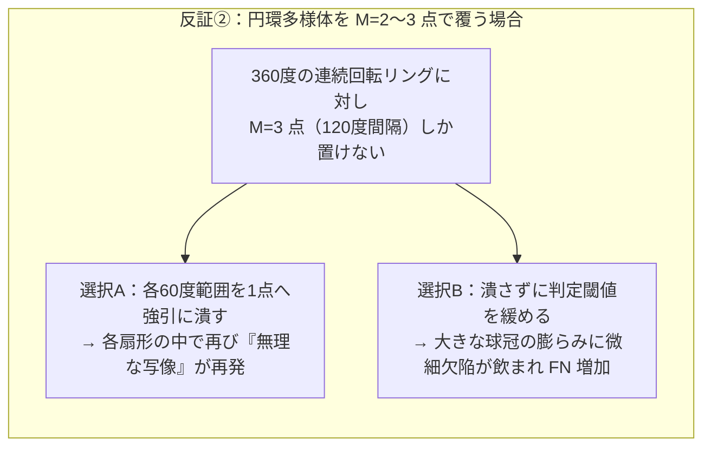

# 良品多峰性の現状理解と「プロキシ数 M=2〜3 増加案」に対するEGM監査・反証・対策設計書

> [!IMPORTANT]
> 本書は、コード改修に入る前の**現状認識の監査・反証検証・対策方針の合意形成**を目的とした技術検証ドキュメントである。
> 実機データ（`bottle` の `session_0004` / `session_0005`、および `bottle2` の `session_0008` / `session_0009` に保存された2214次元特徴量・128次元埋め込み・プロキシ軌跡）の定量計測に基づき、仮説の妥当性と反証を整理している。
> 関連レポート：[Multi_Cluster_Normal_Loss_Review.md](file:///Users/tmcqdtj1089/Desktop/New-metric-learning/Multi_Cluster_Normal_Loss_Review.md)

---

## 1. 現状理解に対する監査（何が事実と整合し、どこに見落としがあるか）

対象となる現状理解：
> 「既知の条件差は排除したデータセットだが、良品データの多峰性により『良品は1クラスに凝集できる』という前提が崩れ、単一超球面への凝集を無理に行ったことで多峰性のある良品データに対して無理な写像が実施され、精度低下を起こした」

この理解を実データと数式で監査すると、**「無理な多対一写像による特徴の潰れ」という骨格は事実と整合する一方、対策の方向性を左右する重大な見落としが3点ある。**

### 見落とし①：「2〜3個の離れた島（離散的多峰性）」ではなく、「平均減算による球面展開 ＋ 連続回転多様体」が正体である
`bottle2` の学習用良品（`train` 分割 172枚）について、MLPに入力される2214次元の標準化特徴量（[`gap_features`](file:///Users/tmcqdtj1089/Desktop/New-metric-learning/trainer/app/routers/train_jobs.py#L457-L459)）の構造を実測した結果は以下の通りである。

| 計測項目（`bottle2` 学習良品 $N=172$） | 全体特徴（2214次元） | `timm` バックボーン部（1536次元、比重59.6%） | 固定グリッド表面統計部（678次元、比重40.4%） | 幾何学的な意味 |
| :--- | :---: | :---: | :---: | :--- |
| **良品全ペア間のコサイン類似度（中央値）** | **`+0.0811`** ($85.3^\circ$) | `+0.1645` ($80.5^\circ$) | **`+0.0184`** ($88.9^\circ$) | 良品同士が平均してほぼ直交（全方位に分散）している |
| **良品全ペア間のコサイン類似度（最小〜最大）** | `-0.4918` 〜 `+0.9061` | `-0.6211` 〜 `+0.9148` | `-0.6856` 〜 `+0.9362` | 反対半球（鈍角 $120^\circ \sim 133^\circ$）まで広がっている |
| **最近傍1枚（1-NN）の良品との類似度（中央値）** | **`+0.6151`** | **`+0.7450`** | **`+0.6374`** | 各良品のすぐ隣にはよく似た別の良品が連続的に存在する |
| **球面 K-Means シルエット係数（$k=2 \dots 8$）** | **`0.1516 〜 0.1618`**（ほぼ横ばい） | （標準化前全体でも `0.150 〜 0.184`） | — | **明確な2〜3個の孤立クラスタは存在しない**（孤立島なら通常 `0.45〜0.75` のピークが出る） |

この4行の数字が示す事実は明確である。
1. **前処理（全体平均の引き算）が良品を全方位へ人工的に引き裂いている**：
   [`calibrate_feature_stats`](file:///Users/tmcqdtj1089/Desktop/New-metric-learning/trainer/app/core/feature_extractor.py#L261-L290) は、データセットの平均ベクトル $\mu$ を引いてから L2 正規化（単位超球面への射影）を行う（さらに [`train_jobs.py` L454](file:///Users/tmcqdtj1089/Desktop/New-metric-learning/trainer/app/routers/train_jobs.py#L454) では不良サンプルまで混ざった `raw_train_only` の平均を引いている）。元々の特徴空間で良品が狭い範囲に固まっていても、**雲のど真ん中に原点を置いて単位球面へ射影すれば、平均の右側の良品と左側の良品は正反対の方向（内積マイナス）へ機械的に吹き飛ばされる。**
2. **固定グリッド特徴量が「回転角度」を連続的な円環（多様体）に変えている**：
   [`extract_handcrafted_surface_statistics`](file:///Users/tmcqdtj1089/Desktop/New-metric-learning/trainer/app/core/feature_extractor.py#L101-L166) は画像を固定の `(x, y)` 格子に切って特徴化するため、同じ良品の瓶でも口部ネジ山のハイライトが12時・3時・6時・9時のどこに写るかで全く別の次元が発火する。その結果、良品データは「2〜3個の点」ではなく、**「瓶底の成形リング有無（離散差） × $360^\circ$ の連続回転リング」という連続多様体（繋がった帯・輪）** を形成している。シルエット係数が $k=2 \dots 8$ で `0.15〜0.16` のまま横ばいなのは、繋がった輪を何等分に切っても切り口で隣同士が接しているためである。

### 見落とし②：「単一超球面への凝集」ではなく「同一超球面上の単一極（北極点）への折り畳み」である
* 本モデルでは L2 正規化（[`proxy_anchor_loss.py` L187](file:///Users/tmcqdtj1089/Desktop/New-metric-learning/trainer/app/core/proxy_anchor_loss.py#L187)）により、良品も不良も最初からすべて同じ128次元単位超球面 $S^{127}$ の表面上に乗っている。
* 問題の本質は「超球面へ乗せたこと」ではなく、全方位に広がった良品多様体全体を**球面上のただ1点 $\hat{p}_{\text{norm}}$ へ折り畳む写像**を2層MLPに強いたことにある。異なる良品ベクトル $h_A, h_B$ を同じ1点へ写すには、MLPは差方向 $h_A - h_B$ の変化をゼロに潰すしかない。すると、たまたま $h_A - h_B$ と同じ方向成分を持つ微細欠陥（例：`session_0009` の `test_broken_small_010_005-93.png`、Ep 100 類似度 `+0.7085`）の変化まで一緒に消去されて見逃し（FN）になる。

### 見落とし③：良品が負半球（`-0.80` 付近）へ飛ばされて FP になる直接原因は「異位相間の境界合成」にある
* 単一プロキシへの求心力自体は常に `+1.0` 方向へ引く力しか持たないため、求心力だけでは良品はマイナス側へ飛ばない。
* 良品が `-0.80 〜 -0.98` まで弾き出された直接の原因は、[`boundary_augmentation.py`](file:///Users/tmcqdtj1089/Desktop/New-metric-learning/trainer/app/core/boundary_augmentation.py#L96-L99) が「ある回転角の不良」と「別の回転角・別キャビティの良品」をモジュロ演算で無差別に混ぜて「不良ラベル」を付与し、良品多様体の内側を横切る位置に斥力源を埋め込んだためである。

---

## 2. 「良品プロキシを M=1 から M=2〜3 に増やす案」に対する4つの反証

「`M=1` を `M=2〜3` に増やし、その数字に論理的根拠を与えれば解決するか？」という仮説に対し、実データと数理の両面から**4つの明確な反証**が存在する。

### 反証①（実機ログによる直接反証）：既に `session_0005` で `M = 2` が実行済みであり、2つのプロキシが角度 $3.1^\circ$ に融合して実質 `M = 1` に退化している
保存済みの学習履歴 [`session_0005`](file:///Users/tmcqdtj1089/Desktop/New-metric-learning/data/artifacts/sessions/session_0005/session_meta.json)（`bottle` データセット、`num_normal_proxies = 2`）のスナップショットを実測すると、以下の現象が起きている。

| `session_0005` (`M = 2`) | 2つの良品プロキシ間の内積 $\langle \hat{p}_0, \hat{p}_1 \rangle$ | プロキシ間角度 | 各プロキシへの良品割当枚数 (`p0 : p1`) | `val` F1 / Accuracy / FP |
| :--- | :---: | :---: | :---: | :---: |
| **Epoch 1** | `+0.9918` | **$7.4^\circ$** | `210枚 : 19枚` | `0.9091` / `0.9589` / 2枚 |
| **Epoch 50** | **`+0.9985`** | **$3.1^\circ$** | `121枚 : 108枚` | `0.9412` / `0.9726` / 2枚 |
| **Epoch 100** | **`+0.9955`** | **$5.4^\circ$** | `200枚 : 29枚` | **`0.8889`** / **`0.9452`** / **4枚** |

* **なぜ `M = 2` にしたのに1点へ融合したのか**：
  1. **ランダム初期MLP上での K-Means 初期化**：[`train_jobs.py` L460-L467](file:///Users/tmcqdtj1089/Desktop/New-metric-learning/trainer/app/routers/train_jobs.py#L460-L467) は元の画像特徴ではなく、未学習のランダム重みMLPを通した後の `init_z` で K-Means を行っているため、Ep 1 の時点で既に2つのプロキシが $7.4^\circ$ しか離れていない。
  2. **MLPとプロキシの共謀による崩壊（Co-adaptation Collapse）**：MLPの重みとプロキシ座標の両方を勾配降下で同時に動かすと、「MLPが全良品を1方向へまとめ、2つのプロキシもそこへ重なる」のが `L_centripetal` を最も簡単にゼロにする近道になる。プロキシ同士の接近を罰する [`proxy_anchor_loss.py` L365](file:///Users/tmcqdtj1089/Desktop/New-metric-learning/trainer/app/core/proxy_anchor_loss.py#L365) のペナルティ最大値は `0.2 * 0.25 * (1.0 - 0.85)^2 = 0.001125` しかなく、求心力（重み `1.0`）の約 **1/900** の強さしかないため、融合を全く阻止できていない。
  * **結論**：現行の学習構造のまま `M = 2〜3` に変更しても、プロキシ同士が重なって実質 `M = 1` に戻るため解決しない。

### 反証②（多様体幾何学による反証）：連続的な輪（回転多様体）は `M = 2〜3` 個の点ではカバーできず、実測でも `M = 2〜3` では精度が頭打ちになる
MLPによる学習歪みを入れる前の2214次元特徴（`bottle2`）上で、`train` 良品から $M$ 個の球面 K-Means 代表点を作り、未知データ（`val + test` 計73枚：良品57枚・不良16枚）に対する最大コサイン類似度で判定した実測結果は以下の通りである。

| 良品代表点数 $M$ | `val+test` AUROC | Best F1 | Best Accuracy | 内訳 (FP / FN) | 幾何学的な状態 |
| :---: | :---: | :---: | :---: | :---: | :--- |
| **`M = 1`** | `0.9518` | `0.8205` | `0.9041` | FP=7, FN=0 | 単一中心から遠い正常位相が大量に FP 化 |
| **`M = 2`** | `0.9419` | `0.8824` | `0.9452` | FP=3, **FN=1** | 2点では円環を覆えず、許容半径拡大により FN が発生し始める |
| **`M = 3`** | `0.9364` | `0.9032` | `0.9589` | FP=1, **FN=2** | $120^\circ$ 間隔の3点では間の孤が膨らみ **FN が2枚に悪化** |
| **`M = 5`** | `0.9474` | `0.9375` | `0.9726` | FP=1, FN=1 | ようやく円環の曲率に追いつき始める |
| **`M = 8`** | `0.9463` | **`0.9677`** | **`0.9863`** | **FP=0, FN=1** | 連続多様体を局所球冠の連鎖で過不足なく被覆 |
| **`M = 172` (全学習良品 / 3-NN)** | **`0.9518`** | **`0.9677`** | **`0.9863`** | **FP=0, FN=1** | 非パラメトリック上限（学習なしでの到達点） |

*(注：678次元の表面グリッド特徴単体で見るとさらに顕著であり、`M = 2〜5` では F1 `0.800〜0.842` に留まるのに対し、3-NN では AUROC `0.9803` に達する)*

* **結論**：良品データが連続的な位相変化（回転・照明グラデーション等）を含む場合、**「$M=2\sim 3$ が最適である」という論理的根拠は存在しない。** 半径 $R$ の連続多様体を欠陥識別分解能 $\epsilon$ で覆うのに必要な球の数（被覆数：Covering Number）は $M \propto (R/\epsilon)^d$ で決まるため、直感的な「2〜3個」という少数固定は数学的に不足する。

### 反証③（単純な大数プロキシ化の反証）：では現行Lossのまま `M = 8〜20` に増やせばよいか？ → 3つの副作用で破綻する
`M = 8` で素の特徴空間の被覆が良くなるからといって、現行の [`CustomizedMultiProxyAnchorLoss`](file:///Users/tmcqdtj1089/Desktop/New-metric-learning/trainer/app/core/proxy_anchor_loss.py#L14) の `num_normal_proxies` をそのまま `8〜20` に増やすと、別の破綻が起きる。
1. **ミニバッチ内の割当枯渇**：`batch_size = 32`（良品16枚）に対してプロキシが10〜20個あると、毎ステップ過半数のプロキシに良品が1枚も割り当たらない。その状態で [`subcenter_anchor`（L232）](file:///Users/tmcqdtj1089/Desktop/New-metric-learning/trainer/app/core/proxy_anchor_loss.py#L232) が動くと、空のプロキシが別クラスタの良品へ引きずり回されて学習が振動する。
2. **外れ値良品への過学習（欠陥の取り込み）**：MLPとプロキシの両方が自由に動ける状態でプロキシ数を増やすと、不良に近い「ギリギリ正常な外れ値個体」に専用の良品プロキシが張り付き、その隣にある本物の微細欠陥まで良品判定にしてしまう。
3. **南半球の消失**：プロキシが球面上に広く散らばるほど、「全良品プロキシとの内積を `-0.20` 以下にせよ」という [`loss_def_proxy_hemisphere`（L346）](file:///Users/tmcqdtj1089/Desktop/New-metric-learning/trainer/app/core/proxy_anchor_loss.py#L346) を満たす領域が球面から消滅する。

### 反証④（原因と対策の順序の反証）：入力側で作った人工的な広がりを放置して Loss 側だけで吸収するのは筋が悪い
* 見落とし①で示した通り、現在の良品の広がりのかなりの部分は「全体平均の引き算＋L2正規化」と「回転に敏感な固定 `(x, y)` グリッド特徴」が人工的に作り出している。
* 蛇口（前処理と特徴設計）から不要な分散を流し込みながら、下流のバケツ（Loss のプロキシ数 $M$）だけを大きくして受け止めようとするのは、必要サンプル数とモデル複雑度を無駄に増やす結果になる。

---

## 3. 多峰性・連続多様体を持つ良品データに対する正しい対策方針と論理的根拠

以上の監査・反証を踏まえると、筋の通った対策は「当て推量で $M=2\sim 3$ と置くこと」ではなく、**①入力側の人工的な分裂要因の除去** と **②残った本質的な良品多様体を表現する数理モデル（以下の方式Aまたは方式B）** の2段構えで設計することである。

### Step A（共通前提）：人工的な多峰性・境界汚染を生む3箇所の是正
Loss の形を議論する前に、どの方式を採る場合でも以下の3点は必須となる。
1. **標準化の修正**：不良が混ざった全体平均を引いて単位球面へ射影する処理を見直し、良品雲のど真ん中に原点を置いて $\pm 180^\circ$ に分裂させる現象を止める。
2. **表面統計特徴の回転不変化（回転が不良ではない検査対象の場合）**：固定 `(x, y)` 直交グリッドではなく、中心からの同心円リング（半径方向）ごとの輝度・エッジ統計（回転しても値が変わらない特徴）へ変更するか比重を下げる。これにより回転角による連続リング多様体自体が消滅し、純粋な個体タイプ差（瓶底の成形リング有無などの本当に2〜3個しかない離散差）だけが残る。
3. **境界合成（Mixup / Defect Transfer）の同近傍限定**：不良サンプルと合成する相手を、その不良の最近傍良品と同じ局所グループ内の良品のみに限定し、良品クラスタ間の隙間に偽の不良を作らない。

---

### Step B（核心の設計選択）：本質的な良品多峰性をどう学習・表現するか（2つの選択肢）

前処理を整えた上で残る「製品本来の多峰性・個体差」に対するアプローチは、以下の **方式A** と **方式B** の2つに整理できる。どちらが適するかは「検査対象の良品変動が離散的か連続的か」で論理的に決まる。

| 比較軸 | **方式A：$\epsilon$-被覆数で自動決定する $M^*$ マルチサブセンター学習** *(DMSVDD [SDM 2020] + SoftTriple [ICCV 2019] 型)* | **方式B：Coreset 代表点バンク ＋ 局所近傍引力・不良斥力学習** *(Levi et al. [ICCV 2021] + PatchCore [CVPR 2022] + DRA [CVPR 2022] 型)* |
| :--- | :--- | :--- |
| **基本思想** | 良品を「少数の離散サブクラスタ（$M^*$ 個）」としてモデル化し、各サブクラスタの中心へ凝集させつつ不良を押し出す。 | **「良品を少数の点へ凝集させる（潰す）」こと自体をやめる。** 良品多様体の代表点群（Coreset）を基準として保持し、良品は自分の局所近傍とのみ結びつけ、不良を代表点群から押し出す。 |
| **$M$ の論理的な決め方（根拠）** | **許容角度半径 $\epsilon$ に基づく最小被覆数（$\epsilon$-Covering Number）**： 「MLPが無理な折り畳みを起こさない最大許容コサイン距離 $\epsilon$（例：$\epsilon = 0.20 \sim 0.25$）」を先に定義し、`train` 良品の各クラスタ90%分位距離が $\epsilon$ 以下になる**最小のクラスタ数 $M^*$**（かつ最小枚数 $n_{\min}$ 以上）として一意に算出する。単峰データなら自動的に $M^*=1$ になる。 | **Greedy Coreset（最遠点サンプリング）による多様体被覆**： `train` 良品の中から、どの良品も最低1つの代表点から距離 $\epsilon$ 以内に収まるまで最遠点を順に追加する（例：$N=172$ 枚なら通常 $15 \sim 40$ 点で自動停止、または全 `train` 良品の EMA バンクを使用）。 |
| **プロキシ融合（`session_0005`）への対策** | 初期ランダムMLPではなく**事前特徴のクラスタ割当を固定（またはEMA更新）** し、プロキシ間に「融合防止上限」と「北半球共有コーン下限（$\ge +0.20$）」の両側制約とクラスタ別半径較正を入れる。 | 代表点バンクは学習良品の埋め込みの指数移動平均（EMA）で更新し、全良品を1点へ引く大域求心力を掛けない（バッチ内の最近傍 $k$ 個の良品同士のみ緩やかに引き寄せる）ため、多対一崩壊が原理的に起きない。 |
| **向いているデータ特性** | 金型キャビティ差（A型/B型）や部品ロット差など、**少数の明確な離散グループ**に分かれる検査対象。空間可視化（Step 6）で少数の中心点として解釈しやすい。 | 回転角度・照明の連続変化・テクスチャの揺らぎなど、**切れ目のない連続多様体**を持つ検査対象（`bottle` を固定グリッド特徴のまま扱う場合を含む）。 |
| **弱点・トレードオフ** | 連続的な円環変動が強く残っている場合、少数プロキシでは反証②の通り扇形内の歪みか FN が残る（Step A の回転不変化とセットなら解決する）。 | 「1〜3個のプロキシ中心」という単純な要約点ではなく、「良品多様体の雲（代表点群）vs 不良」という境界になるため、プロキシ単体での可視化から多様体全体の可視化へ見方が変わる。 |

---

## 4. 議論のまとめ（ここまでの結論）

1. **現状理解の修正点**：精度低下の原因は単なる「2〜3個の離散クラスタの無理な統合」だけではなく、**①平均減算＋L2正規化による良品の全方位展開**、**②固定グリッド特徴による回転角の連続多様体化**、**③異位相間 Mixup による良品内部への偽不良埋め込み**、**④それらを単一極へ折り畳んだことによる欠陥特徴の相殺** の4つが複合して起きている。
2. **`M = 2〜3` 案への監査結論**：
   * 根拠のない固定値 `M = 2〜3` は、実機 `session_0005`（`M = 2` で角度 $3.1^\circ$ に融合し失敗）および `bottle2` の被覆実験（連続多様体に対して `M = 2〜3` では F1 `0.88〜0.90` 止まりで FN 増加、`M = 8` 以上で `0.968`）の双方から**否定（反証）される**。
   * 論理的に説明可能な設計にするには、**「許容歪み半径 $\epsilon$ を満たす最小被覆数 $M^*$ としてデータから自動算出する（方式A＋前処理是正）」** か、そもそも少数点への凝集をやめて **「Coreset 代表点バンク＋局所近傍引力（方式B）」** に転換する必要がある。

---

## 5. 深掘り監査：「境界合成（Mixup）をやめると不良画像の使い回しで過学習する」という懸念の検証と代替策

対象となる仮説と懸念：
> 1. 過検出（FP）の直接原因は [`boundary_augmentation.py`](file:///Users/tmcqdtj1089/Desktop/New-metric-learning/trainer/app/core/boundary_augmentation.py) の異位相間 Mixup / 転写である。
> 2. これを防ぐために Mixup をやめると、不良画像が足りず同じ不良画像を複数回使い回すことになり、過学習の原因になるのではないか。

この2点を実機スナップショット（`session_0004` / `session_0008`）で定量監査すると、**2つの前提修正** と **4つの具体的な解決策** が導かれる。

### 5.1. 前提修正①：FP には「2つの別経路」があり、また「異位相 Mixup の廃止 ＝ 水増し全廃」という二択ではない

`session_0004`（`bottle`）の FP 37枚と `session_0008`（`bottle2`）の FP 4枚をエポック別・分割別に追跡すると、FP は単一原因ではなく以下の**2種類**に分かれている。

| FP の類型 | 実測推移（`session_0004`） | 代表画像と素特徴での距離関係 | 真の発生メカニズム |
| :--- | :--- | :--- | :--- |
| **類型A：後半爆発型 FP** *(合成不良の暴走による良品巻き込み)* | Ep 1: `train` 0枚 / `val` 1枚 Ep 50: `train` 0枚 / `val` 2枚 **Ep 100: `train` 27枚 / `val` 10枚** | `train_good_005_200-13.png`： 最近傍良品との類似度 **`+0.789`**、最近傍実不良とは `+0.383`（実不良から遠い純粋な学習内良品） | **異位相・高 $\alpha$ Mixup ＋ Loss 後半の勾配独占バグ**： ① モジュロ選択（[`boundary_augmentation.py` L96, L182](file:///Users/tmcqdtj1089/Desktop/New-metric-learning/trainer/app/core/boundary_augmentation.py#L96)）での基準良品とターゲット良品の平均類似度は `+0.058`（ほぼ無関係な別位相）。 ② $\alpha \in [0.55, 0.75]$ で補間すると、不良画像自体の98%も正常瓶背景であるため、**学習不良47枚中47枚すべて（100%）で、合成ベクトルが元の不良よりターゲット良品の方に近くなる**（事実上「不良ラベルを貼られた良品」になる）。 ③ Ep 50 以降に実不良がすべて `S < -0.25` へ到達してヒンジ勾配が `0` になると、[`proxy_anchor_loss.py` L296](file:///Users/tmcqdtj1089/Desktop/New-metric-learning/trainer/app/core/proxy_anchor_loss.py#L296) の平均正規化により、**70%が良品である合成データだけで斥力100%分の勾配を出し続け**、学習データ内の良品27枚まで `-0.98` へ引きずり込んだ。 |
| **類型B：初期固定型 FP** *(実不良との正常背景共有による過学習)* | **Ep 1 から Ep 100 まで一貫して FP**（`-0.74 〜 -0.89`） | `test_good_006_000-95.png`（`val`）： 最近傍良品 `+0.758` よりも、**実不良 `test_contamination_003` との類似度 `+0.839` の方が高い** | **少数実不良の「正常背景・回転位相」への近道過学習**： この良品は6時方向のネジ山ハイライト位相が実不良 `contamination_003` と偶然一致しており、学習良品の中に同じ位相の個体が乏しかったため、MLPが「汚れ」ではなく「6時方向の背景特徴そのもの」を不良として暗記・反発した。 |

したがって、**「Mixup をただ OFF にするだけ」では類型A（後半爆発型 FP）は止まっても、類型B（実不良の背景暗記による過学習 FP と未知位置不良の FN）はむしろ悪化する。** 必要なのは「水増しをやめること」ではなく、**「正常背景同士を混ぜて欠陥を薄める線形 Mixup」を廃止し、「欠陥成分だけを分離して多様化する水増し」へ置き換えること**である。

---

### 5.2. 前提修正②：「不良画像の使い回しによる過学習」は既に現行コード内で起きている構造問題である

現行の [`train_jobs.py` L447, L475, L535-L539](file:///Users/tmcqdtj1089/Desktop/New-metric-learning/trainer/app/routers/train_jobs.py#L475) を確認すると、バックボーン凍結時（デフォルト）には以下の状態になっている。
1. 学習用の実不良（`bottle` / `bottle2` では **47枚**）は、回転も反転も掛けない固定画像（`is_train=False`）から1回だけ2214次元ベクトルに変換され、100エポックで約 **480回** 同じ47本のベクトルが繰り返しサンプリングされている。
2. それに対して射影ヘッド [`MetricProjectionModel.projection_head`](file:///Users/tmcqdtj1089/Desktop/New-metric-learning/trainer/app/core/feature_extractor.py#L217-L223) の1層目 `Linear(2214, 384)` だけで **850,176 個の重みパラメータ**（画像枚数の約3,000倍）が存在する。
3. 85万パラメータに対して固定の47本の不良ベクトルしかなければ、MLPは「欠陥の本質」を学ばなくても、**47枚の画像にたまたま写っていた特定の回転角度（例：7時方向）や照明の偏りを丸暗記するだけ**で訓練損失をゼロにできる。これが類型Bの過検出（`test_good_006`）や、別角度に出た微小欠けの見逃しを生む過学習の正体である。

---

### 5.3. FP汚染を防ぎつつ少数不良の過学習も同時に抑える4つの具体策

単純な全画像 Mixup の代わりに採るべき、産業異常検知の先行研究（CutPaste [CVPR 2021]、NSA [ECCV 2022]、DRA [CVPR 2022]、FeatureJitter [NeurIPS 2022]）に基づく4つの対策を示す。これらは単独ではなく組み合わせて機能する。

#### 対策①：「全特徴の線形補間（Mixup）」を廃止し、「異常残差ベクトルの抽出＋同近傍良品への加算」に変える
* **仕組み**：
  1. 各実不良 $h_{\text{bad}}$ から、最も近い学習良品 $h_{\text{ref}} = \arg\max_{h \in \mathcal{N}_{\text{train}}} \langle h_{\text{bad}}, h \rangle$ を引き算し、**正常背景を取り除いた異常残差 $\Delta_{\text{def}} = h_{\text{bad}} - h_{\text{ref}}$** を取り出す。
  2. 貼り付け先の良品 $h_{\text{base}}$ は無関係なモジュロ番目ではなく、**$h_{\text{ref}}$ と類似度が高い同グループ近傍の良品（例：上位 $k$ 近傍かつ $\langle h_{\text{base}}, h_{\text{ref}} \rangle \ge 0.55$）** からランダムに選ぶ。
  3. 欠陥を薄める平均（$0.7 h_{\text{base}} + 0.3 h_{\text{bad}}$）ではなく、異常残差の上位発火次元マスク $M_{\text{top}}$ にランダムな特徴ドロップアウト $D_p$ と強度係数 $\beta \in [0.6, 1.3]$ を掛けて**加算**する：
     $$h_{\text{synth}} = \text{normalize}\!\left(h_{\text{base}} + \beta \cdot \big(D_p(M_{\text{top}}) \odot \Delta_{\text{def}}\big)\right)$$
* **効果と根拠**：
  * ベースは1つの良品 $h_{\text{base}}$ のみなので、**異なる良品クラスタ間の橋（弦）の上に偽の不良が生成されることが一切ない**。
  * 同じ欠陥残差 $\Delta_{\text{def}}$ がエポックごとに異なる正常背景 $h_{\text{base}}$ と組み合わされ、かつ毎回一部の異常チャネルがドロップアウトするため、特定の背景個体や単一ピクセルの丸暗記を防げる。

#### 対策②：画像レベルでの「幾何変換キャッシュ展開」と「局所パッチのみの切り貼り（CutPaste型）」
* **仕組み**：
  1. **実不良・良品の事前幾何変換バンク**：バックボーンが凍結されていても、学習開始前のキャッシュ作成時（[`train_jobs.py` L447](file:///Users/tmcqdtj1089/Desktop/New-metric-learning/trainer/app/routers/train_jobs.py#L447)）に、製品の対称性で許容される変換（円形ワークなら複数角度の回転・反転、非対称ワークなら微小並進・輝度コントラスト変動）を掛けた特徴量を数倍分抽出しておく（処理時間は数秒の増加のみ）。これで47枚の不良が「あらゆる角度・位置に現れる数百通りの実不良特徴」に増え、「7時方向の傷しか検知できない」という位置の過学習が消える。
  2. **画素 Mixup の廃止と局所パッチ転写への一本化**：[`synthesize_anomalous_mixup_images`](file:///Users/tmcqdtj1089/Desktop/New-metric-learning/trainer/app/core/boundary_augmentation.py#L107)（画面全体の半透明合成）は廃止し、残差ピークの局所小領域だけを切り出して、**最近傍の同種良品画像の物体内部（ランダム位置または回転位置）へ貼り付ける局所転写**のみを使う。

#### 対策③：Loss 側の安全弁 — 合成不良の「浅い専用マージン」と「後半エポックでの勾配暴走遮断」
* **仕組み**：
  1. **実不良と合成不良の目標マージン分離**：実不良は従来通り負半球（`delta_real = 0.0`、副マージン `-0.20`）まで押し出す一方、境界付近の壁を作るための合成不良は**良品外縁のすぐ外（例：`delta_synth = +0.20 〜 +0.30`）まで離れたらヒンジ損失を完全に `0` に止め、負半球まで深追いさせない**。
  2. **重み正規化の分離**：実不良の損失が `0` に収束した後に合成不良の重みが自動増幅されないよう、[`proxy_anchor_loss.py` L296](file:///Users/tmcqdtj1089/Desktop/New-metric-learning/trainer/app/core/proxy_anchor_loss.py#L296) で実不良と合成不良を同じ平均正規化分母に入れず、`L_repel = L_repel_real + 0.15 * L_repel_synth` として合成項の上限を固定する。
* **効果と根拠**：これにより、`session_0004` の後半（Ep 50→100）で起きた「実不良が収束した後に合成不良の斥力が暴走して学習良品27枚を負半球へ引きずり込む現象」が構造的に発生しなくなる。

#### 対策④：モデル容量側の過学習対策 — MLPの「残差入力化」と「ボトルネック圧縮・入力ドロップアウト」
* **仕組み**：
  1. **最近傍良品との残差入力**：MLPに生の `h(x)` だけを入れるのではなく、学習良品の代表点群に対する最近傍との差分 $|h(x) - h_{\text{nn}}(x)|$（正常からのズレ量）を入力に含める。これにより MLP が「6時方向の正常ハイライト」のような背景自体を不良と誤認する近道（類型Bの `test_good_006` FP）を断てる。
  2. **自由度の適正化**：47枚の不良に対して過大な `hidden_dim = 384`（85万パラメータ）を `64 〜 128` 程度に絞り、入力特徴に `Dropout(0.25〜0.30)` を入れることで、少数サンプルの丸暗記を物理的に抑える。

### 5.4. 4つの対策の役割分担まとめ

| 対策 | 防ぐ対象①：異位相合成による FP 爆発（類型A） | 防ぐ対象②：少数不良の使い回し過学習（類型B FP / 未知不良 FN） | 実装コスト |
| :--- | :---: | :---: | :---: |
| **① 異常残差抽出 ＋ 同近傍良品への加算** | 異クラスタ間の橋を作らない・欠陥を薄めない | 毎回異なる正常背景と欠陥残差を組み合わせて背景暗記を防止 | 小（`boundary_augmentation.py` 改修） |
| **② 事前幾何変換キャッシュ ＋ 局所パッチ転写** | 全画面半透明 Mixup による正常特徴汚染を排除 | 欠陥の出現位置・角度のバリエーションを数倍に増やし位置暗記を防止 | 小〜中（`train_jobs.py` キャッシュ部） |
| **③ 合成専用マージン分離 ＋ 重み正規化分離** | 後半エポックでの合成斥力暴走による良品巻き込みを完全遮断 | 境界上の過学習（決定境界の過剰な食い込み）を防止 | 極小（`proxy_anchor_loss.py` 数行） |
| **④ 残差特徴入力 ＋ ボトルネック縮小・Dropout** | 背景位相の一致による巻き添え FP（`test_good_006`）を解消 | 85万パラメータの暗記容量を適正化し未知不良への汎化を向上 | 小〜中（`feature_extractor.py` 改修） |

---

## 6. 非対称・位置依存ワーク前提での方針監査：「M=1固定 ＋ 異位相Mixup廃止のみ」で問題ないか？

追加された前提条件と提案方針：
> * **前提条件**：位置によって不良の意味が変わる**非対称ワーク**を対象とする（幾何変換は微小シフトと明度・輝度変動のみに限定し、回転・反転は行わない）。
> * **提案方針**：「良品クラスタ側のプロキシ数は変えない（`M = 1` 固定）。Mixup による異位相間の境界合成（不良斥力源）を無くす」という方向で問題ないか？他に検討すべき内容は何か？

---

### 6.1. 方針に対する監査結論：「異位相Mixup廃止」は必須だが、「良品プロキシ M=1 固定」のままでは不十分（位置依存欠陥の見逃し FN が残る）

結論から述べると、**異位相間の線形 Mixup を無くすだけでは、最初の課題であった「良品内に2つ以上のクラスタがあるときに無理に1つにまとめようとして Accuracy が下がる現象」は解決しない。**

理由は、非対称ワーク（向き固定・位置で意味が変わる）において `M = 1` を維持すると、Mixup を完全に止めても以下の**3つの構造的破綻**が残るためである。

#### 反証①：非対称・位置依存ワーク特有の「座標感度の消去（条件付き異常の検知不能）」が起きる
* 非対称ワークで既知の撮影条件差がないにもかかわらず良品が2クラスタ（グループ $G_1, G_2$：例として金型キャビティA/B、部品ロットA/B、表面反射モードA/B）に分かれている場合、両グループは特定の空間座標 $(x_0, y_0)$ における正常な見え方（微細な刻印・エッジ・光沢など）が異なるからこそ別クラスタに分かれている。
* ここで `M = 1` に固定し、グループ $G_1$ も $G_2$ も**同じ1点 $\hat{p}_{\text{norm}}$ へ強制凝集**させると、MLPは「座標 $(x_0, y_0)$ における $G_1$ と $G_2$ の特徴差 $h_{G_1} - h_{G_2}$ に対する重みをゼロに潰す」以外に両者を1点へ重ねる方法がない。
* すると、グループ $G_2$ のワークの座標 $(x_0, y_0)$ に「本来 $G_2$ では存在してはならない異物・打痕・バリ（位置依存の不良）」が発生した際、**MLPはその座標方向の感度を既に潰しているため、不良を良品中心 $\hat{p}_{\text{norm}}$ の近くに写像して見逃す（FN）**。
* 実証例として、`bottle2` の `session_0009`（`M = 1`）で最後まで見逃された `test_broken_small_010_005-93.png`（類似度 `+0.7085`）は、負方向へ押す Mixup のせいではなく、`M = 1` の求心力が別グループの正常特徴と欠け特徴を一緒に `+1.0` へ折り畳んだことで発生している。

#### 反証②：非対称ワークでは「回転不変化」に頼れないため、離散クラスタ間の大角度折り畳み歪みが直撃する
* 円形対称ワークであれば特徴量を回転不変にして1クラスタへ畳む逃げ道があったが、**「位置で不良の意味が変わる非対称ワーク」では座標 $(x, y)$ の違いを特徴量から消去してはならない**。
* したがって、良品内の複数グループは前処理後もそのまま離れたクラスタとして残る。Mixup を無くしても、大きく離れた複数の良品クラスタを2層MLPで無理やり $0^\circ$ の1点へ折り畳みつつ、各クラスタからわずかしか離れていない微細欠陥だけを $90^\circ$ 以上遠くへ引き剥がす写像は境界が歪みやすく、未知の `val / test` データで過検出・見逃しの双方を招く。

#### 反証③：非対称ワークだからこそ「自動決定 $M^* \in \{1 \dots M_{\max}\}$」が破綻なく機能する
* 第2章で「`bottle2` では `M = 2〜3` でも足りない」と反証した最大の理由は、`bottle2` に **$360^\circ$ の連続回転リング** が含まれていたためである。
* 今回のように**向きが固定された非対称ワーク（微小シフトと輝度変動のみ）であれば、連続的な回転リングは発生せず、良品の多峰性は「1個（単峰）」または「少数の離散クラスタ（2〜4個程度）」に限定される。**
* したがって、「人間が `M=1` や `M=3` に決め打ちする」のではなく、**「単峰データなら自動的に $M^* = 1$ を維持し、許容半径 $\epsilon$ を超える明確な離散サブクラスタが存在するときだけ自動的に $M^* = 2, 3 \dots$ に分割する（かつ事前クラスタ割当アンカーで `session_0005` のようなプロキシ融合を防ぐ）」** という設計にしておく方が、単峰ワークでのシンプルさを一切損なわずに多峰ワークの崩壊を防げる。

---

### 6.2. 「非対称・位置依存ワーク（微小シフト・輝度変動のみ）」で他に必ず検討すべき5つの重要事項

コードベース全体を「非対称・位置依存」という前提で再点検すると、Mixup とプロキシ数以外にも**放置すると精度低下や仕様矛盾を起こす箇所が5つ**存在する。

| # | 検討項目・該当コード | 現状の問題点（なぜ非対称・位置依存ワークで危険か） | 採るべき対策方針 |
| :---: | :--- | :--- | :--- |
| **1** | **学習変換の左右反転バグ** [`feature_extractor.py` L328](file:///Users/tmcqdtj1089/Desktop/New-metric-learning/trainer/app/core/feature_extractor.py#L328) | `build_image_transforms(is_train=True)` に **`RandomHorizontalFlip(p=0.5)` がハードコードされている**。バックボーン凍結時はキャッシュ経路のため偶然通っていないが、`unfreeze_last_block=True` 等にした瞬間に画像の左右が50%の確率で反転し、非対称ワークの位置意味が破壊される。 | `RandomHorizontalFlip` を削除し、指定通り**微小シフト（`translate=(0.02, 0.02)` 程度）＋ 明度・コントラスト微小変動のみ**に変更する。凍結時もこの微小変換を数パターン事前抽出してキャッシュし、少数不良の使い回し過学習を防ぐ。 |
| **2** | **CNN特徴の空間座標 `(x, y)` 消失** [`feature_extractor.py` L48-L73](file:///Users/tmcqdtj1089/Desktop/New-metric-learning/trainer/app/core/feature_extractor.py#L48-L73) | `timm` バックボーン特徴（全体の約60%の比重）を `1×1` の GAP / GeM で全画面プーリングしているため、**CNN特徴側では「画像のどこで反応したか」の座標情報が完全に消えている**（左上にある形状も右下にある形状も同じベクトルになる）。また入力解像度が `128×128` 固定で微細傷が潰れやすい。 | 「位置で不良の意味が変わる」ワークに対応するため、`1×1` 全体プーリングだけでなく **`2×2` または `4×4` の空間グリッドプーリング（Spatial Pyramid Pooling）** を併用してCNN特徴にも位置座標を持たせる（必要に応じて入力解像度も `224` 等を選択可能にする）。 |
| **3** | **局所転写における「位置固定」と「エッジ位置ずれ誤反応」** [`boundary_augmentation.py` L78-L99](file:///Users/tmcqdtj1089/Desktop/New-metric-learning/trainer/app/core/boundary_augmentation.py#L78-L99) | ① 位置で不良の意味が変わるため、欠陥パッチをランダムな別座標へ貼る CutPaste は「正常位置に貼ったのに不良ラベルになる（またはその逆）」危険がある。 ② 微小シフトがある非対称ワークで単純差分 `|I_bad - I_ref|` を取ると、**欠陥ではなく「部品輪郭の1〜2pxの位置ずれ」が最大値になり**、直径41pxの巨大なガウスマスクで正常輪郭を切り貼りしてしまう。 | ① 画素ごとの良品内標準偏差 $\sigma_{\text{norm}}(u,v)$ で割った **Zスコア残差**（輪郭の位置ずれが起きやすい場所は $\sigma$ が大きいため自動的に抑制される）で欠陥位置を特定する。 ② 貼り付け先は**同じ良品サブクラスタ内の画像の「元の欠陥と同じ座標（±微小シフト以内）」**に限定する。 |
| **4** | **特徴標準化への不良データ混入** [`train_jobs.py` L454-L455](file:///Users/tmcqdtj1089/Desktop/New-metric-learning/trainer/app/routers/train_jobs.py#L454-L455) | `calibrate_feature_stats` に `train` の良品だけでなく **`train` の不良サンプルまで混ぜて平均・標準偏差を計算している**。非対称ワークの特定位置に不良が集中すると、その位置の標準偏差 $\sigma$ が膨張して不良信号が割り算で弱められる。さらに単一平均減算が複数良品クラスタを反対半球へ分裂させている。 | 統計量の算出は **`train` の良品のみ** に厳密限定し、複数サブクラスタがある場合はクラスタ間分散を含まない「クラスタ内標準偏差」でスケーリングする。 |
| **5** | **少数サブクラスタの分割偏りと推論時の重み・プロキシ不一致** [`datasets.py` L175-L198](file:///Users/tmcqdtj1089/Desktop/New-metric-learning/backend/app/routers/datasets.py#L175-L198) [`train_jobs.py` L1066-L1078](file:///Users/tmcqdtj1089/Desktop/New-metric-learning/trainer/app/routers/train_jobs.py#L1066-L1078) | ① 良品内の第2クラスタが少数（例：全体の15%）のとき、現在のランダム 6:2:2 分割では `val` や `train` に偏りが出る。 ② 単発推論 API が `best_model.pt`（例：Ep 27 のMLP重み）と「最終 Ep 100 のプロキシ座標」をちぐはぐに組み合わせて判定している。 | ① 良品内の潜在サブクラスタに対しても `train / val / test` が均等になるよう層化分割する。 ② `best_model.pt` の保存時に、その Best Epoch 時点のプロキシ座標・クラスタ別許容半径・閾値を一体で保存する。 |

---

## 7. 補足解説：`calibrate_feature_stats` の問題点と最終的な修正対象範囲の確定

### 7.1. `calibrate_feature_stats` とは何をする関数で、なぜ不良混入が問題なのか

* **混同しやすい点（ミニバッチ学習とは別物）**：
  * エポック中のミニバッチ学習（[`NAB-Sampler`](file:///Users/tmcqdtj1089/Desktop/New-metric-learning/trainer/app/core/nab_sampler.py)）で良品50%・不良50%を混ぜて勾配更新すること自体は正常であり、変更しない。
  * 問題にしている [`model.calibrate_feature_stats`](file:///Users/tmcqdtj1089/Desktop/New-metric-learning/trainer/app/core/feature_extractor.py#L261-L284)（呼び出し元：[`train_jobs.py` L454-L455](file:///Users/tmcqdtj1089/Desktop/New-metric-learning/trainer/app/routers/train_jobs.py#L454-L455)、解説書：[Model_Explanation.md 3.1節(4) L110-L112](file:///Users/tmcqdtj1089/Desktop/New-metric-learning/Model_Explanation.md#L110-L112)）は、**Epoch 1 が始まる前に1回だけ実行される「特徴量の0点（平均 $\mu$）と1目盛りの幅（標準偏差 $\sigma$）を決めるキャリブレーション処理」**である。すべての画像は MLP に入る前に $(h_{\text{raw}} - \mu) \div \sigma$ で変換される。
* **フェーズ1とフェーズ2の食い違い**：
  * フェーズ1（[`two_stage_cluster.py` L176-L178](file:///Users/tmcqdtj1089/Desktop/New-metric-learning/trainer/app/core/two_stage_cluster.py#L176-L178)）では、`norm_ref = features[core_indices]` として**良品データのみ**から基準の平均と標準偏差を計算している。
  * ところがフェーズ2（[`train_jobs.py` L454](file:///Users/tmcqdtj1089/Desktop/New-metric-learning/trainer/app/routers/train_jobs.py#L454)）では、`raw_train_only = raw_all[train_mask_np]` として**`train` 内の良品と不良品をすべて混ぜた配列**を渡してしまっている。
* **具体的な数値で見る2つの悪影響**：
  1. **不良混入による欠陥信号の圧縮**：非対称ワークの右上領域に対応する特徴次元が、良品100枚では常に `10 ± 1`（良品平均 `10`、良品標準偏差 `1`）であり、そこに白い異物がついた不良20枚では `50` になるとする。良品だけで目盛りを決めれば異物不良は `(50 - 10) ÷ 1 = +40`（40目盛り分の強い異常）になるが、不良20枚を混ぜて目盛りを計算すると平均が `16.7`、標準偏差が `15.0` に膨張し、同じ異物不良が `(50 - 16.7) ÷ 15.0 = +2.2` まで縮んでしまう。「不良が出る場所ほど『普段からばらつく場所だ』と誤認して感度を下げてしまう」のが第1の問題である。
  2. **複数良品クラスタ間の差による目盛り膨張**：不良を除外しても、良品内にグループA（`10 ± 1`）とグループB（`30 ± 1`）があるとき、両者を混ぜた全体標準偏差は `10.0` に膨らむため、各グループ内の微細傷（例：`+5` の変化）が `10.0` で割られて `0.5` に潰れる。各グループ内部のばらつきだけを平均した「クラスタ内標準偏差（`= 1.0`）」を使うことで微細傷の感度を維持できる。

---

### 7.2. 合意事項と連動して修正が必要になる全対象箇所の確定リスト（これ以外の修正は不要）

これまでに合意した本体対策に加え、評価画面やミニバッチ抽出で計算式の食い違いを起こさないために連動修正が必要な箇所を合わせた**全対象リスト**は以下の通りである。

1. **特徴抽出・標準化・変換（[`trainer/app/core/feature_extractor.py`](file:///Users/tmcqdtj1089/Desktop/New-metric-learning/trainer/app/core/feature_extractor.py)）**:
   * `RandomHorizontalFlip` の削除と非対称ワーク向け微小シフト＋明度・輝度微小変動への変更。
   * `SpatialPoolingHead` への空間座標保持プーリング（`1×1` ＋ 空間グリッド）の組み込み。
   * `train` 良品のみ・クラスタ内標準偏差に基づく特徴スケーリング対応。
2. **境界ハードサンプル合成（[`trainer/app/core/boundary_augmentation.py`](file:///Users/tmcqdtj1089/Desktop/New-metric-learning/trainer/app/core/boundary_augmentation.py)）**:
   * 全画面・全特徴の線形 Mixup 廃止。
   * 画素合成：画素別良品標準偏差で割った Zスコア残差による欠陥位置特定 ＋ 同一良品サブクラスタ画像の同座標（±微小シフト）への局所転写。
   * 特徴合成：最近傍良品との異常残差 $\Delta_{\text{def}} = h_{\text{bad}} - h_{\text{ref}}$ 抽出 ＋ 同一サブクラスタ近傍良品へのドロップアウト付き残差加算。
3. **損失関数・自動 $M^*$ サブセンター（[`trainer/app/core/proxy_anchor_loss.py`](file:///Users/tmcqdtj1089/Desktop/New-metric-learning/trainer/app/core/proxy_anchor_loss.py)）**:
   * 許容半径 $\epsilon$ とシルエット基準による良品プロキシ数 $M^* \in \{1 \dots M_{\max}\}$ の自動決定（単峰時は $M^*=1$）と事前クラスタ割当アンカー・北半球共有コーン制約・プロキシ別半径較正。
   * 合成不良専用の浅い目標マージン分離と、実不良収束後の合成重み自動増幅の遮断。
4. **連動する周辺4箇所（評価・サンプラー・分割・UIの一貫性維持のみ）**:
   * [`trainer/app/core/evaluator.py`](file:///Users/tmcqdtj1089/Desktop/New-metric-learning/trainer/app/core/evaluator.py)：Step 6 の類似度判定スコアを Loss 側のプロキシ別半径較正スコアと一致させ、クラス別分散を割当プロキシ基準に統一。
   * [`trainer/app/core/nab_sampler.py`](file:///Users/tmcqdtj1089/Desktop/New-metric-learning/trainer/app/core/nab_sampler.py)：$M^* \ge 2$ のときミニバッチの良品スロットも各良品サブクラスタから層化抽出。
   * [`trainer/app/core/two_stage_cluster.py`](file:///Users/tmcqdtj1089/Desktop/New-metric-learning/trainer/app/core/two_stage_cluster.py) ＆ [`backend/app/routers/datasets.py`](file:///Users/tmcqdtj1089/Desktop/New-metric-learning/backend/app/routers/datasets.py)：フェーズ1残差計算のマルチサブクラスタ整合と、6:2:2 分割時の良品サブクラスタ層化。
   * [`trainer/app/routers/train_jobs.py`](file:///Users/tmcqdtj1089/Desktop/New-metric-learning/trainer/app/routers/train_jobs.py) ＆ [`frontend/app/pages/2_training_monitor.py`](file:///Users/tmcqdtj1089/Desktop/New-metric-learning/frontend/app/pages/2_training_monitor.py)：凍結時の微小シフト・輝度変換キャッシュ展開、`best_model.pt` への Best Epoch プロキシ・半径・閾値の一体保存、および UI のプロキシ数デフォルトへの「自動判定（`0 = Auto`）」追加。
