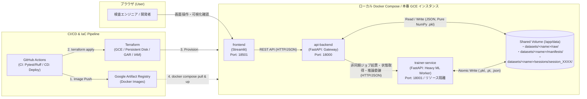

# New-metric-learning

## 弱教師あり異常検知に向けた「前処理自動分類 ＆ 50:50 Power-Balanced Multi-Proxy 深層距離学習」統合システム 要件定義・設計仕様書

> [!IMPORTANT]
> AIモデルの数学的定式化、損失関数の勾配導出、類似手法（標準 MS-Loss / 標準 Proxy-Anchor Loss / ArcFace）との理論・構造比較、および全ハイパーパラメーターの詳細解説については、専用技術ドキュメント **[Model_Explanation.md](file:///Users/tmcqdtj1089/Desktop/New-metric-learning/Model_Explanation.md)** を参照してください。

---

## 1. 統合システム全体像・目的・処理フロー

本システムは、製造業における外観検査の「ラベルなし・極端不均衡（例：良品:不良＝100:2）の初期データ収集段階」から「データリークのない 6:2:2（Train : Val : Test）分割による本番異常検知モデルの学習・空間評価・セッション管理・デプロイ」までを一貫してカバーする、前処理・本番学習一体型のAI開発基盤である。

### 1.1. 目標（Goals）と非目標（Non-Goals）

* **目標（Goals）**:
  1. **良品クラス固定保持 ＋ 異常クラス限定サブクラスタリングと最小工数アノテーション**: 良品サブフォルダ（`normal` / `nomal` 等）を `Cluster 0` として100%固定保護し、異常サブフォルダ（`anomaly`）のみを良品基準残差標準化＋PCA＋シルエット自動選定K-meansで複数の不良モード（`anomaly_cluster_1 .. k*`）へ自動細分化する。さらにUI上から個別画像のラベル直接変更（良品 $\leftrightarrow$ 不良変更・クラス名変更）を可能にする。
  2. **データリークを完全排除した 6:2:2（Train 60% : Val 20% : Test 20%）層化分割と Val 駆動型エポック制御**:
     * **Train（60%）**: モデルの重み更新・プロキシ更新・特徴量標準化統計量（`feat_mean`, `feat_std`）キャリブレーション・初期プロキシ K-Means 初期化・Effective-Number クラス重み $W_c$ 算出・境界合成バンク生成にのみ使用。
     * **Val（20%）**: 各エポック終了時に評価し、次エポックの損失関数の方向性（実効求心力比率 `effective_normal_ratio` $r_{\text{eff}}(t+1)$ およびカリキュラム反発強度 $\gamma(t)$・マージン $m(t)$・Top-K抽出値 $K(t)$）の制御ならびに `best_model.pt` 選定にフィードバック。
     * **Test（20%）**: 学習・スケジューリングから完全隔離された最終ブラインド評価用ホールドアウトデータ。
  3. **128次元単位超球面（$\mathbb{S}^{127}$）上での 50:50 Power-Balanced Multi-Proxy Anchor Loss 学習**:
     * 従来のペアベース手法（標準 MS-Loss）や対称マルチクラス手法（標準 Proxy-Anchor / ArcFace）で発生していた「不良モード同士の不要な斥力による勾配分散」と「良品クラスタの分散肥大化」を解決するため、**①良品の求心力（基準50%: $\lambda_{\text{norm}}=1.0$）** と **②不良の斥力（基準50%: $\lambda_{\text{anom}}=1.0$）** を `[0.0, 1.0]` 対称コサインスケールで完全均衡させた [`CustomizedMultiProxyAnchorLoss`](file:///Users/tmcqdtj1089/Desktop/New-metric-learning/trainer/app/core/proxy_anchor_loss.py#L14-L387) を主力損失として採用（比較検証用に [`AsymmetricMultiSimilarityLoss`](file:///Users/tmcqdtj1089/Desktop/New-metric-learning/trainer/app/core/ms_loss.py#L12-L240) も選択可能）。
  4. **NAB-Sampler（50:50非対称バッチ供給）と Phase 3 境界ハードサンプル合成**:
     * 毎ミニバッチを「良品50% : 不良50%（全不良モード均等）」で構成し、不良データの早期枯渇をインメモリ層化復元抽出＋確率的摂動で回避する。さらに **Mask-Free Residual-Saliency Defect Transfer（残差サリエンシー欠陥転写）** と **片方向 Anomalous Mixup** により、良品境界すれすれの擬似微細欠陥（相対重み $0.25\times$）を生成して識別境界を強化する。
  5. **マルチデータセット管理・学習セッション履歴（`session_XXXX`）・ツールチップ＆画像ポップアップ付き多軸空間評価**:
     * 複数データセットの独立保存・切り替え、過去の学習セッション（`session_0001`, `session_0002`, ...）のワンクリック呼び出し、**3D UMAP 立体散布図（学習済みプロキシ座標付き）**・**128次元生ベクトル活性化ヒートマップ**・混同行列における画像プレビューポップアップと指標解説ツールチップを提供する。
* **非目標（Non-Goals）**:
  * ピクセル単位の異常セグメンテーション（画像単位の異常検知・不良モード分類を対象とする）。
  * 製造ラインPLCとのミリ秒単位のハードリアルタイム直接制御（バッチ学習・対話型評価・REST API推論を対象とする）。

### 1.2. 全体処理フロー

```text
【フェーズ1：前処理自動分類・アノテーション・6:2:2 層化分割（Page 1）】
  [Step 1] 特徴量抽出 (timm バックボーン GAP/GeM/Avg_Max + 678次元 マルチスケール空間グリッド表面統計量)
    ↓
  [Step 2] 良品固定保持 (Cluster 0) ＋ 異常クラス限定 良品基準残差標準化・PCA・シルエット自動選定 K-means
           （※単一未整理フォルダ投入時のみ2段階密度分離 Stage 1 / Stage 2 フォールバック）
    ↓
  [Step 3] UI確認・個別ラベル直接修正 ＋ クラス別層化 6:2:2 (Train 60% / Val 20% / Test 20%) 分割確定
           (-> annotations.json 保存)
    ↓
【フェーズ2：本番異常検知モデル学習（弱教師あり動的Metric-Learning）（Page 2）】
  [Step 4] Train (60%) のみによる Z-Score キャリブレーション ＋ NAB-Sampler (良品50% : 不良50%)
           ＋ Phase 3 境界ハードサンプル合成 (Defect Transfer + 片方向 Anomalous Mixup)
           ＋ 128次元超球面 50:50 Power-Balanced Multi-Proxy Anchor Loss / 非対称 MS-Loss 学習
    ↓
  [Step 5] Val (20%) データによるエポック評価 -> カリキュラム・スケジューラーへフィードバックし
           次エポックの求心力比率 r_eff(t+1) と (γ(t), m(t), K(t)) を動的更新 ＋ XBM 境界良品反発
    ↓
  [Step 6] セッション別空間永続保存 (session_XXXX / 2階層 Pure NumPy .pkl) ＆ Test (20%) 多軸評価（Page 3）
           （Test/Val/Train/All 切替 ＋ Accuracy/Recall/Precision/F1 ＋ 3D UMAP ＋ 128D ヒートマップ ＋ 画像カルーセル）
```

---

## 2. 【フェーズ1】画像分類前処理・マルチデータセット管理・6:2:2 分割仕様

### 2.1. マルチデータセット管理とサブフォルダマージアップロード
* **データセットの独立保存と切り替え**: `data/datasets/<dataset_name>/` 配下に各データセットの `raw/`, `manifests/`, `artifacts/`, `sessions/` を独立管理し、UIから即座にアクティブデータセットを切り替え・新規登録・削除できる。
* **安全なサブフォルダ単位マージアップロード**: `normal`（または `nomal`, `ok`, `good`）と `anomaly`（または不良種別名）のサブフォルダを順番にアップロードしても既存フォルダが消えないよう、`clear_before_upload` のデフォルトを `False`（サブフォルダ単位のマージ保存）とし、1リクエストあたり最大40ファイル・20MB単位のチャンク分割送信でタイムアウトを防止する。

### 2.2. 既製モデル特徴量抽出 ＋ 678次元マルチスケール表面統計量（Step 1）
* **特徴量抽出 ([`MetricProjectionModel`](file:///Users/tmcqdtj1089/Desktop/New-metric-learning/trainer/app/core/feature_extractor.py#L169-L320) & [`extract_handcrafted_surface_statistics`](file:///Users/tmcqdtj1089/Desktop/New-metric-learning/trainer/app/core/feature_extractor.py#L101-L166))**:
  * `timm` バックボーン（`efficientnet_b3`, `vit_base_patch16_224`, `resnet18`, `lightweight_cnn`）による深層特徴マップ抽出（プーリングは `gem` [$p=3.0$] / `avg_max` / `gap` から選択）に加え、ImageNet 事前学習特徴だけでは捉えにくい微細な輝度ムラ・局所コントラスト・エッジ勾配を補完するため、入力画像から **678次元のマルチスケール表面統計量ベクトル**（全体RGB平均[3]・標準偏差[3]、8×8パッチの95%/5%分位点[6]、4×4最大水平・垂直エッジ勾配[6]、8×8平均グリッド[192]、4×4最大/最小グリッド[96]、6×6局所標準偏差グリッド[108]、6×6水平・垂直エッジ勾配グリッド[216]、4×4色差グリッド[48]：計 $18 + 288 + 108 + 216 + 48 = 678$ 次元）を抽出し、それぞれ L2 正規化して連結する。

### 2.3. 良品クラスの固定保持 ＆ 異常クラスのみの自動細分化クラスタリング（Step 2, 3）
* **良品固定 ＋ 異常クラス限定サブクラスタリング ([`run_two_stage_clustering`](file:///Users/tmcqdtj1089/Desktop/New-metric-learning/trainer/app/core/two_stage_cluster.py#L97-L299))**:
  1. **良品クラスの固定保持（`Cluster 0`）**: 良品サブフォルダ内の画像は一切クラスタリングせず、全件単一の「良品クラス（`Cluster 0`, `label_id = 0`）」として固定保持する。
  2. **異常クラスのみの残差標準化＋PCA＋シルエット自動選定K-means（`Cluster 1 .. k*`）**: 異常サブフォルダ内の画像群のみを対象とし、良品基準分布（平均 $\mu_{\text{norm}}$・標準偏差 $\sigma_{\text{norm}}$、ゼロ分散保護 $\hat{\sigma}_{\text{norm}} = \text{where}(\sigma_{\text{norm}} > 10^{-5}, \sigma_{\text{norm}}, 1.0)$）で標準化・L2正規化して欠陥残差成分を抽出した上で、PCA（上限64次元・累積寄与率95%）およびコサイン距離シルエットスコア最大化 K-means を実行し、単一の `anomaly` フォルダを複数の不良モード（`anomaly_cluster_1 .. k*`）へ自動分割する。
* **個別画像のラベル直接変更エディタ**: クラスタリング後またはサブフォルダ確定後でも、Page 1 の「個別画像のラベル直接変更・修正エディタ」（`POST /api/v1/annotations/direct-update`）から任意の画像のクラス名や良品/不良フラグ（`is_defect`）を1枚単位で書き換え可能。
* **6:2:2（Train 60% : Val 20% : Test 20%）クラス別層化分割 ([`_build_and_save_annotations_manifest`](file:///Users/tmcqdtj1089/Desktop/New-metric-learning/backend/app/routers/datasets.py#L144-L243))**:
  * 確定した各クラス内でシード固定シャッフルを行い、以下の規則で `train` / `val` / `test` を割り当てる：
    * $n_{\text{cls}} \ge 3$: $n_{\text{val}} = \max(1, \text{round}(0.20 n_{\text{cls}}))$, $n_{\text{test}} = \max(1, \text{round}(0.20 n_{\text{cls}}))$（ただし $n_{\text{val}} + n_{\text{test}} \ge n_{\text{cls}}$ となる $n_{\text{cls}} \in \{3, 4\}$ では $n_{\text{val}} = 1, n_{\text{test}} = 1$ に補正し3分割すべてに最低1枚を保証）、$n_{\text{train}} = n_{\text{cls}} - n_{\text{val}} - n_{\text{test}}$
    * $n_{\text{cls}} = 2$: `train` = 1枚, `test` = 1枚（`val` = 0枚）
    * $n_{\text{cls}} = 1$: `train` = 1枚

---

## 3. 【フェーズ2】AIモデルの学習方法・損失関数・類似手法比較・ハイパーパラメーター解説

### 3.1. ネットワーク構造と学習データ（Train 60%）基準 Z-Score キャリブレーション
* **ネットワーク構造 ([`MetricProjectionModel`](file:///Users/tmcqdtj1089/Desktop/New-metric-learning/trainer/app/core/feature_extractor.py#L169-L320))**:
  * `timm` バックボーン（デフォルト `freeze_backbone=True`、または `unfreeze_last_block=True` で最終ステージのみ微調整）$\rightarrow$ Pooling（`GeM(p=3.0)` / `avg_max` / `gap`）＋ 678次元表面統計量結合 $\rightarrow$ **学習データ（`train` 60%）のみに基づく Z-Score 標準化バッファ**（[`calibrate_feature_stats`](file:///Users/tmcqdtj1089/Desktop/New-metric-learning/trainer/app/core/feature_extractor.py#L270-L283)：`feat_mean`, `feat_std` で標準化後に `[-10, 10]` クリップ＆L2正規化）$\rightarrow$ MLP Projection Head（`Linear(D_gap, 384) -> BatchNorm1d(384) -> GELU -> Dropout(0.1) -> Linear(384, 128) -> L2Normalize`）$\rightarrow$ 単位超球面 $\mathbb{S}^{127}$ 上の128次元射影ベクトル $z \in \mathbb{R}^{128}$（$\|z\|_2 = 1$）。

### 3.2. 主力損失関数：50:50 Power-Balanced Multi-Proxy Anchor Loss (`CustomizedMultiProxyAnchorLoss`)

実装コード：[`trainer/app/core/proxy_anchor_loss.py`](file:///Users/tmcqdtj1089/Desktop/New-metric-learning/trainer/app/core/proxy_anchor_loss.py#L14-L387)

「サンプル vs サンプル」の総当たり計算を廃止し、単位超球面 $\mathbb{S}^{127}$ 上に学習可能なアンカーとして **$M$ 個の良品サブセンタープロキシ** $\hat{p}_{\text{norm}}^{(1)}, \dots, \hat{p}_{\text{norm}}^{(M)} \in \mathbb{S}^{127}$（`num_normal_proxies`）と **$C$ 個の不良モードプロキシ** $\hat{p}_{\text{def}}^{(1)}, \dots, \hat{p}_{\text{def}}^{(C)} \in \mathbb{S}^{127}$ を配置する。任意のサンプル $x$ の良品プロキシ群との最大コサイン類似度を $S(x, p_{\text{norm}}) = \max_{m \in \{1,\dots,M\}} \langle z(x), \hat{p}_{\text{norm}}^{(m)} \rangle \in [-1, 1]$ とするとき、パワーバランス比率 $r_{\text{norm}} \in [0.05, 0.95]$（`normal_loss_ratio`、デフォルト `0.50`）により重み係数を
$$\lambda_{\text{norm}} = 2.0 \cdot r_{\text{norm}}, \qquad \lambda_{\text{anom}} = 2.0 \cdot (1.0 - r_{\text{norm}})$$
と定め、全体の損失関数 $L_{\text{total}}$ を次式で定義する（$r_{\text{norm}} = 0.50$ のとき $\lambda_{\text{norm}} = 1.0, \lambda_{\text{anom}} = 1.0$ の **50 : 50 対称スケール**）：

$$L_{\text{total}} = \underbrace{\lambda_{\text{norm}} \cdot L_{\text{centripetal}}}_{\text{① 良品の求心力（基準 50\%: }\lambda_{\text{norm}}=1.0\text{）}} + \underbrace{\lambda_{\text{anom}} \cdot L_{\text{repel}}}_{\text{② 不良の斥力（基準 50\%: }\lambda_{\text{anom}}=1.0\text{）}} + \underbrace{L_{\text{aux}}}_{\text{③ 補助正則化項}}$$

1. **① 良品の求心力項（`loss_centripetal`：不感帯のない線形コサイン凝集）**:
   $$L_{\text{primary\_centripetal}} = \frac{1}{|\mathcal{B}_{\text{norm}}|} \sum_{x \in \mathcal{B}_{\text{norm}}} \Big( 1.0 - S(x, p_{\text{norm}}) \Big)$$
   $$L_{\text{centripetal}} = \begin{cases} L_{\text{primary\_centripetal}} & (M = 1) \\ 0.90 \cdot L_{\text{primary\_centripetal}} + 0.10 \cdot \frac{1}{M} \sum_{m=1}^{M} \left( 1.0 - \max_{x \in \mathcal{B}_{\text{norm}}} \langle z(x), \hat{p}_{\text{norm}}^{(m)} \rangle \right) & (M > 1) \end{cases}$$
   * $\frac{\partial (1 - S)}{\partial S} = -1.0$ により、類似度 $S$ が高くなっても減衰しない一定の求心勾配が全良品サンプルに均等に働き続け、かつ良品には不良プロキシからの遠心力を一切作用させないため、良品クラスタ内分散 $\sigma^2_{\text{norm}}$ が単調に収縮する。

2. **② 不良の斥力項（`loss_repel`：アンカー固定 `p_norm.detach()` と平均 $1.0$ 正規化2段ヒンジ斥力）**:
   * **良品プロキシのドリフト防止**: 不良斥力計算時は `p_norm_anchor = p_norm.detach()` により良品プロキシ側の勾配を遮断し、反作用で良品中心が引きずり出されるのを防ぐ：
     $$S_{\text{detach}}(x, p_{\text{norm}}) = \max_{m \in \{1, \dots, M\}} \langle z(x), \text{stop\_grad}(\hat{p}_{\text{norm}}^{(m)}) \rangle$$
   * **平均 $1.0$ 正規化重み $\tilde{w}(x_i)$**: 実不良集合 $\mathcal{B}_{\text{def}}$ には Effective-Number クラス不均衡重み $W_{y_i}$ と、良品プロキシに最も近い上位 $K_{\text{eff}}$ 件へのブースト係数 $\lambda_{\text{hard}}$（`hard_anomaly_boost`、デフォルト `3.0`）を掛け、Phase 3 合成境界サンプル集合 $\mathcal{B}_{\text{synth}}$ には相対重み $0.25$ を割り当てた上で、バッチ内平均が常に $1.0$ になるよう正規化する：
     $$\tilde{w}(x_i) = \frac{w_{\text{raw}}(x_i)}{\frac{1}{N_{\text{neg}}} \sum_{j=1}^{N_{\text{neg}}} \text{stop\_grad}(w_{\text{raw}}(x_j)) + 10^{-8}} \qquad \left(\frac{1}{N_{\text{neg}}} \sum_{i=1}^{N_{\text{neg}}} \tilde{w}(x_i) = 1.0\right)$$
   * **2段コサインマージン・ヒンジ斥力と XBM 境界反発ブレンド**: 目標マージン $\delta$（`repel_delta`、デフォルト `0.0`＝直交90度）と深部マージン $\delta_{\text{deep}} = \min(\delta - 0.25, -0.25)$ を組み合わせ、さらに XBM 内の境界良品上位 $K_{\text{xbm}}$ 件とのヒンジ損失 $L_{\text{xbm\_hinge}}$ を $15\%$ ブレンドする（XBM 空時は $L_{\text{repel}} = L_{\text{repel\_batch}}$）：
     $$\ell_{\text{repel}}(x_i) = 0.85 \cdot \max\Big(0, \; S_{\text{detach}}(x_i, p_{\text{norm}}) - \delta\Big) + 0.15 \cdot \max\Big(0, \; S_{\text{detach}}(x_i, p_{\text{norm}}) - \delta_{\text{deep}}\Big)$$
     $$L_{\text{repel\_batch}} = \frac{1}{N_{\text{neg}}} \sum_{i=1}^{N_{\text{neg}}} \tilde{w}(x_i) \cdot \ell_{\text{repel}}(x_i), \qquad L_{\text{repel}} = 0.85 \cdot L_{\text{repel\_batch}} + 0.15 \cdot L_{\text{xbm\_hinge}}$$
   * **最重要設計上の特徴**: 斥力は「不良サンプルと良品プロキシ（および XBM 境界良品）」の間にのみ働き、**不良モードAと不良モードBのサンプル同士には一切の斥力（Negative Push）を発生させない**。

3. **③ 補助正則化項（`loss_aux`：不良モード別凝集・負半球維持・プロキシ直交化）**:
   $$L_{\text{aux}} = 0.10 \cdot L_{\text{def\_sub}} + 0.10 \cdot L_{\text{def\_hemisphere}} + w_{\text{ortho}} \cdot L_{\text{ortho}}$$
   * 実不良サンプルを対応する不良モードプロキシ $\hat{p}_{\text{def}}^{(c)}$ へ緩やかに引き寄せる $L_{\text{def\_sub}}$、不良プロキシを負の半球（$\le -0.20$）に保つ $L_{\text{def\_hemisphere}}$、および異なる不良プロキシ同士の類似度を `0.20` 以下・良品サブプロキシ同士を `0.85` 以下に保つ2乗ヒンジ直交正則化 $L_{\text{ortho}}$ で構成される。

4. **Val（20%）評価フィードバックによる次エポック Loss 方向性自動制御 ([`CurriculumPenaltyScheduler.step`](file:///Users/tmcqdtj1089/Desktop/New-metric-learning/trainer/app/core/scheduler.py#L61-L112))**:
   * 各エポック終了時に `val` 分割で評価した $\text{Recall}_{\text{val}}, \text{Precision}_{\text{val}}, d_{\min}^{\text{boundary}}, \mathcal{L}_{\text{cent}}^{\text{val}}, \mathcal{L}_{\text{repel}}^{\text{val}}$ から、①カリキュラム進捗度 $p(t) \in [0, 1]$ による $\gamma(t), m(t), K(t)$ の線形更新と、②次エポックの実効求心力比率 $r_{\text{eff}}(t+1) = \text{clip}(r_{\text{base}} + \text{clip}(0.25(\mathcal{L}_{\text{cent}}^{\text{val}} - \mathcal{L}_{\text{repel}}^{\text{val}}) + 0.10(\text{Recall}_{\text{val}} - \text{Precision}_{\text{val}}), -0.15, +0.15), 0.10, 0.90)$ の動的補正を行う。

### 3.3. 比較検証用損失関数：非対称マルチクラス MS-Loss ＋ XBM 双方向 Top-K 境界反発
実装コード：[`trainer/app/core/ms_loss.py`](file:///Users/tmcqdtj1089/Desktop/New-metric-learning/trainer/app/core/ms_loss.py#L12-L240)（クラス名: `AsymmetricMultiSimilarityLoss`）

`loss_type = "ms_loss"` 選択時には、不良アンカーに対して同一クラス内の上位 `local_pos_k = 3` 近傍のみを正例マイニング（$\mathcal{P}_i^*$）し、良品 vs 不良の Primary Negative（$\lambda_{\text{primary}} = -0.15$, 重み $w_{\text{defect}}$）と異種不良間の Auxiliary Negative（$\lambda_{\text{aux}} = +0.15$, 重み $w_{\text{aux}}$）を非対称に分離した MS-Loss に加え、バッチ内良品プロトタイプ整列項 $L_{\text{proto}}$ と **Cross-Batch Memory Bank ([`memory_bank.py`](file:///Users/tmcqdtj1089/Desktop/New-metric-learning/trainer/app/core/memory_bank.py))** による3方向双方向境界反発損失 $\gamma(t) L_{\text{repel}}^{\text{XBM}}$ を計算する。

---

### 3.4. 類似手法（標準 MS-Loss / 標準 Proxy-Anchor Loss / ArcFace）との比較と違い

本モデルで開発した `CustomizedMultiProxyAnchorLoss` と、代表的な深層距離学習手法3種との構造的・数理的違いを以下に示す（詳細な数式・勾配導出は **[Model_Explanation.md 第6章](file:///Users/tmcqdtj1089/Desktop/New-metric-learning/Model_Explanation.md#6-類似手法ms-loss--proxy-anchor-loss--arcfaceとの徹底比較と違い)** を参照）。

| 比較観点 | 1. 標準 MS-Loss<br/>(Wang et al., CVPR 2019) | 2. 標準 Proxy-Anchor Loss<br/>(Kim et al., CVPR 2020) | 3. ArcFace<br/>(Deng et al., CVPR 2019) | 4. 本システム開発手法<br/>(`CustomizedMultiProxyAnchorLoss`) |
| :--- | :--- | :--- | :--- | :--- |
| **基本パラダイム** | Sample-to-Sample（ペアベース類似度行列 $S_{ij}$） | Sample-to-Proxy（対称 LogSumExp / Softplus） | Classification Logit（角度マージン $m$ 付き Softmax CE） | **Asymmetric Sample-to-Multi-Proxy（良品線形求心力 ＋ `p_norm.detach()` 固定アンカー不良ヒンジ斥力の 50:50 結合）** |
| **不良A vs 不良B の扱い** | **全異クラス間で同等に強い斥力が発生**し、「良品 vs 微細不良」の勾配が相殺・分散する | 各不良プロキシが他の全不良サンプルも負例として押し返すため、**不良同士の不要な斥力が発生** | Softmax 分母で全クラスが競合し、**不良クラス同士も互いに押し合う** | **不良サンプル同士の斥力を完全ゼロ化**。メイン斥力 $L_{\text{repel}}$ は「全不良 vs 良品プロキシ」に100%集中 |
| **良品クラスタの収縮力（分散抑制）** | 相対マイニング閾値 $\epsilon$ や $\lambda_{\text{pos}}$ を超えるとペアが破棄され収縮が止まる | LogSumExp の指数重みにより最も遠い外れ値良品1枚に勾配の99%が集中し、さらに不良プロキシからの遠心力で良品が散乱する | 他クラスとの識別境界さえ超えればそれ以上中心へ1点凝集する力は弱まる | **全域一定勾配（$-1.0$）の線形コサイン距離 $1 - S(x, p_{\text{norm}})$** により全良品が単調収縮し、良品への遠心力もゼロ |
| **プロキシ（良品中心）のドリフト耐性 & パワーバランス制御** | プロキシなし（バッチ内のペア数に依存し不均衡時に崩壊） | 不良からの反発勾配が良品プロキシに直接流入してドリフトし、求心力と斥力を独立制御不可 | 全クラス共通のスケール $s$ と角度マージン $m$ のみで非対称制御不可 | **`p_norm.detach()` で良品プロキシのドリフトを完全遮断** し、`[0, 1]` 対称スケール上で `normal_loss_ratio` ($r_{\text{norm}}$, デフォルト `0.50` = 50:50) を連続可変 |
| **極少数不良（1枚のみのモード）耐性** | バッチ内に同クラスが1枚だと **Positive Pair $\mathcal{P}_i = \emptyset$ となり学習シグナルが完全消失** | 常駐プロキシによりバッチ内1枚でも計算可能 | 1〜2枚の不良サンプルに向かって重みベクトル $W_c$ が過学習しやすい | 常駐プロキシ ＋ `NAB-Sampler` 層化復元抽出 ＋ Effective-Number $W_c$ により **1枚の不良モードでも安定学習** |
| **未知の不良モード（Open-Set 異常）への汎化** | 距離閾値判定が可能だが学習時のペア構成に依存 | 未知不良が既存不良プロキシと一致せず良品側に留まるリスク | **閉集合（Closed-Set）ボロノイ分割** のため、未知不良が最大面積の良品クラスへ誤分類されやすい | **「良品プロキシとの類似度 $S(x, p_{\text{norm}}) < \tau_{\text{sim}}$ はすべて異常」** という全方位包囲設計により Open-Set 異常に最適 |

---

### 3.5. NAB-Sampler（不均衡データ枯渇の回避機構）と Phase 3 境界ハードサンプル合成
* **Normal-Anomaly Balanced Sampler ([`NormalAnomalyBalancedSampler`](file:///Users/tmcqdtj1089/Desktop/New-metric-learning/trainer/app/core/nab_sampler.py#L41-L190))**:
  * ミニバッチサイズ $B$（デフォルト `32`）のうち **`nab_normal_ratio`（デフォルト `0.50` ＝ 16枚）を良品スロット**、**残り `50%`（16枚）を異常スロット** として割り当てる。
  * **不良データ早期枯渇の回避メカニズム**:
    1. **良品スロットの2周巡回＋XBMハード良品優先注入**: 良品スロットの最大35%（最大5枚）に XBM が特定した境界ハード良品（`hard_normal_indices`）を優先注入し、残りを `norm_pool` の巡回ポインタ `norm_cursor` から順番に取り出す。1エポックのバッチ数を `max(min_steps, ceil(|norm_pool| / n_norm_slots) * 2)`（`min_steps` は [`train_jobs.py` L515](file:///Users/tmcqdtj1089/Desktop/New-metric-learning/trainer/app/routers/train_jobs.py#L515) で `14`）とすることで、全良品データを1エポックあたり必ず2回以上網羅する。
    2. **異常スロットのモード均等配分＋層化復元抽出**: 16枚の異常スロットを各不良サブクラス $c \in \{1, \dots, C\}$ に均等配分し、クラス内枚数がスロット数未満の希少不良モードでは自動的に `replace=True`（復元抽出）を適用する。抽出後には確率的データ拡張（水平反転・微小輝度摂動または特徴ガウシアン摂動 `randn * 0.015`）が加わるため、不良データの枯渇やポジティブペア欠損を起こすことなく多様な特徴ベクトルとしてプロキシ更新に寄与する。
* **Phase 3 境界ハードサンプル合成 ([`boundary_augmentation.py`](file:///Users/tmcqdtj1089/Desktop/New-metric-learning/trainer/app/core/boundary_augmentation.py#L32-L207))**:
  * `enable_boundary_aug = True` 時、実バッチとは別に以下の2手法で **擬似境界ハード不良（`synth_embeddings`、第2項での相対重み $0.25\times$）** を生成し、良品クラスタ外縁の識別境界を強化する：
    1. **Mask-Free Residual-Saliency Defect Transfer ([`synthesize_defect_transfer_images`](file:///Users/tmcqdtj1089/Desktop/New-metric-learning/trainer/app/core/boundary_augmentation.py#L32-L103) / [`synthesize_boundary_gap_features`](file:///Users/tmcqdtj1089/Desktop/New-metric-learning/trainer/app/core/boundary_augmentation.py#L147-L207))**: 不良画像と最近傍参照良品の平滑化残差マップ $R(u, v) = \text{AvgPool}_{11\times 11}(|I_{\text{bad}} - I_{\text{ref}}|)$ のピーク座標を特定し、2次元ガウシアンフェザリング窓（最大不透明度 `0.82`）で別の良品背景へ欠陥局所領域のみを転写する（特徴空間では異変上位 `30%` 次元を重み `0.85` でスプライス合成）。
    2. **片方向 Anomalous Mixup ([`synthesize_anomalous_mixup_images`](file:///Users/tmcqdtj1089/Desktop/New-metric-learning/trainer/app/core/boundary_augmentation.py#L107-L143) / [`synthesize_boundary_gap_features`](file:///Users/tmcqdtj1089/Desktop/New-metric-learning/trainer/app/core/boundary_augmentation.py#L147-L207))**: 良品と不良を混合比率 $\alpha \sim \mathcal{U}(\alpha_{\min}, \alpha_{\max})$（デフォルト $\alpha \in [0.55, 0.75]$：良品55〜75%＋不良25〜45%）で補間・L2正規化し、良品プロキシ外縁すれすれのハードネガティブを生成する。

---

### 3.6. ハイパーパラメーター一覧と意味・実装デフォルト値リファレンス

[`ClusteringJobRequest` / `TrainingJobRequest`](file:///Users/tmcqdtj1089/Desktop/New-metric-learning/trainer/app/schemas/job_models.py#L21-L80)、[`backend/app/schemas/api_models.py`](file:///Users/tmcqdtj1089/Desktop/New-metric-learning/backend/app/schemas/api_models.py#L46-L135)、および Streamlit UI（[`2_training_monitor.py`](file:///Users/tmcqdtj1089/Desktop/New-metric-learning/frontend/app/pages/2_training_monitor.py#L298-L445)）に実装されている全ハイパーパラメーターの定義・デフォルト値・意味は以下の通りである（詳細な調整指針は **[Model_Explanation.md 第8章](file:///Users/tmcqdtj1089/Desktop/New-metric-learning/Model_Explanation.md#8-全ハイパーパラメータ完全リファレンスコード対応意味調整指針)** を参照）。

#### (A) フェーズ1：前処理クラスタリング ＆ 6:2:2 データ分割パラメーター

| パラメーター名 (JSON / Python) | 型 | デフォルト値 | 設定可能範囲 (UI / API) | 意味・学習への影響 |
| :--- | :--- | :---: | :---: | :--- |
| `dataset_name` | `str \| None` | `None` (現在選択中) | 登録済みデータセット名 | 対象データセット名（省略時はアクティブデータセットを使用）。 |
| `backbone_name` | `str` | `"efficientnet_b3"` | `"efficientnet_b3"`, `"vit_base_patch16_224"`, `"resnet18"`, `"lightweight_cnn"` | 特徴抽出バックボーンモデル。 |
| `pooling_type` | `str` | `"gem"` | `"gem"`, `"avg_max"`, `"gap"` | 空間プーリング方式。`"gem"`（Generalized Mean, $p=3.0$）は微小傷の局所活性化の希釈を防ぐ。 |
| `pretrained` | `bool` | `True` | `True` / `False` | `timm` 事前学習重みの使用フラグ。 |
| `normal_class_name` | `str` | `"normal"` (自動検出) | 任意のサブフォルダ名 | `Cluster 0`（良品: `label_id=0`）としてクラスタリングせず100%固定保持する良品サブフォルダ名。 |
| `max_k` | `int` | `6` (UI) / `8` (API) | `2〜15` (UI) / `2〜20` (API) | 異常サブクラスタリング時の K-means 最大探索クラスタ数 $K_{\max}$。 |
| `max_pca_dim` | `int` | `64` | `2` 〜 `256` (API) | 異常サブクラスタリング前段の PCA 最大次元数。 |
| `pca_variance` | `float` | `0.95` | `0.50` 〜 `0.999` (API) | PCA の累積寄与率閾値（95%）。 |
| `core_quantile` | `float` | `0.85` | `0.50〜0.95` (UI) / `0.50〜0.97` (API) | 単一未整理フォルダ投入時（`density_fallback`）に仮の良品コアとみなす密度上位割合。 |
| `k_nn` | `int` | `15` | `2` 〜 `100` (API) | `density_fallback` 時の局所コサイン密度計算の近傍数。 |
| `train_ratio` / `val_ratio` / `test_ratio` | `float` | `0.60` / `0.20` / `0.20` | `0.20〜0.80` / `0.05〜0.45` / `0.05〜0.45` | クラス別層化分割比率（**6 : 2 : 2**）。 |

#### (B) フェーズ2：50:50 Multi-Proxy Loss・NAB-Sampler・Phase 3 境界合成・XBM カリキュラムパラメーター

| パラメーター名 (`TrainingJobRequest`) | 型 | デフォルト値 | 設定可能範囲 (UI / API) | 意味・学習への影響 |
| :--- | :--- | :---: | :---: | :--- |
| `loss_type` | `str` | `"multi_proxy_anchor"` | `"multi_proxy_anchor"`, `"ms_loss"` | `"multi_proxy_anchor"`: 50:50 Power-Balanced Multi-Proxy Loss（推奨）、`"ms_loss"`: 非対称マルチクラス MS-Loss。 |
| `normal_loss_ratio` ($r_{\text{norm}}$) | `float` | **`0.50`** | `0.10〜0.90` (UI)<br/>`0.05〜0.95` (API) | **①良品求心力 $\lambda_{\text{norm}} = 2 r_{\text{norm}}$ と ②不良斥力 $\lambda_{\text{anom}} = 2(1 - r_{\text{norm}})$ のパワーバランス比率**。`0.50` で 1.0 : 1.0（50:50）。良品分散をさらに絞る場合は `0.60〜0.70` へ上げる。 |
| `repel_delta` ($\delta$) | `float` | **`0.00`** | `-0.50〜+0.50` (UI)<br/>`-0.80〜+0.80` (API) | 不良斥力項 $\max(0, S(x, p_{\text{norm}}) - \delta)$ の目標境界コサイン類似度。`0.00` は直交（90°）まで押し出す設定。 |
| `num_normal_proxies` ($M$) | `int` | **`1`** (UI) / `4` (API) | `1` 〜 `12` | 良品クラスタを表現するサブセンタープロキシ数。単一品種では `1`（単一中心への凝集）、多品種・複数照明条件では `2〜4` を推奨。 |
| `hard_anomaly_boost` ($\lambda_{\text{hard}}$) | `float` | **`3.0`** | `1.0` 〜 `20.0` | 良品プロキシに最も近い上位 $K_{\text{eff}}$ 件の危険実不良に掛ける相対優先度倍率（平均 $1.0$ に自動正規化されるため 50:50 バランスを崩さない）。 |
| `class_balance_beta` ($\beta$) | `float` | **`0.99`** | `0.80〜0.9999` (UI)<br/>`0.50〜0.9999` (API) | Effective-Number クラス不均衡重み $W_c \propto (1-\beta)/(1-\beta^{n_c})$ の減衰率。 |
| `w_defect` | `float` | `1.0` (`2.5` in `ms_loss.py`) | `0.1〜10.0` (UI) / `>=0.1` (API) | `ms_loss` 選択時の Primary Negative 重み倍率および不良アンカー重み。 |
| `w_aux` ($w_{\text{ortho}}$) | `float` | `0.20` (`0.5` in `ms_loss.py`) | `0.0〜2.0` (UI) / `>=0.0` (API) | `multi_proxy_anchor` ではプロキシ直交正則化項 $L_{\text{ortho}}$ の重み（[`train_jobs.py` L389](file:///Users/tmcqdtj1089/Desktop/New-metric-learning/trainer/app/routers/train_jobs.py#L389) で下限 `0.1` 保護）、`ms_loss` では異種不良間重み。 |
| `freeze_backbone` / `unfreeze_last_block` | `bool` | `True` / `False` | `True` / `False` | バックボーン全体の凍結フラグ（デフォルト `True` で高速特徴キャッシュ学習）と、最終ブロックのみ Unfreeze するフラグ。 |
| `epochs` | `int` | `20` (UI) / `10` (API) | `2〜100` (UI) / `1〜200` (API) | 総学習エポック数。 |
| `batch_size` ($B$) | `int` | `32` | `8〜128` (UI) / `4〜256` (API) | ミニバッチサイズ。 |
| `learning_rate` | `float` | `0.002` (`2e-3`) | `1e-5〜5e-2` (UI)<br/>`(0.0, 1.0]` (API) | `AdamW`（`weight_decay=1e-4`）の Projection Head 学習率（プロキシパラメータは `0.5 * lr`、勾配クリップ `max_norm=5.0`）。 |
| `nab_normal_ratio` | `float` | **`0.50`** | `0.30〜0.70` (UI)<br/>`0.25〜0.75` (API) | `NormalAnomalyBalancedSampler` のミニバッチ内良品スロット比率（`0.50` ＝ 良品50% : 不良50%）。 |
| `enable_boundary_aug` | `bool` | **`True`** | `True` / `False` | Phase 3 境界ハードサンプル合成（Defect Transfer ＋ 片方向 Anomalous Mixup）の有効化。 |
| `mixup_alpha_min` / `mixup_alpha_max` | `float` | **`0.55`** / **`0.75`** | `0.30〜0.85` / `0.35〜0.90` (UI)<br/>`0.30〜0.90` / `0.35〜0.95` (API) | 片方向 Anomalous Mixup $h_{\text{mix}} = \alpha h_{\text{good}} + (1-\alpha) h_{\text{bad}}$ における良品混合率 $\alpha$ の下限・上限。 |
| `top_k_mode` | `str` | `"ratio"` | `"ratio"`, `"count"` | Top-$K$ ハード不良および XBM 境界良品の抽出指定方式（`"ratio"`: 割合、`"count"`: 絶対件数）。 |
| `top_k_initial` / `top_k_final` | `float` | `0.30` / `0.15` (`ratio`)<br/>`30` / `20` (`count` UI) | `0.01〜500.0` (UI)<br/>`> 0.0` (API) | カリキュラム進捗度 $p(t)$ に連動する学習初期・後期の Top-$K$ 対象範囲（`scheduler.py` クラス初期値は `50.0 / 20.0`）。 |
| `gamma_initial` / `gamma_final` | `float` | `0.6` / `1.5` (`0.3/1.5` in `scheduler.py`) | `0.1〜5.0` / `0.1〜10.0` (UI)<br/>`>= 0.0` (API) | カリキュラム進捗度 $p(t)$ に連動する境界反発係数 $\gamma(t)$ の初期値・最終値。 |
| `tau_sim` ($\tau_{\text{sim}}$) | `float` | **`0.00`** | `-0.80〜+0.80` (UI)<br/>`-1.00〜+1.00` (API) | $S(x, p_{\text{norm}}) < \tau_{\text{sim}}$ を不良（NG）、$\ge \tau_{\text{sim}}$ を良品（OK）と判定するコサイン類似度閾値。 |
| `full_snapshot_interval` | `int` | `4` | `>= 1` (API) | 高次元 `gap_features` を含む `epoch_XXXX_full.pkl` を定期保存するエポック周期。 |
| `session_label` | `str \| None` | `None` | 任意の文字列 | 学習セッション履歴（`session_XXXX`）に付与する任意のラベル。 |

---

### 3.7. 推論・閾値判定ルール ＆ Step 6 多軸空間評価・セッション管理（Page 3）
* **テストデータ（Test 20%）を主軸としたカンニングなしの評価体系**:
  * Step 6（Space Evaluation）では、表示対象データ分割のデフォルトを **`test`（テストデータ 20%：最終ブラインド評価・カンニングなし）** とし、ラジオボタンで `val`（評価データ 20%）、`train`（学習データ 60%：クラスタ分布・分散確認用）、`all`（全データ統合）を即座に切り替え可能。また、全指標テーブルで Test / Val / Train / All の **Accuracy（正解率）・Recall（不良再現率）・Precision（不良適合率）・F1 Score・混同行列（TP/FN/TN/FP）** を横並び比較できる。
* **学習回数に応じた分散変化を直感的に追える表示順序**:
  1. **【最重要基準①】高次元空間の定量的距離マージン推移 & Accuracy / Recall / F1 推移グラフ**（Test / Val / Train 別指標比較テーブル・良品クラスタ内分散 $\sigma^2_{\text{norm}}$・フィッシャー分離比 $J(t)$ 付き）
  2. **【最重要基準②】128次元 → 3D UMAP インタラクティブ立体散布図（学習済みプロキシ座標 ★ 付き）**：エポック進行に伴う良品クラスタの凝集度（分散縮小）と不良クラスタの分離を最初に立体確認できる配置。
  3. **【最重要基準③】Plotly 128次元生ベクトル活性化ヒートマップ（次元圧縮なし）**
  4. **【詳細画像インスペクタ】混同行列セル別（TP/FN/TN/FP）＆ 3D UMAP 座標連動の矢印ページ送り付き画像ポップアップ（カルーセル）**
* **全評価グラフへの解説ツールチップ搭載**:
  * 各評価セクションのタイトル横に `ℹ️ 指標・グラフの見方（Tooltip）` ポップオーバーボタンを配置し、さらに各メトリクスカードの `?` ツールチップおよび Plotly グラフのホバーツールチップに指標の意味・数式・目標方向を明記。

---

## 4. 非機能要件・代替案検討・リスク緩和策・参考文献

### 4.1. 非機能要件・評価基準
* **拡張性**: `timm` ライブラリをベースとし、特徴量抽出バックボーンを設定ひとつで切り替え可能な疎結合設計とする。
* **評価指標**: 製造業の外観検査で最重要となる **再現率（Recall：不良見落としゼロ）** と **F1スコア** に加え、良品を誤って不良と弾く過剰検知（False Positive）を含めた総合性能を把握するため **正解率（Accuracy）** も全エポック・全分割（Train / Val / Test）で記録・可視化する。

### 4.2. 代替案の検討（Alternatives Considered）

| 設計領域 | 採用手法 | 検討・棄却した代替案 | 棄却理由・トレードオフ |
| :--- | :--- | :--- | :--- |
| **フェーズ1 クラスタリング** | 良品サブフォルダ固定保持（`Cluster 0`）＋ 異常サブフォルダ限定 残差標準化・PCA・シルエット自動選定 K-means | ①良品・異常を混合した単段階 K-means<br/>②HDBSCAN 単独適用 | ①良品と異常を混ぜると微細不良が良品クラスタへ吸収されラベル汚染が起きるため。<br/>②高次元特徴空間での密度勾配が滑らかな場合、HDBSCAN単独では大半がノイズ（`-1`）または単一クラスタに縮退しやすいため。 |
| **フェーズ2 損失関数** | 50:50 Power-Balanced Multi-Proxy Anchor Loss (`CustomizedMultiProxyAnchorLoss`) ＋ XBM 境界反発 | ①1次元2値分類（BCE / Focal Loss）<br/>②標準対称 MS-Loss / 標準 Proxy-Anchor / ArcFace<br/>③Deep SVDD 単独（求心力のみ） | ①多様な不良モードを単一軸へ押し込めると表現崩壊が起きるため。<br/>②不良モードA vs 不良モードBの不要な斥力に勾配が奪われ、肝心の「良品 vs 微細不良」の分離力が低下するため。<br/>③求心力のみを強めると不良クラスタへの遠心力が失われ、特徴空間全体が1点へ崩壊（Hypersphere Collapse）するため。 |
| **データ分割と評価** | 6:2:2（`train` 60% : `val` 20% : `test` 20%）層化分割 ＋ Val 駆動スケジューリング ＋ Test ホールドアウト評価 | 全データ（100%）での学習・評価、または Train/Val 2分割のみでの最良モデル報告 | 学習データやハイパーパラメータ調整（スケジューラ・ベストエポック選定）に使ったデータで最終評価を行うとデータリーク（カンニング）となり、未知不良に対する真の汎化性能を測定できないため。 |
| **システム構成** | `frontend` (Streamlit) + `api-backend` (FastAPI) + `trainer-service` (FastAPI ML Worker) の3コンテナ分離 | 単一モノリスコンテナ（Streamlit 内で直接 PyTorch 学習を実行） | 高負荷な学習・UMAP計算時に GIL 競合やメモリ急増が発生し、UIの応答停止や OOM Kill によるシステム全体のクラッシュを招くため。 |

### 4.3. 理論的根拠・参考文献（References）
1. **Proxy-Anchor Loss**: S. Kim et al., *"Proxy Anchor Loss for Deep Metric Learning"*, CVPR 2020.
2. **Multi-Similarity Loss (GPW Framework)**: X. Wang et al., *"Multi-Similarity Loss with General Pair Weighting for Deep Metric Learning"*, CVPR 2019.
3. **ArcFace (Additive Angular Margin)**: J. Deng et al., *"ArcFace: Additive Angular Margin Loss for Deep Face Recognition"*, CVPR 2019.
4. **Cross-Batch Memory for Embedding Learning (XBM)**: X. Wang et al., *"Cross-Batch Memory for Embedding Learning"*, CVPR 2020.
5. **Class-Balanced Loss Based on Effective Number of Samples**: Y. Cui et al., *"Class-Balanced Loss Based on Effective Number of Samples"*, CVPR 2019.

---

## 5. アプリケーション構成・システムアーキテクチャ

開発効率と本番運用時のリソース隔離を両立するため、**フロントエンド（`frontend`: Streamlit）＋ バックエンドAPI（`api-backend`: FastAPI）＋ 学習専用ワーカーAPI（`trainer-service`: FastAPI別コンテナ）** の3コンテナ構成を採用する。

### 5.1. システム全体アーキテクチャ図



### 5.2. コンポーネント責務と REST API エンドポイント契約一覧

| コンテナ名 | 技術スタック | 提供エンドポイント / 機能契約 | リソース特性 |
| :--- | :--- | :--- | :--- |
| **`frontend`** | Python 3.11 / **Streamlit** / Plotly / httpx | - サイドバー共通: マルチデータセット切替・新規作成・削除<br/>- Page 1 ([`1_clustering_annotation.py`](file:///Users/tmcqdtj1089/Desktop/New-metric-learning/frontend/app/pages/1_clustering_annotation.py)): フォルダ一括アップロード（チャンク分割送信・マージ保存）、合成データ生成、良品固定＋異常サブクラスタリング、個別画像のラベル直接変更エディタ、6:2:2（Train/Val/Test）層化分割確定<br/>- Page 2 ([`2_training_monitor.py`](file:///Users/tmcqdtj1089/Desktop/New-metric-learning/frontend/app/pages/2_training_monitor.py)): 50:50 Multi-Proxy Loss / 非対称MS-Loss パラメータ設定（求心力:斥力比率スライダー、NAB-Sampler、Phase 3 境界合成、XBM）、Val / Test リアルタイム監視（Accuracy / Recall / F1 / 最小コサイン距離）、過去セッション比較<br/>- Page 3 ([`3_space_evaluation.py`](file:///Users/tmcqdtj1089/Desktop/New-metric-learning/frontend/app/pages/3_space_evaluation.py)): セッション（`session_XXXX`）切替、Test / Val / Train / All 分割切替、閾値 $\tau_{\text{sim}}$ 動的スライダー、3D UMAP 散布図、128次元ヒートマップ、画像プレビューポップアップ、指標解説ツールチップ、単発推論テスト | 軽量（CPU / `mem_limit: 1g`） |
| **`api-backend`** | Python 3.11 / **FastAPI** / Pydantic / NumPy / httpx | - `GET /health`: ヘルスチェック<br/>- `GET /api/v1/datasets`, `GET /api/v1/datasets/catalog`, `POST /api/v1/datasets/select`, `DELETE /api/v1/datasets/{dataset_name}`, `POST /api/v1/datasets/{dataset_name}/classes/rename`, `DELETE /api/v1/datasets/{dataset_name}/classes/{class_name}`: マルチデータセット管理・クラス名変更・統計取得<br/>- `POST /api/v1/datasets/upload-folder`, `POST /api/v1/datasets/generate-synthetic`: 画像アップロード・合成データ生成<br/>- `GET /api/v1/clusters`, `GET /api/v1/annotations`, `POST /api/v1/annotations`, `POST /api/v1/annotations/from-subfolders`, `POST /api/v1/annotations/direct-update`: クラスタ結果取得・確定ラベル保存・個別画像ラベル直接変更（6:2:2 `train`/`val`/`test` 層化分割自動付与）<br/>- `POST /api/v1/jobs/clustering`, `POST /api/v1/jobs/training`, `GET /api/v1/jobs/{job_id}`: ジョブ起票・進捗プロキシ<br/>- `GET /api/v1/sessions`, `GET /api/v1/sessions/{session_id}`: 学習セッション履歴一覧・詳細取得<br/>- `GET /api/v1/evaluations`, `GET /api/v1/evaluations/{epoch}?tau_sim=0.0&split=test&session_id=...`: 指定セッション・エポック・データ分割（`test`/`val`/`train`/`all`）の `.pkl` 読込と Accuracy/Recall/Precision/F1 再計算<br/>- `POST /api/v1/inference`: 単発画像推論 | 軽量（PyTorch非依存 / `mem_limit: 1g`） |
| **`trainer-service`** | Python 3.11 / **FastAPI** / PyTorch / `timm` / scikit-learn / umap-learn | - `GET /health`: ヘルスチェック<br/>- `POST /internal/datasets/generate-synthetic`: 良品＋複数不良モード合成画像生成<br/>- `POST /internal/jobs/clustering`: Step 1〜2（良品固定 `Cluster 0` ＋ 異常残差PCA & シルエットK-means）非同期実行<br/>- `POST /internal/jobs/training`: Step 4〜6（6:2:2 分割検証、50:50 Multi-Proxy Anchor Loss / 非対称MS-Loss、NAB-Sampler、Phase 3 境界合成、Val 駆動カリキュラム＆求心力比率フィードバック、セッション別 `.pkl` / `best_model.pt` 保存）非同期実行<br/>- `GET /internal/jobs/{job_id}`: ジョブ状態・エポック履歴（Val & Test 指標含む）返却<br/>- `POST /internal/inference`: `best_model.pt` を用いた128次元埋め込み・コサイン類似度推論 | 高負荷（GPU/CPU・`mem_limit: 6g`） |

### 5.3. 共有ボリューム（`/app/data`）データスキーマ契約

1. **マルチデータセット＆セッションディレクトリ構造**:
   * `data/datasets/<dataset_name>/raw/<subfolder>/`: アップロード・生成された生画像
   * `data/datasets/<dataset_name>/manifests/clustering_result.json`: フェーズ1 クラスタリング結果
   * `data/datasets/<dataset_name>/manifests/annotations.json`: 確定ラベル＋6:2:2分割マニフェスト（`split: "train" | "val" | "test"`）
   * `data/datasets/<dataset_name>/sessions/session_XXXX/`: 学習実行ごとに自動採番されるセッションフォルダ（`session_meta.json`, `best_model.pt`, `epoch_{epoch:04d}_{light|full}.pkl`）
2. **`epoch_{epoch:04d}_{light|full}.pkl`（Pure NumPy `ndarray` / Python 標準型）**:
   * `epoch: int`, `is_full_snapshot: bool`, `image_paths: list[str]`, `labels: np.ndarray (int64[N])`, `label_names: list[str]`, `is_defect: np.ndarray (bool[N])`, `splits: list[str]` (`"train" | "val" | "test"`), `embeddings_128d: np.ndarray (float32[N, 128])`, `normal_prototype: np.ndarray (float32[128])`, `normal_proxies: np.ndarray (float32[M, 128]) | None`, `defect_proxies: np.ndarray (float32[C, 128]) | None`, `normal_proxies_umap_3d: np.ndarray (float32[M, 3]) | None`, `defect_proxies_umap_3d: np.ndarray (float32[C, 3]) | None`, `cosine_similarities: np.ndarray (float32[N])`, `umap_3d: np.ndarray (float32[N, 3])`, `d_min_centroid: float`, `d_min_boundary: float`, `test_d_min_centroid: float`, `test_d_min_boundary: float`, `normal_intra_disp: float`, `defect_intra_disp: float`, `fisher_separation_ratio: float`, `metrics_at_zero: dict`（Val 指標: `accuracy, recall, precision, f1, tp, fp, tn, fn`）, `test_metrics_at_zero: dict`（Test 指標）, `train_metrics_at_zero: dict`（Train 指標）, `all_metrics_at_zero: dict`（All 指標）

### 5.4. リポジトリ対象ファイル境界一覧（File Boundary）

```text
New-metric-learning/
├── README.md                                     # システム全体要件定義・アーキテクチャ・ハイパーパラメータ仕様書
├── Model_Explanation.md                          # AIモデル学習方法・損失関数数理・MS-Loss/Proxy-Anchor/ArcFace比較解説書
├── note.md                                       # 設計思考・数理検証・実装記録ノート
├── proxy_anchor_design_review.md                 # Multi-Proxy Anchor Loss & NAB-Sampler 理論検証レポート
├── .env.example                                  # 環境変数テンプレート
├── docker-compose.yml                            # ローカル開発用3コンテナ構成
├── docker-compose.prod.yml                       # GCE本番用オーバーライド構成
├── frontend/                                     # [Container 1: frontend (Streamlit)]
│   ├── Dockerfile
│   ├── pyproject.toml
│   └── app/
│       ├── main.py                               # Streamlit エントリポイント・マルチデータセット管理UI
│       ├── api_client.py                         # api-backend 通信クライアント（チャンクアップロード対応）
│       └── pages/
│           ├── 1_clustering_annotation.py        # フェーズ1：クラスタ確認・個別ラベル修正・6:2:2分割確定UI
│           ├── 2_training_monitor.py             # フェーズ2：50:50 Multi-Proxy / MS-Loss 学習設定＆Val/Test進捗モニタ
│           └── 3_space_evaluation.py             # Step 6：Test/Val/Train評価・3D UMAP・128Dヒートマップ・画像ポップアップ
├── backend/                                      # [Container 2: api-backend (FastAPI Gateway)]
│   ├── Dockerfile
│   ├── pyproject.toml
│   ├── app/
│   │   ├── main.py                               # FastAPI アプリケーション定義
│   │   ├── config.py                             # 環境変数・アクティブデータセット/セッション解決
│   │   ├── schemas/
│   │   │   └── api_models.py                     # 全リクエスト/レスポンス Pydantic スキーマ
│   │   └── routers/
│   │       ├── datasets.py                       # マルチデータセット・クラスタ・アノテーション・6:2:2層化分割管理
│   │       ├── jobs_proxy.py                     # trainer-service ジョブ委譲・進捗取得プロキシ
│   │       └── evaluation.py                     # セッション管理・.pkl読込・split別動的指標再計算
│   └── tests/
│       └── test_backend_api.py                   # Backend API 結合・6:2:2分割・閾値再計算テスト
├── trainer/                                      # [Container 3: trainer-service (FastAPI ML Worker)]
│   ├── Dockerfile
│   ├── pyproject.toml
│   ├── app/
│   │   ├── main.py                               # FastAPI Trainer サービス定義
│   │   ├── config.py                             # ML・デバイスパラメータ設定
│   │   ├── schemas/
│   │   │   └── job_models.py                     # 内部ジョブ・ハイパーパラメータ Pydantic スキーマ
│   │   ├── routers/
│   │   │   └── train_jobs.py                     # 非同期ジョブ実行・6:2:2学習ループ・Valフィードバック・セッション保存
│   │   └── core/
│   │       ├── synthetic_data.py                 # 製造外観検査用合成画像ジェネレータ
│   │       ├── feature_extractor.py              # timm (GAP/GeM/Avg_Max) + 678D表面統計 + Z-Score + 128D Projection Head
│   │       ├── two_stage_cluster.py              # 良品固定 Cluster 0 + 異常残差PCA & シルエット自動選定K-means
│   │       ├── proxy_anchor_loss.py              # 50:50 Power-Balanced Multi-Proxy Anchor Loss
│   │       ├── ms_loss.py                        # 非対称マルチクラスMS-Loss + XBM双方向Top-K境界反発損失
│   │       ├── nab_sampler.py                    # Normal-Anomaly Balanced Sampler (50:50 バッチ & 層化復元抽出)
│   │       ├── boundary_augmentation.py          # Phase 3: Residual-Saliency Defect Transfer & One-Sided Mixup
│   │       ├── memory_bank.py                    # Cross-Batch Memory Bank (detach格納・エポック毎明示解放)
│   │       ├── scheduler.py                      # Val 駆動カリキュラム＆求心力比率フィードバック・スケジューラー
│   │       └── evaluator.py                      # Train/Val/Test 分割別評価・3D UMAP・Pure NumPy .pkl保存
│   └── tests/
│       └── test_trainer_core.py                  # クラスタリング・Proxy-Anchor・MS-Loss・XBM・6:2:2評価単体テスト
├── infra/
│   └── terraform/                                # GCE VM、Persistent Disk、GAR、IAM Terraform 定義
└── .github/
    └── workflows/                                # CI (Ruff/Pytest/Docker) & CD (GCE Deploy) ワークフロー
```

---

## 6. 開発・デプロイ手順（ローカルDocker開発 〜 GCE本番CI/CD）

### 6.1. ローカル環境での開発手順（Docker Compose）

1. **環境変数ファイルの作成とデータディレクトリの準備**
   ```bash
   cp .env.example .env
   mkdir -p data/raw data/manifests data/artifacts data/datasets data/sessions
   ```
   ※実画像がない場合でも、起動後に Streamlit UI（Page 1）または `POST http://localhost:18000/api/v1/datasets/generate-synthetic` から合成検査画像を自動生成して全フローをテスト可能。

2. **コンテナ群のビルドと起動**
   ```bash
   docker compose up --build -d
   ```
   * **Streamlit Frontend (`frontend`)**: `http://localhost:18501`
   * **FastAPI Backend (`api-backend` Swagger UI)**: `http://localhost:18000/docs`
   * **FastAPI Trainer Worker (`trainer-service` Swagger UI)**: `http://localhost:18001/docs`

3. **リソース使用状況・ログの確認と停止**
   ```bash
   docker stats
   docker compose logs -f trainer-service
   docker compose down
   ```

### 6.2. GCP / Terraform 初期ブートストラップ手順（初回のみ）

1. **GCP APIの有効化とTerraform State用GCSバケット作成**
   ```bash
   export PROJECT_ID="your-gcp-project-id"
   export REGION="us-central1"

   gcloud config set project "${PROJECT_ID}"
   gcloud services enable \
     compute.googleapis.com \
     artifactregistry.googleapis.com \
     iam.googleapis.com \
     iamcredentials.googleapis.com

   gcloud storage buckets create "gs://${PROJECT_ID}-tfstate" --location="${REGION}"
   ```

2. **初回 Terraform 適用（GCE・永続ディスク・GAR・IAM作成）**
   ```bash
   cd infra/terraform
   terraform init -backend-config="bucket=${PROJECT_ID}-tfstate"
   terraform plan -var="project_id=${PROJECT_ID}" -var="region=${REGION}"
   terraform apply -var="project_id=${PROJECT_ID}" -var="region=${REGION}"
   ```

3. **GitHub Actions Secrets の登録**
   リポジトリの `Settings > Secrets and variables > Actions` に以下を登録する：
   * `GCP_PROJECT_ID`, `GCP_REGION`（`us-central1`）, `GCP_WORKLOAD_IDENTITY_PROVIDER`, `GCP_SERVICE_ACCOUNT`, `GCE_INSTANCE_NAME`, `GCE_ZONE`（`us-central1-a`）

### 6.3. GitHub Actions による CI/CD 自動デプロイ手順（通常運用）

1. **Pull Request 作成時（`.github/workflows/ci.yml`）**
   * `Ruff` 静的解析、`Pytest` 単体・結合テスト、および3コンテナの `docker build` 検証を自動実行する。
2. **`main` ブランチへのマージ時（`.github/workflows/cd-gce.yml`）**
   * Workload Identity で GCP へ認証し、3つの Docker イメージをビルドして Google Artifact Registry (GAR) へ Push。
   * `gcloud compute scp --tunnel-through-iap` で最新の `docker-compose.yml` と `docker-compose.prod.yml` を GCE インスタンス（`/opt/metric-learning`）へ転送し、`gcloud compute ssh --tunnel-through-iap` 経由でコンテナ群を更新再起動する：
     ```bash
     gcloud compute ssh "${GCE_INSTANCE_NAME}" --zone="${GCE_ZONE}" --tunnel-through-iap \
       --command="cd /opt/metric-learning && gcloud auth configure-docker ${GCP_REGION}-docker.pkg.dev --quiet && IMAGE_TAG=${GITHUB_SHA} docker compose -f docker-compose.yml -f docker-compose.prod.yml pull && IMAGE_TAG=${GITHUB_SHA} docker compose -f docker-compose.yml -f docker-compose.prod.yml up -d --remove-orphans && docker image prune -f"
     ```
3. **デプロイ後のヘルスチェックと IAP トンネル経由の UI アクセス**
   ```bash
   # ヘルスチェック
   gcloud compute ssh "${GCE_INSTANCE_NAME}" --zone="${GCE_ZONE}" --tunnel-through-iap \
     --command="cd /opt/metric-learning && docker compose -f docker-compose.yml -f docker-compose.prod.yml ps && curl -fsS http://localhost:18000/health && curl -fsS http://localhost:18001/health"

   # ローカルPCからGCE上のStreamlit UI (18501) へセキュアに接続
   gcloud compute ssh "${GCE_INSTANCE_NAME}" --zone="${GCE_ZONE}" --tunnel-through-iap -- -L 18501:localhost:18501 -N
   ```
