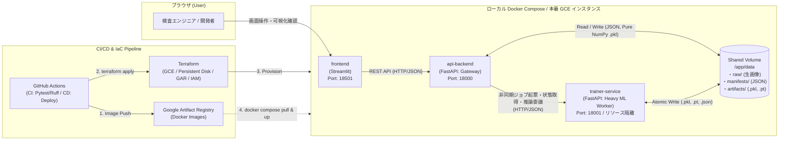

# New-metric-learning

## 弱教師あり異常検知に向けた「前処理自動分類 ＆ 動的Metric-Learning」統合システム 要件定義・設計仕様書

---

## 1. 統合システム全体像・目的・処理フロー

本システムは、製造業における外観検査の「ラベルなし・極端不均衡（例：良品:不良＝100:2）の初期データ収集段階」から「本番運用可能な異常検知モデルの学習・空間評価・デプロイ」までを一貫してカバーする、前処理・本番学習一体型のAI開発基盤である。

### 1.1. 目標（Goals）と非目標（Non-Goals）

* **目標（Goals）**:
  1. **生データ分布を歪めない初期クラスタリングと最小工数アノテーション**: 100:2の不均衡データから高密度良品コアを分離した上で低密度テール領域をクラスタリングし、人間が最小限の確認で「正常」「不良モードA（傷）」「不良モードB（汚れ）」等の疑似多クラスラベルを確定できるようにする。
  2. **128次元単位超球面上での非対称マルチクラスMS-Loss学習**: 1次元のOK/NG直線への射影による多峰性不良の表現崩壊を防ぎ、128次元超球面（$\mathbb{S}^{127}$）上で良品領域から多様な不良モードを全方位へ分離する。
  3. **Cross-Batch Memory Bank（XBM）とカリキュラム連動 Top-K 境界良品反発**: ミニバッチサイズ制約を超えて不良に肉薄する境界良品（Top-K件または上位割合）を特定し、双方向斥力と優先サンプリングで境界線を鮮明化する（OOM防止のためエポック毎にメモリバンクを明示解放）。
  4. **コサイン類似度閾値 $\tau_{\text{sim}}$ による2値判定と3軸空間評価**: 学習時デフォルト閾値 $\tau_{\text{sim}} = 0.0$（直交）を基準に検証 Recall / F1 を算出し、評価UI上でユーザーが閾値 $\tau_{\text{sim}} \in [-1, 1]$ を動的に変更しながら、高次元最小コサイン距離・128次元生ベクトルヒートマップ・3D UMAP散布図の3軸で検証できるようにする。
* **非目標（Non-Goals）**:
  * ピクセル単位の異常セグメンテーション（画像単位の異常検知・不良モード分類を対象とする）。
  * 製造ラインPLCとのミリ秒単位のハードリアルタイム直接制御（バッチ学習・対話型評価・REST API推論を対象とする）。

### 1.2. 全体処理フロー

```text
【フェーズ1：前処理自動分類（未ラベル・100:2の不均衡データ）】
  [Step 1] 特徴量抽出 (timm: EfficientNet-B3 / ViT 等による GAP / GeM 特徴量抽出)
    ↓
  [Step 2] 2段階密度分離 ＋ シルエットスコアによる最適クラスター数(k)の自動選定
           (Stage 1: 高密度良品コア抽出 / Stage 2: 低密度テール領域のPCA + K-means)
    ↓
  [Step 3] 自動クラスタリング結果のUI確認 ＋ 人間によるラベル確定（疑似多クラス化の完了 -> annotations.json）
    ↓
【フェーズ2：本番異常検知モデル学習（弱教師あり動的Metric-Learning）】
  [Step 4] 128次元超球面 非対称マルチクラスMS-Lossモデルの学習
           （※対称データ拡張 ＋ Class-Balanced Batch Sampling ＋ 非対称ペア重みによる不均衡対策）
    ↓
  [Step 5] 再現率(Recall)/境界最小コサイン距離連動型ペナルティ・スケジューラーと
           Cross-Batch Memory Bank による「境界線上の良品(Top-K: 件数/割合可変)」の動的押し戻し
    ↓
  [Step 6] 空間永続保存（2階層 .pkl）＆ 3軸多角評価
           （高次元最小コサイン距離ログ ＋ Plotly 128次元生ベクトルヒートマップ ＋ 3D UMAP ＋ 閾値τ_simスライダー）
```

---

## 2. 【フェーズ1】画像分類前処理（不良クラス自動分類）機能要件

### 2.1. 既製モデル特徴量抽出 ＆ 次元削減（Step 1）
* **特徴量抽出**: 画像ピクセルを直接クラスタリングすることによる背景・照明ノイズ支配を防ぐため、ImageNet等で事前学習済みの `timm` バックボーン（`efficientnet_b3` または `vit_base_patch16_224` 等、設定で切替可能）を活用し、高次元の特徴量ベクトルを抽出する。微小な局所欠陥（傷・打痕等）の希釈を防ぐため、プーリング層は標準の Global Average Pooling (GAP) に加え、Generalized Mean (GeM) Pooling または Avg+Max 連結プーリングを選択可能とする。
* **計算高速化と次元の呪い抑制のためのPCA**: Stage 2 におけるクラスタリング劣化の抑制およびシルエットスコア計算負荷の削減のため、L2正規化後の特徴量に対して PCA（主成分分析：上限64次元かつ累積寄与率95%到達次元）を実施する。

### 2.2. 良品クラスの固定保持 ＆ 異常クラスのみの自動細分化クラスタリング（Step 2, 3）
* **良品固定 ＋ 異常クラス限定サブクラスタリング**: 良品（例：`normal` / `nomal` フォルダ）と異常（例：`anomaly` フォルダ）のサブフォルダが与えられた弱教師あり環境において、良品と異常を混ぜてクラスタリングするとラベル汚染が生じる。そのため、以下の通り処理する：
  1. **良品クラスの固定保持（Cluster 0）**: 良品サブフォルダに属する画像は一切クラスタリングせず、全件そのまま単一の「良品クラス（`Cluster 0`, `label_id = 0`）」として100%固定保持する。
  2. **異常クラスのみのPCA＋シルエット自動選定K-means（Cluster 1 .. $k^*$）**: 異常サブフォルダ内の画像群（サンプル数 $N_{\text{anom}}$）のみを対象とし、良品基準分布（平均 $\mu_{\text{norm}}$・標準偏差 $\sigma_{\text{norm}}$）で標準化して欠陥残差成分を抽出した上で、PCA（上限64次元・累積寄与率95%）およびシルエットスコア最大化 K-means（$k \in [2, \min(K_{\max}, N_{\text{anom}} - 1)]$）を実行し、単一の `anomaly` クラスを複数の不良サブクラス（`anomaly_cluster_1 .. k*`）へと自動分割する（※完全未ラベルの単一フォルダ投入時のみ密度分位フォールバックを使用）。
* **アノテーションUIと構造化マニフェスト出力**: クラスタリング結果をユーザーが Streamlit 画面上で確認し、良品（`Cluster 0`）および分割された各異常サブクラス（`Cluster 1 .. k*`）に対してクラス名（`anomaly_cluster_1` や `broken_large`, `contamination` 等）を確定する。確定したラベルは `data/manifests/annotations.json`（画像パス、クラスタID、確定クラスID/名称、OK/NG 2値フラグ、層化抽出による Train/Val 分割フラグ）として保存し、フェーズ2へ引き渡す。

---

## 3. 【フェーズ2】本番異常検知モデル学習（動的Metric-Learning）機能要件

### 3.1. 多次元超球面空間（128次元）を維持した「疑似多クラス」非対称MS-Loss学習（Step 4）
* **ネットワーク構造**:
  * `timm` バックボーン（過学習防止のためバックボーン重み Freeze または最終ブロックのみ Unfreeze を選択可能）$\rightarrow$ Pooling（GAP / GeM：特徴量 $h \in \mathbb{R}^{D_{\text{backbone}}}$）$\rightarrow$ MLP Projection Head（`Linear(D_backbone, 512) -> LayerNorm -> GELU -> Linear(512, 128) -> L2Normalize`）$\rightarrow$ 単位超球面 $\mathbb{S}^{127}$ 上の128次元射影ベクトル $z \in \mathbb{R}^{128}$（$\|z\|_2 = 1$）。
* **1対多クラスへの対応（128次元超球面空間の維持）**: 識別軸をOK/NGの1次元直線に射影すると多様な不良モードが単一方向へ潰れて表現崩壊を起こすため、最終出力は128次元の単位超球面空間として保持し、複数の不良モードを良品領域から異なる方向へ分離する。
* **不均衡データ対策（対称データ拡張 ＆ Class-Balanced Batch Sampling ＆ 非対称ペア重み）**:
  * **ショートカット学習（Clever Hans効果）防止の対称データ拡張**: 回転・反転・輝度調整等のデータ拡張オペレータ自体は良品・不良の双方に同条件で適用し、変換アーティファクトによる偽の識別を防止する。
  * **バッチ編成と非対称MS-Loss**: 各ミニバッチに良品と各不良モードを規定比率で含めるサンプラーと、100:2の不均衡比率に応じた不良クラスの損失重み $w_{\text{defect}}$ を組み合わせる。コサイン類似度 $S_{ij} = z_i^\top z_j \in [-1, 1]$ に対し、以下の3種のペア関係を制御する：
    1. **Positive Pair ($\mathcal{P}_i$)**: 同一クラス（良品同士、または同一不良モード同士）の凝集。
    2. **Primary Negative Pair ($\mathcal{N}_i^{\text{primary}}$)**: 良品 vs 各不良モード間の強い反発（重み $w_{\text{defect}} > 1$、マージン $\lambda$）。
    3. **Auxiliary Negative Pair ($\mathcal{N}_i^{\text{aux}}$)**: 異なる不良モード間（モードA vs モードB）の適度な分離（重み $w_{\text{aux}}$、全不良モードが1点に縮退するのを防ぐ）。

    $$L_{\text{MS}} = \frac{1}{B} \sum_{i=1}^{B} w_i \left\{ \frac{1}{\alpha} \log \left[ 1 + \sum_{k \in \mathcal{P}_i} e^{-\alpha (S_{ik} - \lambda)} \right] + \frac{1}{\beta} \log \left[ 1 + \sum_{k \in \mathcal{N}_i^{\text{primary}}} w_{\text{defect}} e^{\beta (S_{ik} - \lambda)} + \sum_{k \in \mathcal{N}_i^{\text{aux}}} w_{\text{aux}} e^{\beta (S_{ik} - \lambda_{\text{aux}})} \right] \right\}$$

### 3.2. 進捗駆動型（再現率・境界マージン連動）ペナルティ・スケジューラーと Cross-Batch Memory Bank（Step 5）
* **Cross-Batch Memory Bank (XBM) とエポック毎メモリ解放**:
  * ミニバッチサイズの制約を超えてデータセット全体から各不良データに最も肉薄しているグレーゾーンの良品データ（Top-K）を特定するため、学習データセットの最新128次元射影ベクトルを保持する **Cross-Batch Memory Bank** を導入する。
  * **OOM Kill 防止設計**: メモリバンク格納時は計算グラフから切り離し（`z.detach()`）、**各エポック終了時にメモリバンクの明示的破棄・ガベージコレクション・デバイスキャッシュ解放**を実行する。エポック冒頭でバンク内の有効良品数 $|\mathcal{M}_{\text{normal}}|$ が $K(t)$ 未満の場合は $K_{\text{eff}}(t) = \min(K(t), |\mathcal{M}_{\text{normal}}|)$ で安全にクリップする。
* **双方向 Top-K 境界反発損失と Hard-Negative 優先バッチサンプリング**:
  * 各不良アンカー $i \in \mathcal{D}_{\text{defect}}$ に対してメモリバンク内のコサイン類似度上位 $K_{\text{eff}}(t)$ 件の境界良品集合 $\mathcal{B}_i^{(K)}$ を抽出し、かつミニバッチ内の境界良品アンカー $j \in \mathcal{D}_{\text{normal}}$ からもメモリバンク内の不良集合 $\mathcal{M}_{\text{defect}}$ に対する反発を計算する双方向斥力損失 $L_{\text{repel}}$ を課す（さらに特定された Top-K 境界良品インデックスを次ステップのバッチサンプラーへ優先供給し、境界良品自体にもライブ勾配を流す）：

    $$L_{\text{repel}} = \frac{1}{|\mathcal{D}_{\text{defect}}|} \sum_{i \in \mathcal{D}_{\text{defect}}} \frac{1}{\beta_{\text{rep}}} \log \left( 1 + \sum_{k \in \mathcal{B}_i^{(K_{\text{eff}}(t))}} \exp\left(\beta_{\text{rep}} (S_{ik} - m(t))\right) \right) + \frac{1}{|\mathcal{D}_{\text{normal}}|} \sum_{j \in \mathcal{D}_{\text{normal}}} \frac{1}{\beta_{\text{rep}}} \log \left( 1 + \sum_{d \in \mathcal{M}_{\text{defect}}} \exp\left(\beta_{\text{rep}} (S_{jd} - m(t))\right) \right)$$

    $$L_{\text{total}} = L_{\text{MS}} + \gamma(t) L_{\text{repel}}$$

* **可変 Top-K（件数 / 割合指定）とカリキュラム学習制御**:
  * 押し戻し対象数 $K(t)$ は、バックエンド設定により **絶対件数指定（`top_k_mode="count"`：例 初期100件 $\rightarrow$ 後期20件）** と **良品母数に対する割合指定（`top_k_mode="ratio"`：例 初期25% $\rightarrow$ 後期10%）** の両方に対応する。
  * 検証データの再現率 $\text{Recall}(t)$ および「不良〜最近傍境界良品間の最小コサイン距離 $d_{\min}(t) = \min_{i \in \text{defect}, k \in \text{normal}} (1 - S_{ik})$」に基づく進捗度 $p(t) = \text{clip}\left(0.5 \cdot \text{Recall}(t) + 0.5 \cdot \frac{d_{\min}(t)}{d_{\text{target}}}, 0.0, 1.0\right)$ に連動し、学習初期（ペナルティ係数 $\gamma(t)$ 弱、マージン $m(t)$ 緩、対象 $K(t)$ 広）から学習後期（$\gamma(t)$ 強、$m(t)$ 厳、$K(t)$ 狭）へと自動制御する。

### 3.3. 推論・閾値判定ルール ＆ 空間の永続保存・3軸多角評価システム（Step 6）
* **コサイン類似度によるOK/NG判定と動的閾値調整**:
  * 学習データの良品群から算出したL2正規化済み良品プロトタイプ中心 $\mu_{\text{normal}}$ とのコサイン類似度 $s(x) = z(x)^\top \mu_{\text{normal}} \in [-1, 1]$ を算出する。
  * **学習時のデフォルト判定閾値を $\tau_{\text{sim}} = 0.0$（直交：コサイン距離 $1.0$）** とし、$s(x) < \tau_{\text{sim}}$ を **不良（NG）**、$s(x) \ge \tau_{\text{sim}}$ を **正常（OK）** と判定して検証データの Recall / Precision / F1 スコアを算出する。
  * 評価画面（Step 6）では、ユーザーが UI スライダー（$-1.0 \le \tau_{\text{sim}} \le 1.0$）で閾値 $\tau_{\text{sim}}$ を動的に変更し、混同行列・Recall・F1スコアの推移を確認して運用閾値を確定できる。
* **2階層 `.pkl` 永続保存（Pure NumPy 契約）**:
  * ディスクI/O律速を防ぎ、かつ PyTorch 非依存の `api-backend` コンテナから安全にロードできるよう、すべての配列を `numpy.ndarray`（`float32`）および Python 標準型に変換して一時ファイル経由でアトミック保存（`os.replace`）する。
  * **軽量スナップショット（毎エポック：`epoch_{epoch:04d}_light.pkl`）**: 128次元射影ベクトル、コサイン類似度、3D UMAP座標、ラベル、距離・Recall/F1指標を保存。
  * **フルスナップショット（ベスト更新時・カリキュラム遷移時・指定間隔：`epoch_{epoch:04d}_full.pkl`）**: 上記に加えて高次元 GAP/GeM 特徴量を保存。
* **3軸多角評価**:
  1. **高次元定量的マージン（最重要基準）**: 3次元可視化の定性的印象に依存せず、128次元空間における「不良〜最近傍境界良品間の最小コサイン距離 $d_{\min}^{\text{boundary}}$」および「良品中心 $\mu_{\text{normal}}$ 〜不良間の最小コサイン距離 $d_{\min}^{\text{centroid}}$」を厳密に数値ログ化する。
  2. **Plotly 128次元生ベクトルヒートマップ（最重要基準）**: 良品と各不良モードの128次元生ベクトルの活性化パターンを並べたヒートマップを Plotly で出力し、次元圧縮なしのパターン差を視覚確認する。
  3. **3D UMAP インタラクティブ散布図（補助基準）**: 128次元射影ベクトルに対して直接 `UMAP(n_components=3, metric="cosine")` を適用（高次元GAP特徴量 $>300\text{次元}$ を比較可視化する場合のみ前段にPCAを適用）し、Plotly の3D散布図で良品空間から各不良モードが全方向へ分離される様子を任意の視点から確認可能にする。

---

## 4. 非機能要件・代替案検討・リスク緩和策・参考文献

### 4.1. 非機能要件・評価基準
* **拡張性**: `timm` ライブラリをベースとし、特徴量抽出バックボーンを設定ひとつで切り替え可能な疎結合設計とする。
* **評価指標**: 偽陰性（False Negative：不良の見落とし）の最小化が求められる製造業の外観検査の特性上、モデル評価は全体の Accuracy ではなく **再現率（Recall）** および **F1スコア** を最重要視する。

### 4.2. 代替案の検討（Alternatives Considered）

| 設計領域 | 採用手法 | 検討・棄却した代替案 | 棄却理由・トレードオフ |
| :--- | :--- | :--- | :--- |
| **フェーズ1 クラスタリング** | $k$-NN大域密度による良品コア抽出 ＋ 低密度テール PCA & シルエット自動選定 K-means | ①生データ全体への単段階 PCA + K-means<br/>②HDBSCAN 単独適用 | ①98%を占める良品に分散とシルエットスコアが支配され、2%の不良が良品クラスタに埋没するため。<br/>②高次元特徴空間での密度勾配が滑らかな場合、HDBSCAN単独では大半がノイズ（`-1`）または単一クラスタに縮退しやすいため。 |
| **フェーズ2 損失関数** | 128次元単位超球面 非対称マルチクラス MS-Loss ＋ XBM 双方向 Top-K 境界反発 | ①1次元2値分類（BCE / Focal Loss）<br/>②Triplet Loss / Contrastive Loss<br/>③標準対称 MS-Loss（バッチ内のみ） | ①多様な不良モードを単一軸へ押し込めると表現崩壊が起きるため。<br/>②ペア単体の距離のみに依存し、周辺ペアとの相対類似度を考慮できないため。<br/>③100:2の不均衡では単一ミニバッチ内に真のグローバル境界良品が含まれる確率が低く、バッチを跨いだ境界マイニングが不可欠なため。 |
| **システム構成** | `frontend` (Streamlit) + `api-backend` (FastAPI) + `trainer-service` (FastAPI ML Worker) の3コンテナ分離 | 単一モノリスコンテナ（Streamlit 内で直接 PyTorch 学習を実行） | 高負荷な学習・UMAP計算時に GIL 競合やメモリ急増が発生し、UIの応答停止や OOM Kill によるシステム全体のクラッシュを招くため。 |

### 4.3. リスク・制約事項と緩和策（Risks & Mitigations）

1. **Stage 1 における微細不良の良品コア混入リスク**:
   * *リスク*: 事前学習空間上で良品と極めて近い微細傷が Stage 1 の良品コア（上位85%）に入る可能性。
   * *緩和策*: 空間平均による希釈を抑える GeM / Avg+Max プーリングを提供し、UI上で良品コア（特に密度境界付近のサンプル）の抜き取りスポットチェックと個別ラベル修正を可能にする。
2. **学習初期における閾値 $\tau_{\text{sim}}=0.0$ 固定時の Recall ゼロ張り付きリスク**:
   * *リスク*: 学習初期に全ベクトルが正の類似度コーン（$s(x) > 0$）にある間、$\tau_{\text{sim}}=0.0$ での Recall が $0$ となる。
   * *緩和策*: カリキュラム進捗度 $p(t)$ に連続値である境界最小コサイン距離 $d_{\min}(t)$ を併用して初期エポックから滑らかに駆動させるとともに、反発マージン $m(t)$ によって不良を負の半球（$s(x) < 0$）へ押し出す。
3. **極少数サンプル（Few-shot）時の統計的エッジケース**:
   * *リスク*: 特定の不良モードが1〜2枚のみの場合に K-means シルエット計算や層化 Train/Val 分割が失敗する。
   * *緩和策*: $K_{\max} = \min(K_{\max\_\text{config}}, N_{\text{tail}} - 1)$、`UMAP` の `n_neighbors = min(15, max(2, N - 1))`、およびクラス内サンプル数 $N_c < 2$ の場合の Train/Val 割り当てフォールバック規則を実装する。

### 4.4. 理論的根拠・参考文献（References）
1. **Multi-Similarity Loss (GPW Framework)**: X. Wang et al., *"Multi-Similarity Loss with General Pair Weighting for Deep Metric Learning"*, CVPR 2019.
2. **Weakly Supervised Anomaly Detection**: M. Jiang et al., *"Weakly Supervised Anomaly Detection: A Survey"*, arXiv:2302.04549, 2023.
3. **Unsupervised-to-Supervised Defect Pipeline**: *"From Anomaly Detection to Defect Classification"* (U2S-CNN pipeline).
4. **Few-Shot Anomaly Generation & Boundary Control**: *"Few-Shot Anomaly-Driven Generation for Anomaly Classification and Segmentation"* (AnoGen), ECCV / arXiv:2505.09263.

---

## 5. アプリケーション構成・システムアーキテクチャ（詳細実装計画）

開発効率と本番運用時のリソース隔離を両立するため、**フロントエンド（`frontend`: Streamlit）＋ バックエンドAPI（`api-backend`: FastAPI）＋ 学習専用ワーカーAPI（`trainer-service`: FastAPI別コンテナ）** の3コンテナ構成を採用する。ローカル開発は **Docker Compose** で統一し、本番環境は **Terraform** と **GitHub Actions** を用いて **Google Compute Engine (GCE)** へCI/CDデプロイする。

### 5.1. システム全体アーキテクチャ図



### 5.2. コンポーネント責務と REST API エンドポイント契約一覧

`trainer-service` 側にコンテナメモリ上限（`mem_limit`）を設定し、高負荷学習時のメモリ消費から `api-backend` と `frontend` を隔離する。また、`trainer-service` 内では `ThreadPoolExecutor(max_workers=1)` により重い計算を別スレッドへ逃がし、学習実行中も `/internal/jobs/{job_id}` や `/health` がブロックされない設計とする（ジョブ重複起票時は HTTP `409 Conflict` を返却）。

| コンテナ名 | 技術スタック | 提供エンドポイント / 機能契約 | リソース特性 |
| :--- | :--- | :--- | :--- |
| **`frontend`** | Python 3.11 / **Streamlit** / Plotly / httpx | - Page 1 (`1_clustering_annotation.py`): **フォルダ画像一括アップロード（サブフォルダ名＝学習クラス名）**、合成サンプルデータ生成、2段階クラスタリング実行、良品コア抜き取りチェック、一括/サブフォルダ優先/個別ラベル確定<br/>- Page 2 (`2_training_monitor.py`): 非対称MS-Loss＋XBM学習パラメータ設定（Top-K件数/割合、閾値 $\tau_{\text{sim}}$ 等）、エポック進捗・最小コサイン距離・Recallリアルタイム監視<br/>- Page 3 (`3_space_evaluation.py`): エポック選択、閾値 $\tau_{\text{sim}} \in [-1, 1]$ 動的スライダー、128次元生ベクトルヒートマップ、3D UMAP散布図、単発推論テスト | 軽量（CPU / `mem_limit: 1g`） |
| **`api-backend`** | Python 3.11 / **FastAPI** / Pydantic / NumPy / httpx | - `GET /health`: ヘルスチェック<br/>- `GET /api/v1/datasets`: 画像一覧・サブフォルダ別クラス枚数統計取得<br/>- `POST /api/v1/datasets/upload-folder`: フォルダ画像一括アップロード（`/app/data/raw/<subfolder_class_name>/` へ保存）<br/>- `POST /api/v1/datasets/generate-synthetic`: 検証用100:2不均衡合成データセット生成（`trainer-service` へプロキシ）<br/>- `GET /api/v1/clusters`: 最新クラスタリング結果（`clustering_result.json`）取得<br/>- `GET /api/v1/annotations`, `POST /api/v1/annotations`, `POST /api/v1/annotations/from-subfolders`: 確定ラベル（`annotations.json`）の取得・保存（サブフォルダ名のクラス化＆層化Train/Val分割付与）<br/>- `POST /api/v1/jobs/clustering`, `POST /api/v1/jobs/training`, `GET /api/v1/jobs/{job_id}`: ジョブ起票・進捗取得プロキシ<br/>- `GET /api/v1/evaluations`: 保存済みエポック一覧取得<br/>- `GET /api/v1/evaluations/{epoch}?tau_sim=0.0`: 指定エポックの `.pkl` を読み込み、指定閾値 $\tau_{\text{sim}}$ での Recall/Precision/F1/混同行列・ヒートマップ・3D UMAP データを即時返却<br/>- `POST /api/v1/inference`: 単発画像推論（`trainer-service` へプロキシ） | 軽量（PyTorch非依存 / `mem_limit: 1g`） |
| **`trainer-service`** | Python 3.11 / **FastAPI** / PyTorch / `timm` / scikit-learn / umap-learn | - `GET /health`: ヘルスチェック（アクティブジョブ状態含む）<br/>- `POST /internal/datasets/generate-synthetic`: 良品＋複数不良モード（傷・汚れ・打痕）の合成検査画像生成<br/>- `POST /internal/jobs/clustering`: Step 1〜2（`timm` 特徴抽出＋2段階密度分離クラスタリング）非同期実行<br/>- `POST /internal/jobs/training`: Step 4〜6（非対称MS-Loss＋XBM双方向Top-K反発＋エポック毎メモリ解放＋2階層 `.pkl` 保存）非同期実行<br/>- `GET /internal/jobs/{job_id}`: ジョブ状態・エポック履歴の返却<br/>- `POST /internal/inference`: 学習済み重み（`best_model.pt`）を用いた128次元埋め込み・コサイン類似度算出 | 高負荷（GPU/CPU・`mem_limit: 6g`） |

### 5.3. 共有ボリューム（`/app/data`）データスキーマ契約

1. **`data/manifests/clustering_result.json`**:
   * `backbone_name: str`, `total_samples: int`, `normal_core_count: int`, `tail_count: int`, `best_tail_k: int`, `silhouette_scores: dict[str, float]`, `items: list[{image_path: str, file_name: str, cluster_id: int, is_normal_core: bool, density_score: float, preview_2d: list[float], ground_truth_hint: str | None}]`
2. **`data/manifests/annotations.json`**:
   * `updated_at: str`, `class_map: dict[str, int]`（`"normal": 0, "defect_scratch": 1, ...`）, `items: list[{image_path: str, cluster_id: int, label_name: str, label_id: int, is_defect: bool, split: "train" | "val"}]`
3. **`data/artifacts/epoch_{epoch:04d}_{light|full}.pkl`**（すべて Pure NumPy `ndarray` / Python 標準型で保存）:
   * `epoch: int`, `is_full_snapshot: bool`, `image_paths: list[str]`, `labels: np.ndarray (int64[N])`, `label_names: list[str]`, `is_defect: np.ndarray (bool[N])`, `splits: list[str]`, `embeddings_128d: np.ndarray (float32[N, 128])`, `normal_prototype: np.ndarray (float32[128])`, `cosine_similarities: np.ndarray (float32[N])`, `umap_3d: np.ndarray (float32[N, 3])`, `d_min_centroid: float`, `d_min_boundary: float`, `train_loss: float`, `curriculum_progress: float`, `effective_top_k: int`, `metrics_at_zero: {tau_sim: float, recall: float, precision: float, f1: float, tp: int, fp: int, tn: int, fn: int}`, `gap_features: np.ndarray (float32[N, D]) | None`

### 5.4. リポジトリ対象ファイル境界一覧（File Boundary）

```text
New-metric-learning/
├── README.md                                     # [Modify] 要件定義・アーキテクチャ・デプロイ仕様書
├── note.md                                       # [Modify] 設計思考・数理検証・実装記録ノート
├── .env.example                                  # [Create] 環境変数テンプレート
├── .gitignore                                    # [Create] Git除外設定
├── docker-compose.yml                            # [Create] ローカル開発用3コンテナ構成
├── docker-compose.prod.yml                       # [Create] GCE本番用オーバーライド構成
├── frontend/                                     # [Container 1: frontend]
│   ├── Dockerfile                                # [Create]
│   ├── pyproject.toml                            # [Create]
│   └── app/
│       ├── __init__.py                           # [Create]
│       ├── main.py                               # [Create] Streamlit エントリポイント
│       ├── api_client.py                         # [Create] api-backend 通信クライアント
│       └── pages/
│           ├── 1_clustering_annotation.py        # [Create] フェーズ1：2段階クラスタ確認＆アノテーションUI
│           ├── 2_training_monitor.py             # [Create] フェーズ2：MS-Loss＋XBM学習設定＆進捗モニタ
│           └── 3_space_evaluation.py             # [Create] Step 6：ヒートマップ・3D UMAP・閾値スライダー
├── backend/                                      # [Container 2: api-backend]
│   ├── Dockerfile                                # [Create]
│   ├── pyproject.toml                            # [Create]
│   ├── app/
│   │   ├── __init__.py                           # [Create]
│   │   ├── main.py                               # [Create] FastAPI アプリケーション定義
│   │   ├── config.py                             # [Create] 環境変数・パス設定
│   │   ├── schemas/
│   │   │   ├── __init__.py                       # [Create]
│   │   │   └── api_models.py                     # [Create] 全リクエスト/レスポンス Pydantic スキーマ
│   │   └── routers/
│   │       ├── __init__.py                       # [Create]
│   │       ├── datasets.py                       # [Create] データセット・クラスタ・アノテーション管理
│   │       ├── jobs_proxy.py                     # [Create] trainer-service ジョブ委譲・進捗取得プロキシ
│   │       └── evaluation.py                     # [Create] .pkl読込・閾値(τ_sim)動的Recall/F1再計算・推論プロキシ
│   └── tests/
│       └── test_backend_api.py                   # [Create] Backend API 結合・閾値再計算・PyTorch非依存テスト
├── trainer/                                      # [Container 3: trainer-service]
│   ├── Dockerfile                                # [Create]
│   ├── pyproject.toml                            # [Create]
│   ├── app/
│   │   ├── __init__.py                           # [Create]
│   │   ├── main.py                               # [Create] FastAPI Trainer サービス定義
│   │   ├── config.py                             # [Create] ML・デバイスパラメータ設定
│   │   ├── schemas/
│   │   │   ├── __init__.py                       # [Create]
│   │   │   └── job_models.py                     # [Create] 内部ジョブ・推論 Pydantic スキーマ
│   │   ├── routers/
│   │   │   ├── __init__.py                       # [Create]
│   │   │   └── train_jobs.py                     # [Create] 非同期ジョブ実行・排他制御・合成データ生成・推論API
│   │   └── core/
│   │       ├── __init__.py                       # [Create]
│   │       ├── synthetic_data.py                 # [Create] 100:2 製造外観検査用合成画像ジェネレータ
│   │       ├── feature_extractor.py              # [Create] timm バックボーン (GAP/GeM) + 128D Projection Head
│   │       ├── two_stage_cluster.py              # [Create] Stage 1 良品コア抽出 + Stage 2 PCA & シルエットK-means
│   │       ├── ms_loss.py                        # [Create] 非対称マルチクラスMS-Loss + 双方向Top-K境界反発損失
│   │       ├── memory_bank.py                    # [Create] Cross-Batch Memory Bank (detach格納・エポック毎解放)
│   │       ├── scheduler.py                      # [Create] Recall & 境界最小コサイン距離連動スケジューラー
│   │       └── evaluator.py                      # [Create] コサイン類似度評価・UMAP(3D)・2階層Pure NumPy .pkl保存
│   └── tests/
│       └── test_trainer_core.py                  # [Create] 2段階クラスタリング・MS-Loss・XBM解放・評価の単体テスト
├── infra/
│   └── terraform/
│       ├── main.tf                               # [Create] GCE VM、Persistent Disk、VPC/Firewall定義
│       ├── artifact_registry.tf                  # [Create] Google Artifact Registry リポジトリ定義
│       ├── iam.tf                                # [Create] サービスアカウント・Workload Identity 定義
│       ├── variables.tf                          # [Create]
│       └── outputs.tf                            # [Create]
└── .github/
    └── workflows/
        ├── ci.yml                                # [Create] PR時：Ruff、Pytest、Dockerビルド検証
        └── cd-gce.yml                            # [Create] mainマージ時：GAR Push -> GCE SCP & Compose 更新
```

### 5.5. 段階的実装フェーズ（Phasing & Checkpoints）とテスト計画

1. **Phase 1: Trainer ML コアモジュール実装 ＆ 単体テスト (`trainer/app/core/*`, `trainer/tests/test_trainer_core.py`)**
   * 検証項目：2段階クラスタリングによる少数不良分離、非対称MS-Loss＋双方向Top-K反発損失の勾配伝播、Cross-Batch Memory Bank の件数/割合指定とエポック終了時メモリ解放（`len == 0`）、Pure NumPy `.pkl` に `torch.Tensor` が混入しないこと。
2. **Phase 2: Trainer FastAPI ワーカー ＆ Backend API ゲートウェイ実装 (`trainer/app/*`, `backend/app/*`, `backend/tests/test_backend_api.py`)**
   * 検証項目：非同期ジョブ実行とステータス取得、アノテーション保存時の層化 Train/Val 分割、`.pkl` ロードと動的閾値 $\tau_{\text{sim}}$（例：$-0.2, 0.0, +0.3$）変更による Recall / F1 再計算。
3. **Phase 3: Streamlit フロントエンド実装 (`frontend/app/*`)**
   * 検証項目：3画面（クラスタリング＆アノテーション、学習モニタ、Plotly 128次元ヒートマップ＋3D UMAP＋閾値スライダー評価）のエンドツーエンド連携。
4. **Phase 4: Docker Compose・Terraform・GitHub Actions 構築 (`docker-compose*.yml`, `infra/terraform/*`, `.github/workflows/*`)**
   * 検証項目：設定ファイル構文検証および全テストスイート通過。

---

## 6. 開発・デプロイ手順（ローカルDocker開発 〜 GCE本番CI/CD）

### 6.1. ローカル環境での開発手順（Docker Compose）

1. **環境変数ファイルの作成とデータディレクトリの準備**
   ```bash
   cp .env.example .env
   mkdir -p data/raw data/manifests data/artifacts
   ```
   ※実画像がない場合でも、起動後に Streamlit UI（Page 1）または `POST http://localhost:18000/api/v1/datasets/generate-synthetic` から 100:2 比率の合成検査画像を自動生成して全フローをテスト可能。

2. **コンテナ群のビルドと起動**
   ```bash
   docker compose up --build -d
   ```
   * **Streamlit Frontend (`frontend`)**: `http://localhost:18501`
   * **FastAPI Backend (`api-backend` Swagger UI)**: `http://localhost:18000/docs`
   * **FastAPI Trainer Worker (`trainer-service` Swagger UI)**: `http://localhost:18001/docs`

3. **リソース使用状況・ログの確認と停止**
   ```bash
   docker stats
   docker compose logs -f trainer-service
   docker compose down
   ```

### 6.2. GCP / Terraform 初期ブートストラップ手順（初回のみ）

1. **GCP APIの有効化とTerraform State用GCSバケット作成**
   ```bash
   export PROJECT_ID="your-gcp-project-id"
   export REGION="us-central1"

   gcloud config set project "${PROJECT_ID}"
   gcloud services enable \
     compute.googleapis.com \
     artifactregistry.googleapis.com \
     iam.googleapis.com \
     iamcredentials.googleapis.com

   gcloud storage buckets create "gs://${PROJECT_ID}-tfstate" --location="${REGION}"
   ```

2. **初回 Terraform 適用（GCE・永続ディスク・GAR・IAM作成）**
   ```bash
   cd infra/terraform
   terraform init -backend-config="bucket=${PROJECT_ID}-tfstate"
   terraform plan -var="project_id=${PROJECT_ID}" -var="region=${REGION}"
   terraform apply -var="project_id=${PROJECT_ID}" -var="region=${REGION}"
   ```

3. **GitHub Actions Secrets の登録**
   リポジトリの `Settings > Secrets and variables > Actions` に以下を登録する：
   * `GCP_PROJECT_ID`, `GCP_REGION`（`us-central1`）, `GCP_WORKLOAD_IDENTITY_PROVIDER`, `GCP_SERVICE_ACCOUNT`, `GCE_INSTANCE_NAME`, `GCE_ZONE`（`us-central1-a`）

### 6.3. GitHub Actions による CI/CD 自動デプロイ手順（通常運用）

1. **Pull Request 作成時（`.github/workflows/ci.yml`）**
   * `Ruff` 静的解析、`Pytest` 単体・結合テスト、および3コンテナの `docker build` 検証を自動実行する。
2. **`main` ブランチへのマージ時（`.github/workflows/cd-gce.yml`）**
   * Workload Identity で GCP へ認証し、3つの Docker イメージをビルドして Google Artifact Registry (GAR) へ Push。
   * `gcloud compute scp --tunnel-through-iap` で最新の `docker-compose.yml` と `docker-compose.prod.yml` を GCE インスタンス（`/opt/metric-learning`）へ転送し、`gcloud compute ssh --tunnel-through-iap` 経由でコンテナ群を更新再起動する：
     ```bash
     gcloud compute ssh "${GCE_INSTANCE_NAME}" --zone="${GCE_ZONE}" --tunnel-through-iap \
       --command="cd /opt/metric-learning && gcloud auth configure-docker ${GCP_REGION}-docker.pkg.dev --quiet && IMAGE_TAG=${GITHUB_SHA} docker compose -f docker-compose.yml -f docker-compose.prod.yml pull && IMAGE_TAG=${GITHUB_SHA} docker compose -f docker-compose.yml -f docker-compose.prod.yml up -d --remove-orphans && docker image prune -f"
     ```
3. **デプロイ後のヘルスチェックと IAP トンネル経由の UI アクセス**
   ```bash
   # ヘルスチェック
   gcloud compute ssh "${GCE_INSTANCE_NAME}" --zone="${GCE_ZONE}" --tunnel-through-iap \
     --command="cd /opt/metric-learning && docker compose -f docker-compose.yml -f docker-compose.prod.yml ps && curl -fsS http://localhost:18000/health && curl -fsS http://localhost:18001/health"

   # ローカルPCからGCE上のStreamlit UI (18501) へセキュアに接続
   gcloud compute ssh "${GCE_INSTANCE_NAME}" --zone="${GCE_ZONE}" --tunnel-through-iap -- -L 18501:localhost:18501 -N
   ```
